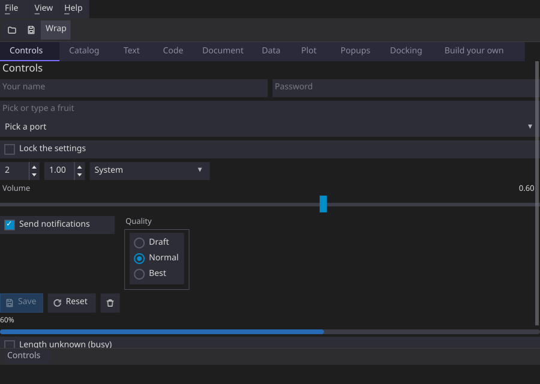

<p align="center">
  
</p>

<h3 align="center">Persistent Rendering &amp; Interactive Scene Model</h3>

<p align="center">
  A from-scratch C++26 GUI framework. Write a struct, get a UI.<br/>
  The renderer runs on its own thread, so slow app code never freezes the window.
</p>

<p align="center">
  <a href="https://github.com/jeandet/PRISM/actions/workflows/ci.yml"></a>
  <a href="https://jeandet.github.io/PRISM/"></a>
  
  
</p>

> [!WARNING]
> PRISM is an R&D project. Nothing here is production-ready yet.

```cpp
#include <prism/prism.hpp>
using namespace prism;   // the snippets below assume it: names read core::Field, ui::Slider, app::run

struct Counter {
    core::Field<int> count{42};
    core::Field<std::string> label{"Hello, PRISM!"};
};

int main() {
    Counter counter;
    return app::run(counter, {.title = "My App"});   // C++26 reflection builds the UI
}
```

<p align="center"></p>

**Try it without installing anything:** the [live demos](https://jeandet.github.io/PRISM/) run the
real examples, compiled to WebAssembly.

## Why PRISM

Qt, GTK and wxWidgets run your code and the renderer on the same thread.
If one callback is slow, nothing else happens.
The window cannot repaint, cannot resize, and looks frozen.

PRISM puts the renderer on a separate thread.
Your code still blocks its own thread, but the window stays alive.

<p align="center"></p>

This is an architectural choice, not a tuning trick. It is built in from day one.

## Documentation

The guide and the design notes live in [`doc/`](doc/index.md), and build into a Read the Docs site
(`doc/conf.py`).

| Start | Guide | |
|---|---|---|
| [Why PRISM and how it works](doc/guide/concepts.md) | [From a struct to a window](doc/guide/struct-to-ui.md) | [Documents, code and Markdown](doc/guide/documents.md) |
| [Building](doc/guide/building.md) | [Blocks](doc/guide/blocks.md) | [Settings that persist](doc/guide/settings.md) |
| [Examples](doc/guide/examples.md) | [Reactive core](doc/guide/reactive-core.md) | [Drag and drop, and docking](doc/guide/drag-and-dock.md) |
| [Python SDK](doc/guide/python.md) | [Canvas and plot](doc/guide/canvas-and-plot.md) | [Windows, themes and the inspector](doc/guide/windows-and-themes.md) |
| [Roadmap](doc/guide/roadmap.md) | [Table, tree and tabs](doc/guide/data-widgets.md) | [HTTP, TCP and serial](doc/guide/io.md) |
| [Design notes](doc/design/README.md) | [Text, editing and menus](doc/guide/text-and-menus.md) | |

## Examples

[`examples/tour/`](examples/tour/) is the place to start: five programs of 20 to 40 lines, one idea
each. [`examples/`](examples/README.md) holds eight complete apps, from a widget gallery to a
synthesizer and a SQL tool; all of them [run in the browser](https://jeandet.github.io/PRISM/).

<p align="center"></p>

## Building

You need **Meson ≥ 1.5** and a recent C++ compiler.
All dependencies are fetched as Meson wraps.

```bash
meson setup builddir
ninja -C builddir
meson test -C builddir
```

| Compiler | Reflection | What you write |
|---|---|---|
| GCC 16+ | yes, `-freflection` is auto-detected | nothing: structs become UIs |
| GCC 14+, Clang 17+ | no | one `view()` method per model |

The browser build, the WebGPU renderer and the four entry points are in
[Building](doc/guide/building.md).

## License

MIT
