<p align="center">
  
</p>

<h3 align="center">Persistent Rendering &amp; Interactive Scene Model</h3>

<p align="center">
  A from-scratch C++26 GUI framework. Write a struct, get a UI.<br/>
  The renderer runs on its own thread, so slow app code never freezes the window.
</p>

<p align="center">
  <a href="https://github.com/jeandet/PRISM/actions/workflows/ci.yml"></a>
  <a href="https://jeandet.github.io/PRISM/"></a>
  
  
</p>

> [!WARNING]
> PRISM is an R&D project. Nothing here is production-ready yet.

```cpp
#include <prism/prism.hpp>
using namespace prism;   // the snippets below assume it: names read core::Field, ui::Slider, app::model_app

struct Counter {
    core::Field<int> count{42};
    core::Field<std::string> label{"Hello, PRISM!"};
};

Counter counter;
app::model_app("My App", counter);   // C++26 reflection builds the UI
```

<p align="center">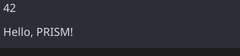</p>

**Try it without installing anything:** the [live demos](https://jeandet.github.io/PRISM/) run the
real examples, compiled to WebAssembly.

## Contents

- [Why PRISM](#why-prism)
- [How it works](#how-it-works)
- [Quick tour](#quick-tour)
- [Reactive core](#reactive-core)
- [Python SDK](#python-sdk)
- [Building](#building)
- [Roadmap](#roadmap)
- [Design documents](#design-documents)

## Why PRISM

Qt, GTK and wxWidgets run your code and the renderer on the same thread.
If one callback is slow, nothing else happens.
The window cannot repaint, cannot resize, and looks frozen.

PRISM puts the renderer on a separate thread.
Your code still blocks its own thread, but the window stays alive.

<p align="center">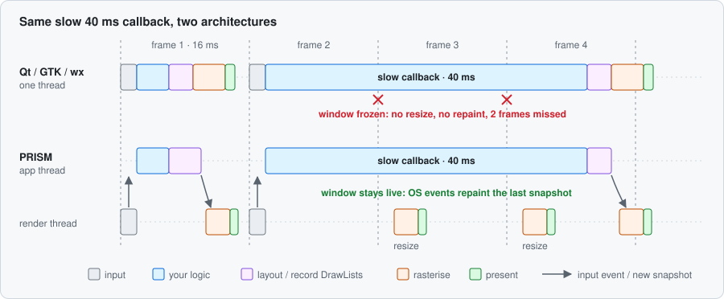</p>

This is an architectural choice, not a tuning trick. It is built in from day one.

The take on Qt in one sentence: keep the persistent widget tree, drop moc and `QObject`, replace
string-based signals with typed callbacks, drive the event loop with C++26 `std::execution`, and
let plain structs generate the UI.

## How it works

PRISM follows a **Model-View-Behavior** (MVB) pattern:

- **Model**: plain structs with `Field<T>` members. Data plus change notification. Knows nothing about rendering.
- **View**: one `Widget<T>` per field type. Draws the field and turns raw input into edits. Generated for you.
- **Behavior**: your `on_change()` / `observe()` callbacks. Business logic that reacts to changes.

<p align="center">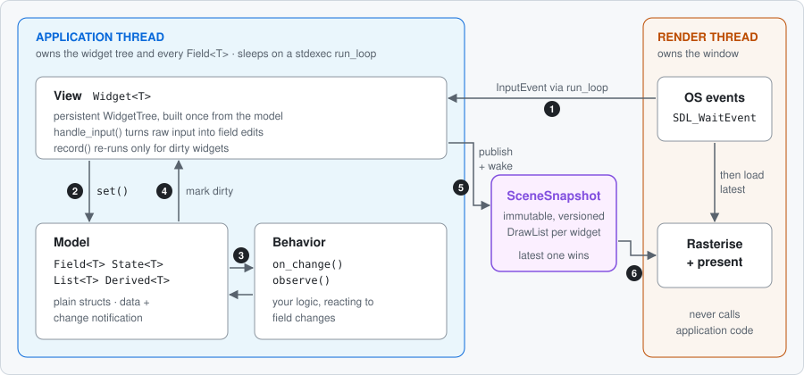</p>

One frame, step by step:

1. The render thread receives an OS event and posts it to the app thread.
2. The target widget handles it and calls `set()` on its field.
3. Your `on_change()` callbacks run. They may set more fields.
4. Every changed field marks its widgets dirty.
5. Only dirty widgets re-record their `DrawList`. The app publishes a new snapshot and wakes the renderer.
6. The render thread loads the latest snapshot, rasterises it and presents it.

The snapshot is handed over with one atomic pointer swap.
If the app publishes faster than the screen refreshes, the renderer only sees the latest one.
Both threads sleep in the OS when nothing changes, so an idle app uses zero CPU.

**The frame contract:** the app never blocks the renderer, and the renderer never calls app code.

### From struct to pixels

There are two ways to describe a UI.
With C++26 reflection there is nothing to write.
Without it, each model gets a short `view()` method.
Both paths build the same intermediate `Node` tree, so the result is identical.

<p align="center">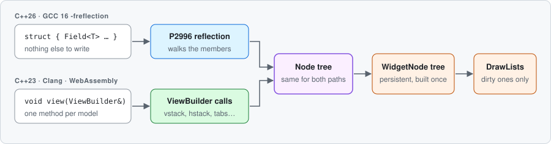</p>

The widget tree is built once and kept.
It is never diffed and never rebuilt every frame.
See [reactivity](doc/design/reactivity.md) and [threading model](doc/design/threading-model.md) for why.

## Quick tour

Every screenshot below is generated by the build itself. Each snippet is compiled, rendered
headlessly and exported as SVG (`scripts/update_screenshots.sh`).

### No reflection? Add one line

On C++23, or on Clang and WebAssembly, add a `view()` method. Same result:

```cpp
void view(app::WidgetTree::ViewBuilder& vb) { vb.vstack(count, label); }
```

### The field type picks the widget

No registration. The type inside `Field<T>` decides:

```cpp
struct AudioMixer {
    core::Field<ui::Slider<>> volume{{.value = 0.75, .min = 0.0, .max = 1.0}};
    core::Field<ui::Slider<int>> quality{{.value = 3, .min = 1, .max = 5, .step = 1}};
    core::Field<ui::Checkbox> mute{{.checked = false, .label = "Mute"}};
};
```

<p align="center">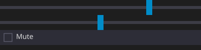</p>

<details>
<summary><b>Every built-in field type</b></summary>

```cpp
enum class Theme { Light, Dark, System };

struct Editor {
    core::Field<std::string>         title{""};                                    // read-only text
    core::Field<ui::Label<>>      status{{"OK"}};                               // read-only label
    core::Field<ui::TextField<>>  search{{.placeholder = "Search..."}};         // editable text
    core::Field<ui::Password<>>   secret{{.placeholder = "API key"}};           // masked input
    core::Field<ui::Slider<>>     volume{{.value = 0.8}};                       // continuous slider
    core::Field<ui::Slider<int>>  quality{{.value = 3, .min = 1,
                                               .max = 5, .step = 1}};               // discrete slider
    core::Field<ui::Button>       save{{"Save"}};                               // button
    core::Field<bool>                dark_mode{true};                              // checkbox
    core::Field<ui::Checkbox>     notify{{.checked = true, .label = "Enable"}}; // labelled checkbox
    core::Field<Theme>               theme{Theme::Dark};                           // dropdown, from the enum
    core::Field<ui::Radio<Theme>> look{{Theme::Dark}};                          // the same enum, as radio buttons
    core::Field<ui::RadioGroup>   units{{.options = {"Metric", "Imperial"}}};   // radio buttons, from strings
    core::Field<ui::SpinBox<int>> copies{{.value = 1, .min = 1, .max = 99}};    // number with steppers
    core::Field<ui::ProgressBar>  done{{.value = 0.4, .label = "Exporting"}};   // progress, display only
};
```

<p align="center">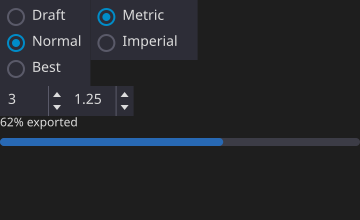</p>

Widgets match on **concepts**, not concrete types. Your own string type works in `Label<>` if it
is `StringLike`. Any scoped enum gets a dropdown, through P2996 `enumerators_of` or magic_enum.

</details>

### Compose by nesting

Models are plain structs. Nest them. No inheritance, no macros:

```cpp
struct Settings {
    core::Field<std::string> username{"jeandet"};
    core::Field<bool> dark_mode{true};
};

struct Dashboard {
    Settings settings;                      // nested group, reflection recurses into it
    core::Field<ui::Slider<>> brightness{{.value = 0.6, .min = 0.0, .max = 1.0}};
    core::Field<ui::Button> apply{{"Apply"}};

    void view(app::WidgetTree::ViewBuilder& vb) {   // optional: only for a custom layout
        vb.vstack([&] {
            vb.component(settings);
            vb.hstack(brightness, apply);
        });
    }
};
```

<p align="center">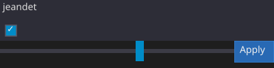</p>

Put `vb.handle()` between two children of an `hstack`/`vstack` to make a draggable split pane.

### Canvas escape hatch

Drop to raw drawing when you need it:

```cpp
struct Waveform {
    core::Field<ui::Slider<>> frequency{{.value = 3.0, .min = 0.5, .max = 8.0}};

    void canvas(render::DrawList& dl, core::Rect bounds, const ui::WidgetNode& node) {
        // polylines, shapes, theme colors...
    }

    void view(app::WidgetTree::ViewBuilder& vb) {
        vb.canvas(*this).depends_on(frequency);   // repaint only when frequency changes
        vb.widget(frequency);
    }
};
```

Canvases can also draw images: `dl.image(img, rect)` with `render::Image::from_rgba(w, h, pixels)`.

<p align="center"></p>

### Plot

Scientific plots with zoom, pan, crosshair, stacking and decimation for large series:

```cpp
struct PlotShowcase {
    plot::PlotModel plot;   // add XYData series to it

    void view(app::WidgetTree::ViewBuilder& vb) {
        vb.canvas(plot)
            .depends_on(plot.x_range).depends_on(plot.y_range)
            .depends_on(plot.view).depends_on(plot.cursor)
            .depends_on(plot.revision);
    }
};
```

<p align="center">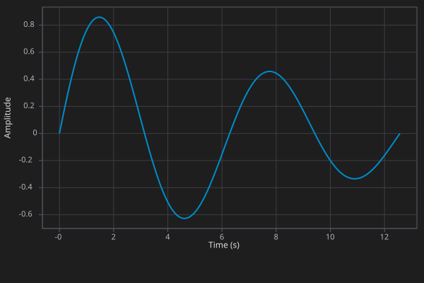</p>

### Table, tree and tabs

<table>
<tr>
<td width="50%">

```cpp
struct Reading {
    core::Field<std::string> sensor{""};
    core::Field<double> value{0.0};
};

struct TableShowcase {
    core::List<Reading> readings;

    void view(app::WidgetTree::ViewBuilder& vb) {
        vb.table(readings).headers({"Sensor", "Value"}).sort(1, /*descending=*/true);
    }
};
```

</td>
<td>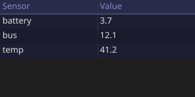</td>
</tr>
<tr>
<td>

```cpp
struct Sensors { float battery_v = 3.7f; float bus_v = 12.1f; };
struct Device  { std::string name = "Controller";
                 Sensors sensors; int firmware = 12; };

struct TreeShowcase {
    Device device;
    ui::TreeController ctrl{ui::wrap_struct_tree(device)};

    void view(app::WidgetTree::ViewBuilder& vb) { vb.tree(ctrl); }
};
```

</td>
<td>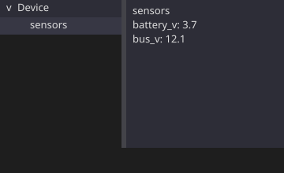</td>
</tr>
<tr>
<td>

```cpp
void view(app::WidgetTree::ViewBuilder& vb) {
    vb.tabs(tabs, [&] {
        vb.tab("Account", [&](auto& tvb) {
            tvb.vstack(username, dark_mode);
        });
        vb.tab("Audio", [&](auto& tvb) {
            tvb.widget(volume);
        });
    });
}
```

</td>
<td>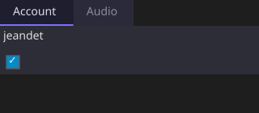</td>
</tr>
</table>

Tables and trees are virtualized, so only visible rows cost anything.
Click a table header to sort (numbers sort by value), drag a header edge to resize a column,
and select rows with click, Ctrl-click, Shift-click, Shift+arrows or Ctrl+A.
A sorted table re-sorts when it hears about a change: a `List<T>` notifies it, and column
storage does through `.depends_on(...)`.
Both bind to data of any shape through three adapter tiers:

| Tier | Tree | Table | Needs reflection |
|---|---|---|---|
| 1. Write the source by hand | implement `TreeSource` | implement `ColumnStorage` | no |
| 2. Adapt your own container | `wrap_tree_storage()` | `wrap_column_storage()` | no |
| 3. Point it at a struct | `wrap_struct_tree()` | `wrap_row_storage()` | yes |

[`examples/model_tree_browser`](examples/model_tree_browser/) is a filesystem browser built on tier 2.

### Text, editing and menus

Text fields behave like a desktop app's: selection (shift+arrows, mouse drag, shift+click,
Ctrl/Cmd+A), copy, cut and paste, undo and redo, input methods for Chinese, Japanese and Korean,
and UTF-8 throughout. Text is measured with the real font: Noto Sans for the interface,
JetBrains Mono for code and `TextArea`. Widgets size to their content: buttons and labels take
their text width, text fields fill the row.

```cpp
struct Editor {
    core::Field<ui::Menu> file{{.title = "File", .items = {"Open", "Save", "Quit"}}};
    core::Field<ui::TextField<>> find{{.placeholder = "Find..."}};
    core::Field<ui::TextArea<>> body{{.rows = 20}};

    void view(app::WidgetTree::ViewBuilder& vb) {
        vb.vstack([&] {
            vb.hstack(file, find);
            vb.widget(body);
        });
    }
};

Editor editor;
auto on_menu = editor.file.on_change().connect([](const ui::Menu& m) {
    if (m.chosen == 1) { /* save */ }
});
```

Menus open on an in-window popup layer that takes input first: a click outside closes the menu
without reaching the widget underneath. Menus side by side form a menu bar: with one open, the
arrow keys or the mouse move to the next. Popups always stay inside the window: near an edge a
menu opens above its title, and a right-click menu opens up or left of the pointer.

A right-click menu belongs to the container it is declared in, and a modal dialog is a field
the app opens:

```cpp
core::Field<ui::ContextMenu> actions{{.items = {"Copy", "Paste"}}};
core::Field<ui::Dialog> ask{{.title = "Unsaved changes",
                             .message = "Reloading discards your edits.",
                             .buttons = {"Discard", "Cancel"}}};
// in view(): vb.context_menu(actions); vb.dialog(ask);
// to ask:    auto d = ask.get(); d.open = true; ask.set(d);
// the answer arrives through ask.on_change(): d.chosen is the button, or empty on Escape.
```

<p align="center">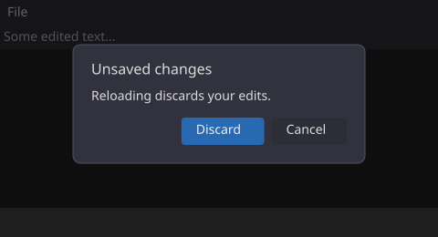</p>

A tooltip shows when the pointer rests on a widget, and a click, key or scroll hides it; long
text wraps. Set it where the widget is placed, or annotate the member when the UI comes from
reflection:

```cpp
vb.widget(save).tooltip("Write the file to disk");                  // in view()
[[=core::tooltip<"Output level, in dB">]] core::Field<ui::Slider<>> volume;   // reflected
```

Every widget also describes itself for assistive technology (role, name, value), ready for a
screen-reader bridge.

<p align="center">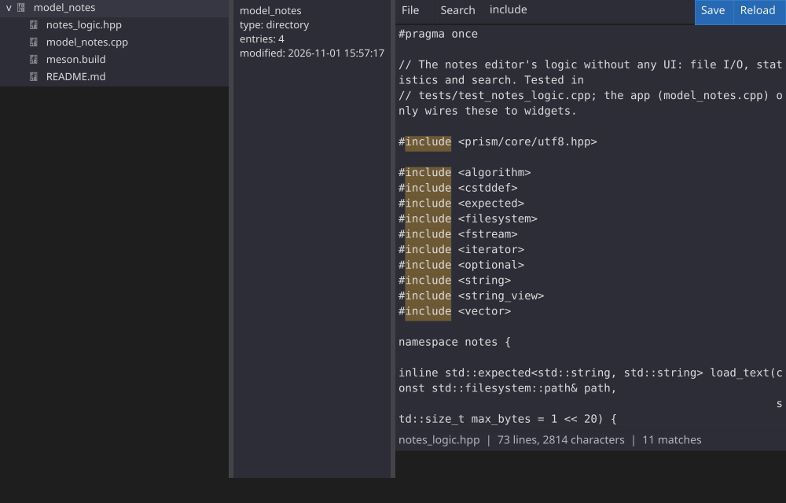</p>

### Live inspector

Point PRISM at a plain struct behind a `Shared<T>`. You get a live, editable panel, with no mirror
struct to write. It is made for state that lives on another thread: device drivers, background
workers, plugin config.

```cpp
struct DeviceState {
    float voltage = 3.3f;
    int mode = 2;
    bool enabled = true;
};

core::Shared<DeviceState> device_state{DeviceState{}};   // updated by some other thread
inspector::Inspector<DeviceState> inspector(device_state);
app::model_app("Device Control", inspector);            // or embed it with vb.component()
```

<p align="center">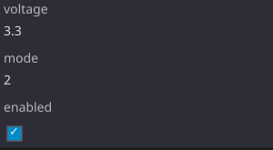</p>

C++26 annotations tune individual fields without changing their type:

```cpp
struct Settings {
    [[=inspector::skip]]                  int internal_version;   // hidden
    [[=inspector::readonly]]              std::string device_id;  // shown, not editable
    [[=inspector::label<"Sample Rate">]]  int sample_rate;        // custom caption
    [[=inspector::section<"Audio">]]      float volume;           // header row above
};
```

### Full examples

[`examples/`](examples/README.md) holds complete apps, from a raw draw-list demo up to
[`model_system_monitor`](examples/model_system_monitor/): live `/proc` data from a background
thread, plots, and a sortable process table and tree. [`model_notes`](examples/model_notes/) is
its text-heavy counterpart: a small editor with a file tree, search, a File menu and undo.

<p align="center">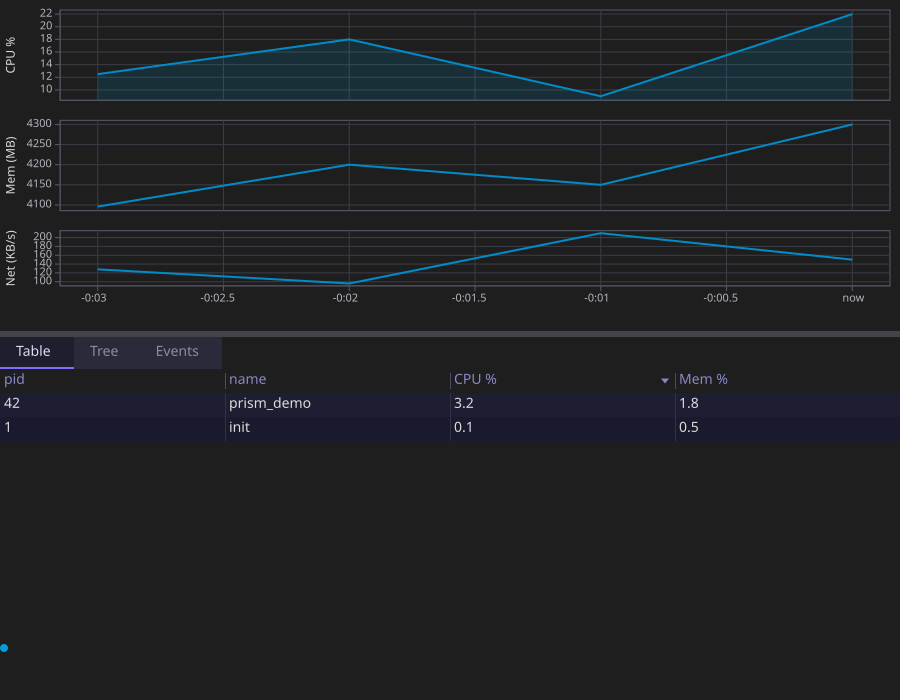</p>

## Reactive core

| Type | Holds | Widget | Thread rule | Use it for |
|---|---|---|---|---|
| `Field<T>` | a value | yes | logic thread | anything the user sees or edits |
| `State<T>` | a value | no | logic thread | observable state with no UI (tokens, counters) |
| `Derived<T>` | a computed value | read-only | logic thread | values computed from other observables |
| `List<T>` | a collection | via table/tree | logic thread | rows, with insert/erase notifications |
| `Shared<T>` | the latest value | via inspector | **any thread** | state published by workers; old values are dropped |
| `Channel<T>` | every value, in order | no | **any thread** | event streams where nothing may be lost |

```cpp
core::Derived<double> total{[&]{ return price.get() * quantity.get(); }, price, quantity};

auto conn = price.on_change().connect([](const double& p) { /* ... */ });   // RAII handle

prism::transaction([&] {   // one notification at the end, not one per set()
    price.set(9.99);
    quantity.set(3);
});
```

A few rules worth knowing:

- `set()` with an equal value does not notify.
- `Field<T>` holds only a value, never a label. The label comes from the member name.
- One logic thread owns the widget tree and every `Field<T>`. They are not thread-safe.
- Other threads talk to it through `Shared<T>::set()`, `Channel<T>::send()` or a posted closure.
- A `Shared<T>::set()` or `Channel<T>::send()` wakes an idle app. Members the widget tree sees are
  wired automatically; for others, call `member.set_waker(ctx.waker())` in the setup.
- An exception in a callback goes to `core::set_unhandled_error_handler` and never stops the loop.
- `transaction()` coalesces notifications. It does not roll back on exception.

## Python SDK

The same MVB model from Python, and any thread may mutate it:

```python
import prism
from typing import Annotated
from pydantic import Field as PField

Vol = Annotated[float, PField(ge=0, le=1)]

class Mixer(prism.Model):
    volume: Vol = 0.75                          # Annotated: validated by pydantic
    mute = prism.checkbox(False, label="Mute")
    count = prism.field(42)
    volume_slider = prism.slider(0.75, min=0.0, max=1.0)
    total = prism.derived(lambda self: self.count.value * 2, "count")

    def view(self, vb):                         # optional, else fields are stacked
        vb.hstack(self.volume_slider, self.mute)
        vb.widget(self.count)

m = Mixer()
prism.run(m, title="Mixer")                     # blocks; releases the GIL around the event pump

# from any thread:
m.count.value = 43
conn = m.count.observe(lambda v: print(v))
with prism.transaction():                       # one publish for both changes
    m.count.value = 1
    m.volume = 0.9
```

<details>
<summary><b>Python ↔ C++ mapping</b></summary>

| Python | C++ | Notes |
|---|---|---|
| `prism.field(default)` | `Field<T>` | `.value` get/set, `.observe()` |
| `prism.slider` / `prism.checkbox` | `Field<Slider<>>` / `Field<Checkbox>` | widget types |
| `prism.radio(default, options=[...])` | `Field<RadioGroup>` | `.value` is the chosen option string |
| `prism.spinbox(default, min, max, step)` | `Field<SpinBox<int64_t>>` / `Field<SpinBox<double>>` | int when `default` and `step` are ints |
| `prism.progress(default, label=...)` | `Field<ProgressBar>` | display only |
| `prism.shared(default)` | `Shared<T>` | latest value, cross-thread |
| `prism.channel(type_hint)` | `Channel<T>` | lossless, ordered |
| `prism.derived(fn, *deps)` | `Derived<T>` | recomputed when a dep changes |
| `prism.list_field([...])` | `List<T>` | `push` / `erase` / `observe_*` |
| `prism.transaction()` | `prism::transaction([]{...})` | coalesced publish |
| `prism.run(model)` | `model_app(title, model)` | |

Also: `prism.headless()` and `prism.run(m, headless_seconds=..., until=...)` for tests and CI,
`field.add(n)` for atomic increments, a `tooltip="..."` keyword on every field factory
(`ViewBuilder::tooltip_for` in C++), `plot.replace_series()` / `set_labels()`, and the
`@prism.on_change(*deps)` method decorator.

</details>

```bash
pip install -e . --no-build-isolation
PYTHONPATH=builddir/python python python/examples/01_counter.py
```

[`python/examples/`](python/examples/README.md) has a dozen runnable examples, from a counter to
worker-pool plots and an asyncio bridge. Its README also spells out the
[threading guarantees](python/examples/README.md#threading-guarantees).
The [Python SDK design doc](doc/design/python-sdk.md) covers the GIL, the posted-mutation queue
and object lifetimes.

## Building

You need **Meson ≥ 1.5** and a recent C++ compiler.
All dependencies (SDL3, stdexec, doctest, fmt, magic_enum) are fetched as Meson wraps.

```bash
meson setup builddir
ninja -C builddir
meson test -C builddir
```

| Compiler | Reflection | What you write |
|---|---|---|
| GCC 16+ | yes, `-freflection` is auto-detected | nothing: structs become UIs |
| GCC 14+, Clang 17+ | no | one `view()` method per model |

<details>
<summary><b>Language features PRISM relies on</b></summary>

| Feature | Used for | Required |
|---|---|---|
| Static reflection (P2996) | UI generated from structs | no, `view()` is the fallback |
| `std::execution` (P2300) | `run_loop` event loop, `core::then` / `core::on` adaptors | yes, via stdexec |
| Concepts | widget resolution, strong geometry types | yes |
| `std::expected` | fallible APIs, no exceptions at the boundary | yes |
| Designated initialisers | named-parameter widget construction | yes |
| magic_enum | enum dropdowns without reflection | only without P2996 |

</details>

### Three ways in

| Entry point | You get | Example |
|---|---|---|
| `app::model_app(title, model)` | UI from your model structs (the main API) | most of [`examples/`](examples/) |
| `app<State>(title, state, view, update)` | manual `row()` / `column()` layout | [`hello_rect`](examples/hello_rect/) |
| `app::App` + `Frame` | a raw `DrawList`, nothing else | |

All three take a `WindowConfig`. Its `decoration` picks the window chrome:

```cpp
app::model_app({.title = "My App", .width = 900, .height = 600,
                  .decoration = app::DecorationMode::Custom}, dashboard);
```

- `Custom` (default): PRISM draws the title bar and resize edges. Looks the same everywhere, including Wayland.
- `Native`: the OS window manager draws it.
- `None`: a borderless window.

### WebGPU renderer (experimental)

By default PRISM draws with SDL's renderer. Build with `-Dwebgpu=enabled` to add a WebGPU
renderer (a prebuilt [wgpu-native](https://github.com/gfx-rs/wgpu-native), Linux and macOS),
then pick it per app or per run:

```bash
meson setup builddir -Dwebgpu=enabled
PRISM_RENDERER=webgpu ./builddir/examples/model_notes/model_notes
```

```cpp
auto backend = app::Backend::software({.renderer = app::Renderer::WebGpu});
auto& window = backend.create_window({.title = "Notes"});
app::model_app(backend, window, notes);
```

Windows, input and the clipboard stay SDL's; only the drawing changes. Without a GPU, Mesa's
software Vulkan (lavapipe) works too. A window that cannot get a WebGPU surface falls back to
SDL's renderer with a warning. Status and plan: [`doc/design/second-backend.md`](doc/design/second-backend.md).

### In the browser

The same code builds for the web with [Emscripten](https://emscripten.org) 6.0.10+.
Upstream Clang has no P2996, so models need a `view()` method there.

```bash
source /path/to/emsdk/emsdk_env.sh
meson setup builddir-wasm --cross-file cross/wasm32-emscripten.ini
ninja -C builddir-wasm
meson test -C builddir-wasm                 # tests run under node
emrun builddir-wasm/examples/model_dashboard/model_dashboard.html
```

Anything linking `prism_dep` gets the browser setup for free: SDL3 from Emscripten ports, the
fonts bundled in, and JSPI so the event loop can wait without freezing the page.
Two requirements:

- PRISM uses threads, so the page needs COOP/COEP headers. `emrun` sends them.
- JSPI needs Chrome 137+, Firefox 153+ or Safari 27.

The [live demos](https://jeandet.github.io/PRISM/) are built by `.github/workflows/pages.yml`.
`scripts/build_web_site.sh` builds the same site locally.

## Roadmap

<p align="center">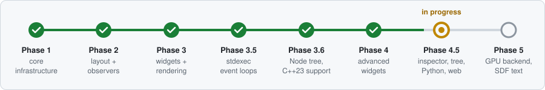</p>

<details>
<summary><b>What each phase contains</b></summary>

- **Phase 1**: DrawList, SceneSnapshot, SDL3 backend, event-driven loop.
- **Phase 2**: layout engine, hit testing, `Connection`/`SenderHub`, `Field<T>`, `List<T>`, P2996 reflection, `WidgetTree`, `model_app()`.
- **Phase 3**: widget dispatch, SDL_Renderer + SDL3_ttf, all basic widgets, overlays and popups, keyboard focus, `view()` override, `canvas()`, strong coordinate types.
- **Phase 3.5**: stdexec `run_loop` event loops, `core::then`/`core::on`, `AppContext`.
- **Phase 3.6**: the `Node` layer, C++23 support through `view()`, magic_enum fallback.
- **Phase 4**: scroll areas, virtual lists, animation, mouse capture and drag, table, tabs, plot, SVG export, custom window chrome, themes, transactions, `Derived<T>`/`Shared<T>`.
- **Phase 4.5** (in progress): `Widget<T>` for custom types, live inspector and annotations, `Tree<T>`, live widget-tree inspector, `Channel<T>`, the Python SDK, the WebAssembly build, frame pacing, snapshot and present statistics, `perf_lab`, plot decimation; real text metrics with Noto Sans and JetBrains Mono, text selection, clipboard, undo and input methods, content-sized layout, a popup layer, menu bars, context menus, modal dialogs and tooltips, accessibility metadata, images, anti-aliased shapes; table sorting, multi-row selection, column resize and horizontal scroll; word wrap; radio groups, spin boxes and progress bars; pixel tests through SDL. Plan and status: [`doc/review-2026-11-01.md`](doc/review-2026-11-01.md).
- **Phase 5**: WebGPU renderer (started: shapes, text, images and windows on desktop; browser next), GPU text (Slug), tile compositing.

</details>

## Design documents

Each subsystem has a design note explaining its choices.
[`doc/design/`](doc/design/) holds the living ones; `docs/superpowers/specs/` holds the original feature specs.

| Area | Documents |
|---|---|
| **Threads & frames** | [Threading model](doc/design/threading-model.md) · [Scene snapshot](doc/design/scene-snapshot.md) · [stdexec integration](doc/design/stdexec-integration.md) · [Python SDK](doc/design/python-sdk.md) |
| **Reactive state** | [Field / sender / widget](docs/superpowers/specs/2026-03-27-field-sender-widget-design.md) · [State taxonomy](docs/superpowers/specs/2026-04-11-state-taxonomy-design.md) · [Transactions](docs/superpowers/specs/2026-04-04-transaction-api-design.md) · [Reactivity (history)](doc/design/reactivity.md) |
| **Building the UI** | [Node tree](doc/design/dynamic-node-tree.md) · [Widgets & sentinels](doc/design/widgets-and-sentinels.md) · [Custom widget from type](docs/superpowers/specs/2026-04-11-custom-widget-from-type-design.md) · [Components](doc/design/components.md) · [Styling](doc/design/styling.md) · [Theme palette](docs/superpowers/specs/2026-04-01-theme-palette-design.md) |
| **Rendering** | [Draw list](doc/design/draw-list.md) · [Render backend](doc/design/render-backend.md) · [SDL_Renderer migration](docs/superpowers/specs/2026-03-28-sdl-renderer-migration-design.md) · [SVG export](docs/superpowers/specs/2026-04-01-svg-export-draw-commands-design.md) · [Frame pacing](docs/superpowers/specs/2026-09-04-frame-pacing-design.md) |
| **Input & layout** | [Input events](doc/design/input-events.md) · [Input routing](docs/superpowers/specs/2026-03-27-input-routing-design.md) · [Layout & hit regions](docs/superpowers/specs/2026-03-27-layout-hit-regions-design.md) · [Window abstraction](docs/superpowers/specs/2026-04-01-window-abstraction-design.md) |
| **Widgets** | [Table](docs/superpowers/specs/2026-03-31-table-widget-design.md) · [Tabs](docs/superpowers/specs/2026-03-31-tab-widget-design.md) · [Plot](docs/superpowers/specs/2026-04-01-plot-widget-design.md) · [Plot decimation](docs/superpowers/specs/2026-09-04-plot-decimation-design.md) · [Tree](docs/superpowers/specs/2026-07-20-tree-widget-design.md) |
| **Debugging tools** | [Live object inspector](docs/superpowers/specs/2026-07-14-live-object-inspector-design.md) · [Inspector annotations](docs/superpowers/specs/2026-07-15-inspector-field-annotations-design.md) · [Live tree inspector](docs/superpowers/specs/2026-07-15-live-tree-inspector-design.md) |

## License

MIT
