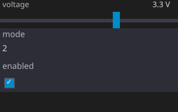

# Inspectors

PRISM has two inspectors. The **object inspector** turns a plain struct into a live, editable
panel, with no UI code at all. The **widget-tree inspector** is a debugging window that shows
the widgets of a running app.

## The object inspector

Point it at a plain struct held in a `core::Shared<T>`. You get one row per member, kept in step
with the struct both ways:

```cpp
#include <prism/prism.hpp>
#include <prism/widgets/inspector.hpp>
using namespace prism;

enum class Mode { Idle, Measure, Calibrate };

struct DeviceState {
    [[=core::range<0.f, 5.f, 0.1f>, =core::unit<"V">]] float voltage = 3.3f;   // a slider
    Mode mode = Mode::Idle;                                                     // a drop-down
    bool enabled = true;                                                        // a checkbox
};

int main() {
    core::Shared<DeviceState> device_state{DeviceState{}};
    inspector::Inspector<DeviceState> panel{device_state};
    return app::run(panel, {.title = "Device"}, [&](app::AppContext& ctx) {
        // wake the window when another thread changes the state
        ctx.receive(device_state, [](const DeviceState&) {});
    });
}
```



It is made for state that lives on another thread: a device driver, a background worker, a
plugin's configuration. The other thread calls `device_state.set(...)`, and the panel follows.
The user edits a row, and the new struct is set back into `device_state`, whole.

:::{note}
The object inspector reads the struct's members through C++26 reflection. It needs GCC 16 or
later with `-freflection`.
:::

### What each member becomes

| Member type | Row |
|---|---|
| A number (`int`, `float`, `double`...) | Its value, as text. Not editable: give it a `range` to edit it. |
| A number with `range` | A slider, captioned with the member's name. |
| `bool` | A checkbox. |
| `std::string` | Its text. Not editable. |
| A scoped enum | A drop-down of its values' names. |
| A nested struct | Its own rows, under it. |

The editable rows are the sliders, the checkboxes and the drop-downs.

### Annotations

Annotations tune one member without changing its type. Put them before the member, between
`[[=` and `]]`; separate several with commas.

```cpp
struct Settings {
    [[=core::skip]]                     int internal_version = 3;   // not shown
    [[=core::readonly]]                 bool connected = false;     // shown, not editable
    [[=core::label<"Sample rate">]]     int sample_rate = 48000;    // caption instead of the name
    [[=core::section<"Audio">]]         float volume = 0.5f;        // a header row above it
    [[=core::range<0, 100>]]            int gain = 50;              // a slider, 0 to 100
    [[=core::range<0.0, 1.0, 0.01>, =core::unit<"%">]] double mix = 0.2;   // step and unit
};
```

| Annotation | Effect | On |
|---|---|---|
| `core::skip` | The member gets no row. | Any member. |
| `core::readonly` | Shown, not editable. | `bool` and enums (numbers and strings are read-only already). Not with `range`, not on a nested struct. |
| `core::label<"text">` | The caption shown instead of the member's name. | Any shown member. |
| `core::section<"title">` | A header row above the member. | Any shown member. |
| `core::range<min, max, step>` | A slider from `min` to `max`. `step` 0 (the default) is continuous. | Numbers only. |
| `core::unit<"text">` | Printed after the value, on a slider. | With `range`. |
| `core::tooltip<"text">` | A tooltip on the member's widget. | A model's fields (below), not the inspector. |

The same names also exist as `inspector::skip`, `inspector::readonly` and so on.

### The Inspector type

| Member | Meaning |
|---|---|
| `Inspector<T>(core::Shared<T>& source)` | Mirrors `source`. Reads its value at once. |
| `view(vb)` | Places the rows. You can embed an inspector in a bigger view with `vb.block(panel)`. |
| `mirror()` | The rows' own fields, if you need to reach one. |

## Annotations on a model

`range`, `unit` and `tooltip` also work on the fields of a model shown without a `view()`:

```cpp
struct Bench {
    [[=core::range<0.0, 30.0, 0.1>, =core::unit<"V">]] core::Field<double> volts{5.0};
    [[=core::tooltip<"Stops the output at once">]] core::Field<ui::Button> stop{{.text = "Stop"}};
};
```

`volts` is a slider captioned "volts", and it writes a plain `double`. A `label` annotation
changes that caption.

A `view()` that places such a field with `vb.widget(volts)` does not see the annotation: it sees
the field, not the member. Give the slider its range in the code there.

## The widget-tree inspector

Press **Ctrl+Shift+I** in any PRISM window. A second window opens with the window's widget tree:

- One row per widget, indented by depth. Click a row with children to unfold it.
- The widget under the pointer in the app is highlighted in the tree.
- Clicking a row highlights that widget in the app and shows its details: its layout kind, its
  rectangle, whether it is dirty, hovered, focused or pressed.
- A line on top sums up the last frame: how long it took to build, how many draw commands,
  how many widgets were redrawn, its size in memory, the layout passes.

Press Ctrl+Shift+I again to close it.

The hotkey is built in when the build is not a release build. The meson option
`prism_debug_tools` forces it on (`enabled`) or off (`disabled`).

## Pitfalls

- The `Shared<T>` must outlive the inspector: the inspector keeps a callback registered on it.
- An inspector cannot be copied or moved.
- Without the `ctx.receive(...)` line, a change made on another thread shows only at the next
  input event: nothing wakes the window.
- `[[=core::skip]]` on a model's field does not hide it. There it only silences the debug
  warning about a field a `view()` never placed.
