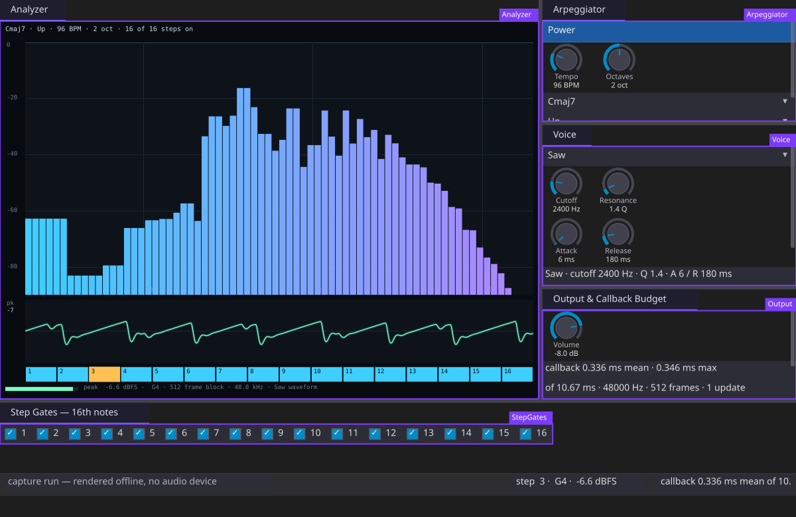

# Blocks

A block is a struct that holds its fields, lays them out, and reacts to them.
Apps are made of blocks, the way a rack is made of modules.
This page shows how to write one, reuse it, connect blocks together, and give one access to the
running app.

## A block is a struct

Any struct with fields is a block. Here is one channel of a mixer:

```cpp
struct ChannelStrip {
    core::Field<ui::Label<>> name{{"Channel"}};
    core::Field<ui::Slider<>> gain{{.value = 0.0, .min = -60.0, .max = 6.0, .label = "Gain", .unit = "dB"}};
    core::Field<ui::Checkbox> mute{{.label = "Mute"}};

    void view(app::ViewBuilder& vb) { vb.vstack(name, gain, mute); }
};
```

There is no base class and nothing to register.
A parent places it with `vb.block(strip)`, wherever it wants it.

## Reuse is declaring more

Eight channels are eight members. Each has its own state:

```cpp
struct Mixer {
    std::array<ChannelStrip, 8> strips;

    void view(app::ViewBuilder& vb) {
        vb.hstack([&] { for (auto& s : strips) vb.block(s); });
    }
};
```

The parent never names a field inside a block.
That is what keeps a large app readable: each file is one block, a few dozen lines.

The synth rack is six blocks. Run any app with `PRISM_SHOW_BLOCKS=1` and each block is outlined
and named on screen:



## A block reacts to its own fields

A block that reacts only to its own fields uses `observe`. The reaction lasts as long as the field,
so it ends with the block:

```cpp
struct Timer {
    core::Field<int> seconds{0};
    core::Field<ui::Button> reset{{"Reset"}};

    Timer() {
        reset.observe([this](const ui::Button&) { seconds = 0; });
    }
};
```

A value computed from the block's fields wants a [`Derived`](reference/derived.md) instead: it
needs no reaction at all.

## Blocks connected together

A block that reacts to *another* block's fields keeps its connections in a `core::Wiring` member.
They end when the block ends, like Qt's context object, but as a member instead of a base class:

```cpp
struct Order {
    core::Field<double> price{1.0};
    core::Field<int> quantity{1};
};

struct Summary {
    core::Field<ui::Label<>> text{};
    core::Wiring wire;

    explicit Summary(Order& order) {
        wire.on_any([this, &order] {
            set_value(text, std::format("{} x {:.2f}", order.quantity.get(), order.price.get()));
        }, order.price, order.quantity);
    }
};
```

`wire.on(field, fn)` reacts to one field, `wire.on_any(fn, a, b, c)` to any of several.
Either side may be destroyed first: a field that goes leaves its connections quiet.

### One block's output into another's input

`wire.link(source, target)` copies the source's value into the target now, and after each change:

```cpp
struct Meter {
    core::Field<double> level{0.0};
};

struct Display {
    core::Field<double> shown{0.0};
    core::Field<ui::Label<>> text{};
    core::Wiring wire;

    explicit Display(Meter& meter) {
        wire.link(meter.level, shown);                       // the same type: copied
        wire.link(meter.level, text, [](double v) {          // another type: converted
            return ui::Label<>{std::format("{:.1f} dB", v)};
        });
    }
};
```

Two links in opposite directions settle: setting an equal value notifies nobody.
The target must outlive the `Wiring`, so keep the `Wiring` in the target's block.
[Signals and connections](reference/signals.md) has the whole `Wiring` API.

## A block that needs the running app

Some blocks need the app itself: to receive a worker's values, to read the clock, to open a window.
They say so with an `attach` method. It runs once, on the logic thread, before the app starts:

```cpp
struct LevelMeter {
    core::Field<ui::Label<>> level{};
    core::Shared<double> reading{};   // a worker thread sets it

    void attach(app::AppContext& ctx) {
        ctx.receive(reading, [this](double v) { set_value(level, std::format("{:.1f} dB", v)); });
    }

    void view(app::ViewBuilder& vb) { vb.widget(level); }
};
```

Blocks inside blocks are attached first, then their parent, then the app's own setup function.
[AppContext](reference/app.md#appcontext) lists what the app offers.

## The forgotten-field check

In a debug build with reflection, PRISM checks that a block's `view()` placed every `Field` and
`Derived` the block declares. It prints the ones it did not:

```text
[prism] warning: Field 'mute' in ChannelStrip not placed by view()
```

That is usually a forgotten widget.
A field the block keeps as a value, not a widget, is marked `[[=core::skip]]`:

```cpp
struct StepGates {
    std::array<core::Field<ui::Checkbox>, 16> boxes{};
    [[=core::skip]] core::Field<std::uint16_t> step_mask{0xFFFF};   // a value, not a widget
};
```

A view that reads a value without placing it, for a canvas or a table, says so with
`.depends_on(value)`: the value counts as placed, and the widget redraws when it changes.

:::{note}
Only a compiler with reflection parses `[[=...]]`, and the check runs only there.
Code that must also build with Clang keeps such a field in a small nested struct instead.
:::

## What a block may hold

| Member | In a window built by reflection | In a `view()` |
|---|---|---|
| `Field<T>` | its widget | placed with `vb.widget` or a stack |
| `Derived<T>` | read-only text | placed like a field |
| `Shared<T>` | read-only text | placed like a field, or received in `attach` |
| `State<T>`, `Channel<T>` | nothing | nothing |
| a nested struct with fields | its own block | placed with `vb.block` |
| anything else (`int`, `Wiring`, a thread) | nothing | nothing |
