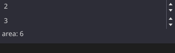

# The model

The model is your data: plain structs of observable values.
This page shows the six kinds of values, how a change travels, and how to read and write them.
Each type has a reference page with its whole API: see [Reference](reference/index.md).

## The six kinds of values

| Type | Holds | Shown as a widget | Which thread may change it | Use it for |
|---|---|---|---|---|
| [`Field<T>`](reference/field.md) | one value | yes | the logic thread | what the user sees or edits |
| [`State<T>`](reference/field.md#state) | one value | no | the logic thread | state with no widget: a token, a counter |
| [`Derived<T>`](reference/derived.md) | a value computed from others | read-only | the logic thread | totals, labels, enabled flags |
| [`List<T>`](reference/list.md) | rows | in a list, table or tabs | the logic thread | collections that grow and shrink |
| [`Shared<T>`](reference/shared.md) | the newest value | read-only | **any thread** | what a worker measures; older values are dropped |
| [`Channel<T>`](reference/channel.md) | every value, in order | no | **any thread** | events where none may be lost |

The *logic thread* is the thread that runs your model while the app runs: `app::run` starts it.
The first four types belong to it. The last two cross from other threads,
as [Threads](threads.md) explains.

## A field and its changes

A `Field<T>` holds a value. Assigning it notifies whoever listens:

```cpp
struct Order {
    core::Field<double> price{1.0};
    core::Field<int> quantity{1};
};

Order order;
order.price.observe([](double p) { std::println("price is now {}", p); });

order.price = 9.99;     // prints "price is now 9.99"
order.quantity += 2;    // quantity is 3
++order.quantity;       // quantity is 4
order.price = 9.99;     // the same value: nothing is printed
```

Every operator you would use on the value works on the field: `=`, `+=`, `-=`, `*=`, `/=`, `%=`,
`|=`, `&=`, `^=`, `++` and `--`. A string field takes `+=` to append.
Each one is a `set()` underneath: the new value is stored, and listeners run only if it changed.

Reading a field gives its value. `get()` says so explicitly:

```cpp
double total = order.price * order.quantity;   // a field reads as its value
if (order.quantity.get() > 10) { /* ... */ }
```

## A value computed from others

`Derived<T>` runs a function and keeps its result up to date:

```cpp
struct Order {
    core::Field<double> price{1.0};
    core::Field<int> quantity{1};
    core::Derived<double> total{[this] { return price.get() * quantity.get(); }};
};

Order order;
order.quantity = 3;
// order.total.get() is 3.0
```



The `Derived` notes which values its function reads, and recomputes when one of them changes.
There is no list to maintain. [Derived](reference/derived.md) has the details: branches, and how to
read a value without following it.

## Widgets wrap values

A `Field<ui::Slider<>>` holds a whole slider: its value, its range, its label.
Three helpers reach the value inside without touching the rest:

```cpp
struct Mixer {
    core::Field<ui::Slider<>> volume{{.value = 0.5, .min = 0.0, .max = 1.0, .label = "Volume"}};
};

Mixer mixer;
double v = value(mixer.volume);         // 0.5: the number inside the slider
set_value(mixer.volume, 0.8);           // the value changes; the range and label stay
mixer.volume.update([](ui::Slider<>& s) { s.max = 2.0; s.value = 1.5; });   // one notification
mixer.volume = {.value = 0.2};          // a whole new slider: min, max and label go back to defaults
```

| Call | Changes | Notifications |
|---|---|---|
| `set_value(field, v)` | only the value | one |
| `field.update(fn)` | whatever `fn` changes | one |
| `field = {...}` | the whole widget: members not named reset | one |

`value()` works on any field, `Derived` or `Shared`: a slider's number, a text field's text, a
checkbox's tick, or the plain value of a `Field<int>`. `set_value()` does not compile on a
`Derived`, which is computed, never set.

## Many changes, one notification

`prism::transaction` groups changes. Each changed value notifies once, at the end, with its final value:

```cpp
prism::transaction([&] {
    order.price = 9.99;
    order.quantity = 3;
    order.quantity = 4;
});
// now: price notifies once, quantity once (with 4), total once
```

A transaction does not roll back if the function throws: the changes made so far stay.

## Lists

`List<T>` is a vector that tells its views what changed: a row added, removed, updated or moved.
A list or table shows only the rows on screen, so a list of 100,000 rows costs what is visible.

```cpp
struct Reading {
    std::string sensor;
    double value = 0;
};

struct Readings {
    core::List<Reading> rows;
    void view(app::ViewBuilder& vb) { vb.table(rows); }   // a column per member (reflection)
};

Readings r;
r.rows.push_back({"temp", 41.2});
r.rows.set(0, {"temp", 41.5});
r.rows.erase(0);
```

[List](reference/list.md) has every operation and signal.

## Listening to changes

There are three ways to run code when a value changes.
They differ in how long the reaction lasts:

| Way | Lasts | Use it for |
|---|---|---|
| `field.observe(fn)` | as long as the field | a struct reacting to its own fields |
| `wire.on(field, fn)` with a `core::Wiring` member | as long as the `Wiring` | a struct reacting to another struct's fields |
| `auto c = field.on_change().connect(fn)` | as long as `c` | anything else; `c.disconnect()` ends it |

```cpp
struct Summary {
    core::Field<ui::Label<>> text;
    core::Wiring wire;   // its connections end with Summary

    explicit Summary(Order& order) {
        wire.on(order.price, [this](double p) { set_value(text, std::format("{:.2f} EUR", p)); });
    }
};
```

Either side may go first. If `order` is destroyed before `summary`, the connection goes quiet.
[Signals and connections](reference/signals.md) covers `Wiring`, `link` and the lower layer.

## Rules worth knowing

- Setting a value equal to the current one notifies nobody. Two values linked both ways settle.
- One logic thread owns every `Field`, `State`, `Derived` and `List`. They are not thread-safe.
  A debug build asserts when another thread sets one.
- Other threads talk to the model through `Shared<T>`, `Channel<T>`, or a posted function.
  See [Threads](threads.md).
- An exception thrown by a reaction does not stop the app. It goes to the handler set with
  `core::set_unhandled_error_handler`, which prints it by default.
- A `Field` holds only its value, never a label. In a window built by reflection, the label is the
  member's name.
