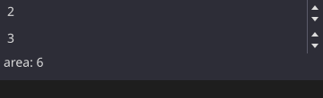

# Derived

`#include <prism/prism.hpp>` · namespace `prism::core`

`Derived<T>` is a value computed from other values, kept up to date.
You give it a function. It runs the function, remembers which values it read, and runs it again
when one of them changes.

## Example

```cpp
struct Rectangle {
    core::Field<ui::SpinBox<int>> width{{.value = 2, .min = 1, .max = 99}};
    core::Field<ui::SpinBox<int>> height{{.value = 3, .min = 1, .max = 99}};
    core::Derived<std::string> area{[this] {
        return "area: " + std::to_string(value(width) * value(height));
    }};
};
```



Change either spin box and `area` recomputes. A window shows it as read-only text.

## Construction

| Form | Follows |
|---|---|
| `Derived<T> d{fn};` | what `fn` reads, found again at every recompute |
| `Derived<T> d{fn, a, b, c};` | exactly `a`, `b` and `c` |

`fn` takes no argument and returns a `T`. It runs once at construction, so the values it reads
must be declared before the `Derived` in the struct.

Without a list, a branch not taken is not followed until it is:

```cpp
core::Field<bool> metric{true};
core::Field<double> km{1.0}, miles{0.62};
core::Derived<double> distance{[this] { return metric.get() ? km.get() : miles.get(); }};
// follows metric and km; once metric is false, follows metric and miles
```

With a list, a debug build warns when `fn` reads a value it does not list:

```text
prism: a Derived<double> reads a value it does not list as a source
```

## Members

| Member | Meaning |
|---|---|
| `get()` | the current value, `const T&` |
| conversion to `const T&` | reads as its value |
| `observe(fn)` | calls `fn(const T&)` after each change, for as long as the `Derived` lives |
| `on_change()` | its signal; `connect(fn)` returns a [`Connection`](signals.md) |

There is no `set`. `set_value()` on a `Derived` does not compile.

## Reading without following

`core::untracked(fn)` runs `fn` without recording what it reads:

```cpp
core::Derived<std::string> label{[this] {
    auto unit = core::untracked([&] { return unit_name.get(); });   // read, never followed
    return std::format("{:.1f} {}", level.get(), unit);
}};
```

`label` recomputes when `level` changes, not when `unit_name` does.

## How changes travel

1. A value it follows changes.
2. The `Derived` runs its function again.
3. If the result equals the old one, nothing else happens.
4. Otherwise it stores it and notifies, like a field: its widget redraws, and values computed from
   it recompute in turn.

Inside a [transaction](transaction.md), a `Derived` that depends on several changed values
notifies once, at the end, with its final value. Its function may run once per changed input.

## Thread rules

Logic thread only, like a field. The function runs on the logic thread.

## Pitfalls

- **A `Derived` cannot move.** Its connections point at it. Keep it as a member of a struct that
  stays put, not in a vector that reallocates.
- **Read through `get()`, `value()` or the conversion.** Those are what it follows. A value read
  some other way, for example through a pointer to the inner `T`, is not followed.
- **The function must not set fields.** It computes; use a reaction to change things.
- **Declaration order matters.** The function runs in the constructor: what it reads must be
  constructed first.
