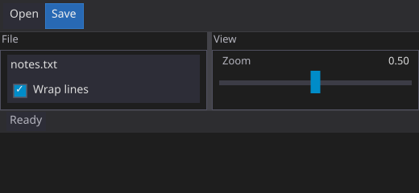

# Views and layout

A view says where each field goes.
This page shows how to write one: rows and columns, nesting, splits, frames and scrolling.
The full list of calls is in the [ViewBuilder reference](reference/view-builder.md).

## When you need a view

With C++26 reflection, a struct without a `view()` is shown as a column of its fields, in
declaration order. You write a `view()` when you want another layout, or when your compiler has no
reflection (Clang, GCC before 16, the browser).

A `view()` is a method that takes a `app::ViewBuilder&`:

```cpp
struct Login {
    core::Field<ui::TextField<>> user{{.placeholder = "User"}};
    core::Field<ui::Password<>> password{{.placeholder = "Password"}};
    core::Field<ui::Button> sign_in{{"Sign in"}};

    void view(app::ViewBuilder& vb) {
        vb.vstack(user, password, sign_in);
    }
};
```

PRISM calls `view()` to build the widgets, and keeps them.
A changed value does not call `view()` again: only the widget that shows it redraws.
Parts that come and go, such as the page of a tab or the content of a folded section, are built
when they appear.

## Rows and columns

`vb.hstack` lays out left to right, `vb.vstack` top to bottom.
Each takes either fields, or a function that places children:

```cpp
struct Confirm {
    core::Field<ui::Label<>> question{{"Delete the file?"}};
    core::Field<ui::Button> ok{{"Delete"}};
    core::Field<ui::Button> cancel{{.text = "Cancel", .primary = false}};

    void view(app::ViewBuilder& vb) {
        vb.vstack([&] {
            vb.widget(question);
            vb.hstack(ok, cancel);   // a row of two buttons
        });
    }
};
```

The function form nests to any depth.
The window's content is a column, so fields placed at the top level stack up.

:::{warning}
`vb.vstack(a, b)` with fields does **not** open a column: it places them in the current
container. Inside an `hstack`, they land in the row. Use `vb.vstack([&] { ... })` to open a
column inside a row.
:::

## Space between widgets

| Call | Effect |
|---|---|
| `vb.spacer()` | takes all the space left, pushing what follows to the end |
| `vb.gap(8)` | a fixed gap of 8 points |
| `vb.handle()` | a divider the user drags to resize the two sides |

```cpp
struct Footer {
    core::Field<ui::Link> help{{.text = "Help", .url = "https://example.org/help"}};
    core::Field<ui::Button> cancel{{.text = "Cancel", .primary = false}};
    core::Field<ui::Button> ok{{"OK"}};

    void view(app::ViewBuilder& vb) {
        vb.hstack([&] {
            vb.widget(help);
            vb.spacer();       // pushes the buttons to the right edge
            vb.widget(cancel);
            vb.gap(8);
            vb.widget(ok);
        });
    }
};
```

## Split panes

A `vb.handle()` between two children of a row or column makes a split.
`vb.remember_split(sizes)` keeps the pane sizes in a field, so the app can save them:

```cpp
struct Browser {
    core::Field<ui::TextArea<>> files{{.rows = 10}};
    core::Field<ui::TextArea<>> preview{{.rows = 10}};
    core::Field<ui::SplitSizes> split{};   // the pane sizes, as the user leaves them

    void view(app::ViewBuilder& vb) {
        vb.hstack([&] {
            vb.remember_split(split);
            vb.widget(files);
            vb.handle();
            vb.widget(preview);
        });
    }
};
```

Put `split` in your [settings](../app/settings.md) and the window reopens with the panes as the user left them.

## Frames: toolbar, group, status bar

Four containers draw a frame of their own:

```cpp
struct Editor {
    core::Field<ui::Button> open{{.text = "Open", .primary = false}};
    core::Field<ui::Button> save{{.text = "Save"}};
    core::Field<ui::TextField<>> name{{.value = "notes.txt"}};
    core::Field<ui::Checkbox> wrap{{.checked = true, .label = "Wrap lines"}};
    core::Field<ui::Slider<>> zoom{{.value = 0.5, .label = "Zoom"}};
    core::Field<ui::Label<>> status{{"Ready"}};

    void view(app::ViewBuilder& vb) {
        vb.toolbar([&] { vb.widget(open); vb.widget(save); });
        vb.hstack([&] {
            vb.group("File", [&] { vb.widget(name); vb.widget(wrap); });
            vb.handle();
            vb.group("View", [&] { vb.widget(zoom); });
        });
        vb.status_bar([&] { vb.widget(status); });
    }
};
```



| Call | Looks like | Lays out |
|---|---|---|
| `vb.toolbar(fn)` | a band on the window's chrome color | a row |
| `vb.status_bar(fn)` | a band of short texts, usually last | a row |
| `vb.group("Title", fn)` | an outline under a title | a column |
| `vb.card(fn)` | a raised surface with an outline | a column |

## A section that folds

`vb.section(expander, fn)` shows a header the user clicks to fold and unfold.
The content exists only while it is open: folded widgets take no focus and no clicks.

```cpp
struct Export {
    core::Field<ui::Expander> advanced{{.title = "Advanced"}};
    core::Field<ui::SpinBox<int>> dpi{{.value = 96, .min = 72, .max = 600}};

    void view(app::ViewBuilder& vb) {
        vb.section(advanced, [&](app::ViewBuilder& inner) { inner.widget(dpi); });
    }
};
```

## Scrolling

`vb.scroll(fn)` puts what `fn` places in a scroll area. The scroll bar appears when needed.

```cpp
struct Strip {
    core::Field<ui::Slider<>> gain{{.value = 0.5, .label = "Gain"}};
    core::Field<ui::Checkbox> mute{{.label = "Mute"}};
    void view(app::ViewBuilder& vb) { vb.hstack(gain, mute); }
};

struct Desk {
    std::array<Strip, 32> strips;

    void view(app::ViewBuilder& vb) {
        vb.scroll([&] {
            for (auto& s : strips) vb.block(s);
        });
    }
};
```

`vb.scroll(ScrollBarPolicy::Always, fn)` keeps the bar.
`vb.scroll(field, fn)` with a `Field<ui::ScrollArea>` lets the app read and set the position.
Lists, tables, trees and text views scroll on their own: they need no scroll area.

## Enabled or not

`.enabled(flag)` greys a widget out while a bool field (or a `Derived<bool>`) is false.
`vb.enabled_if(flag, fn)` does it for everything `fn` places:

```cpp
struct Save {
    core::Field<ui::TextField<>> name{{.placeholder = "File name"}};
    core::Field<ui::Button> save{{"Save"}};
    core::Derived<bool> has_name{[this] { return !value(name).empty(); }};

    void view(app::ViewBuilder& vb) {
        vb.widget(name);
        vb.widget(save).enabled(has_name);   // waits for a name
    }
};
```

## Tooltips

`.tooltip(text)` shows a short help text when the pointer rests on the widget:

```cpp
void view(app::ViewBuilder& vb) {
    vb.widget(save).tooltip("Write the file to disk");   // save: a Field<ui::Button>
}
```

With reflection, the annotation `[[=core::tooltip<"Output level, in dB">]]` on the member does the
same for a window built with no `view()`.

## Nested structs: blocks

`vb.block(s)` places a nested struct with its own `view()`, or, with reflection, as a column of
its fields when it has none. A struct placed this way is a *block*: [Blocks](blocks.md) is about building apps from them.

## Where widgets go

Every widget has a call to place it: `vb.widget(field)` for a field, and calls of their own for the
widgets that are not one field: `vb.table`, `vb.list`, `vb.tree`, `vb.tabs`, `vb.dock`, `vb.canvas`,
`vb.text_editor`. They are described with each widget in [Widgets](../widgets/index.md).
