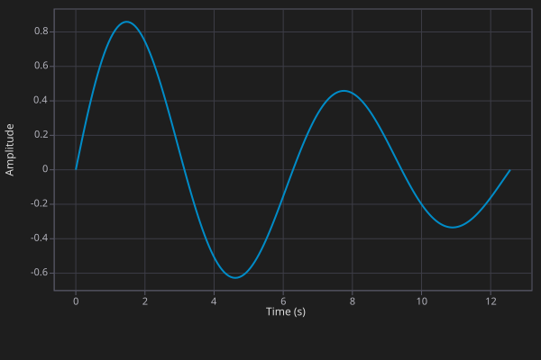

# Canvas and plot

## Canvas escape hatch

Drop to raw drawing when you need it:

```cpp
struct Waveform {
    core::Field<ui::Slider<>> frequency{{.value = 3.0, .min = 0.5, .max = 8.0}};

    void canvas(render::DrawList& dl, core::Rect bounds, const ui::WidgetNode& node) {
        // polylines, shapes, theme colors...
    }

    void view(app::ViewBuilder& vb) {
        vb.canvas(*this).depends_on(frequency);   // repaint only when frequency changes
        vb.widget(frequency);
    }
};
```

Canvases can also draw images: `dl.image(img, rect)` with `render::Image::from_rgba(w, h, pixels)`.


## Plot

Scientific plots with zoom, pan, crosshair, stacking and decimation for large series:

```cpp
struct PlotShowcase {
    plot::PlotModel plot;   // add XYData series to it

    void view(app::ViewBuilder& vb) {
        vb.canvas(plot)
            .depends_on(plot.x_range).depends_on(plot.y_range)
            .depends_on(plot.view).depends_on(plot.cursor)
            .depends_on(plot.revision);
    }
};
```


