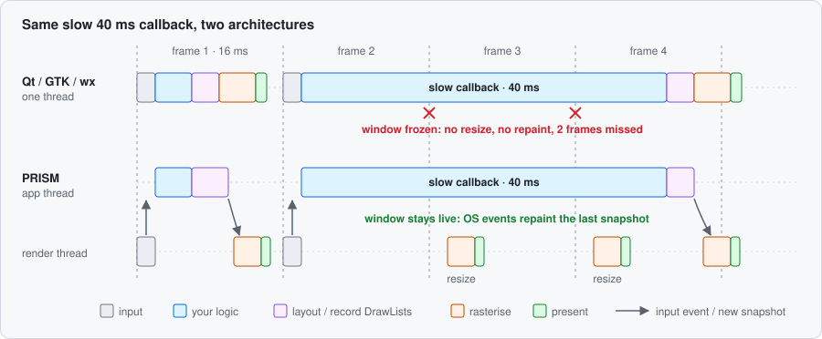
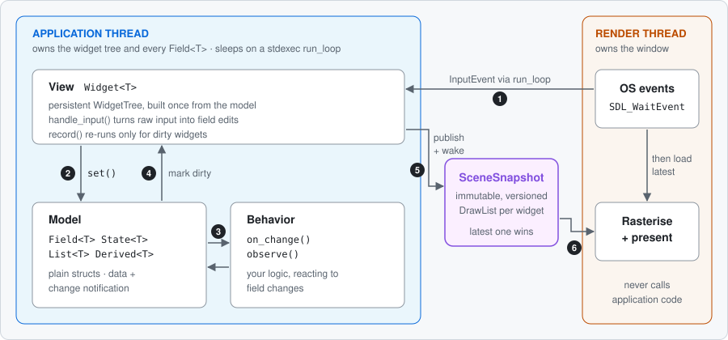
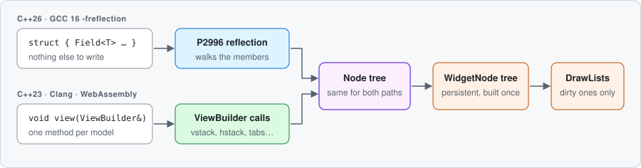

# Why PRISM

Qt, GTK and wxWidgets run your code and the renderer on the same thread.
If one callback is slow, nothing else happens.
The window cannot repaint, cannot resize, and looks frozen.

PRISM puts the renderer on a separate thread.
Your code still blocks its own thread, but the window stays alive.

This is an architectural choice, not a tuning trick. It is built in from day one.

The take on Qt in one sentence: keep the persistent widget tree, drop moc and `QObject`, replace
string-based signals with typed callbacks, drive the event loop with C++26 `std::execution`, and
let plain structs generate the UI.

# How it works

PRISM follows a **Model-View-Behavior** (MVB) pattern:

- **Model**: plain structs with `Field<T>` members. Data plus change notification. Knows nothing about rendering.
- **View**: one `Widget<T>` per field type. Draws the field and turns raw input into edits. Generated for you.
- **Behavior**: your `on_change()` / `observe()` callbacks. Business logic that reacts to changes.

One frame, step by step:

1. The render thread receives an OS event and posts it to the app thread.
2. The target widget handles it and calls `set()` on its field.
3. Your `on_change()` callbacks run. They may set more fields.
4. Every changed field marks its widgets dirty.
5. Only dirty widgets re-record their `DrawList`. The app publishes a new snapshot and wakes the renderer.
6. The render thread loads the latest snapshot, rasterises it and presents it.

The snapshot is handed over with one atomic pointer swap.
If the app publishes faster than the screen refreshes, the renderer only sees the latest one.
Both threads sleep in the OS when nothing changes, so an idle app uses zero CPU.

**The frame contract:** the app never blocks the renderer, and the renderer never calls app code.

## From struct to pixels

There are two ways to describe a UI.
With C++26 reflection there is nothing to write.
Without it, each model gets a short `view()` method.
Both paths build the same intermediate `Node` tree, so the result is identical.

The widget tree is built once and kept.
It is never diffed and never rebuilt every frame.
See [reactivity](../design/reactivity.md) and [threading model](../design/threading-model.md) for why.
