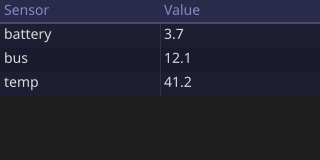
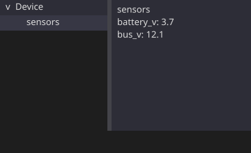
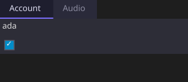

# Table, tree and tabs

## Table

```cpp
struct Reading {
    core::Field<std::string> sensor{""};
    core::Field<double> value{0.0};
};

struct TableShowcase {
    core::List<Reading> readings;

    void view(app::ViewBuilder& vb) {
        vb.table(readings).headers({"Sensor", "Value"}).sort(1, /*descending=*/true);
    }
};
```



## Tree

```cpp
struct Sensors { float battery_v = 3.7f; float bus_v = 12.1f; };
struct Device  { std::string name = "Controller";
                 Sensors sensors; int firmware = 12; };

struct TreeShowcase {
    Device device;
    ui::TreeController ctrl{ui::wrap_struct_tree(device)};

    void view(app::ViewBuilder& vb) { vb.tree(ctrl); }
};
```



## Tabs

```cpp
void view(app::ViewBuilder& vb) {
    vb.tabs(tabs, [&] {
        vb.tab("Account", [&](auto& tvb) {
            tvb.vstack(username, dark_mode);
        });
        vb.tab("Audio", [&](auto& tvb) {
            tvb.widget(volume);
        });
    });
}
```



## Rows: icons, selection, sorting and editing

Tables and trees are virtualized, so only visible rows cost anything. A tree source may also give
each node an `icon(id)` (a glyph) or an `image(id)` (any image). A tree comes with a pane
showing the selected row's details; `vb.tree(ctrl, /*detail=*/false)` leaves it out, for an app
that shows the selection its own way, for example with `vb.pages(field, ...)`: tabs without the
header, where the app picks the page.
A tree selects several nodes with Ctrl-click, Shift-click and Shift+arrows. A source with
`checked(id)` and `set_checked(id, on)` gets checkboxes (a click on the box or Space toggles it);
one with `rename(id, name)` renames nodes in place with F2 or a double-click, and refuses a name
by returning false.
A table cell can hold a checkbox (`cell_check(row, col)`; a click hands `set_cell` "true" or
"false", and a `bool` member of a `List<struct>` row gets one for free) or an icon before its
text (`cell_image(row, col)`).
`vb.table(...).columns(field)` hands the table a `Field<std::vector<size_t>>` of the columns to
show, in order (empty: all): set it to hide columns, save it to restore the user's order.
Click a table header to sort (numbers sort by value), drag a header to move its column, drag a
header edge to resize a column,
and select rows with click, Ctrl-click, Shift-click, Shift+arrows or Ctrl+A.
A sorted table re-sorts when it hears about a change: a `List<T>` notifies it, and column
storage does through `.depends_on(...)`.
Cells can be edited in place: double-click one, or press F2 on a row; Enter keeps the text,
Escape drops it, Tab goes to the next cell. A source takes edits with a
`bool set_cell(row, col, text)` (false refuses the text: the editor stays open) and can limit
them to some columns with `bool editable(col)`. A table over a `List` of plain structs takes
them by itself, each column parsed into its member's type.
Both bind to data of any shape through three adapter tiers:

| Tier | Tree | Table | Needs reflection |
|---|---|---|---|
| 1. Write the source by hand | implement `TreeSource` | implement `ColumnStorage` | no |
| 2. Adapt your own container | `wrap_tree_storage()` | `wrap_column_storage()` | no |
| 3. Point it at a struct | `wrap_struct_tree()` | `wrap_row_storage()` | yes |

[`model_notes`](../../examples/model_notes/)' file tree is tier 2 over the filesystem; the
[Widget Gallery](../../examples/widget_gallery/) and the System Monitor use tiers 1 and 2, so they build
without reflection, in the browser too.
