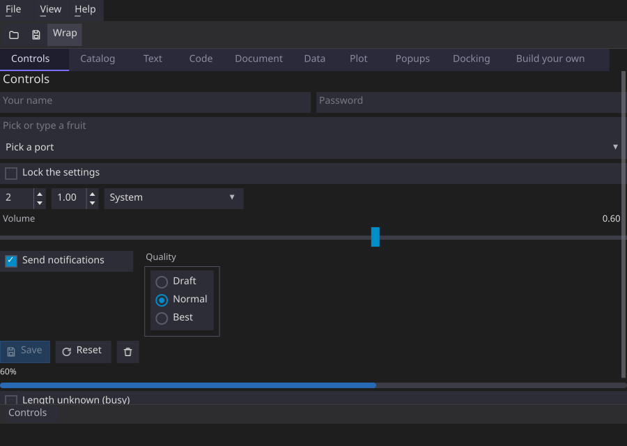
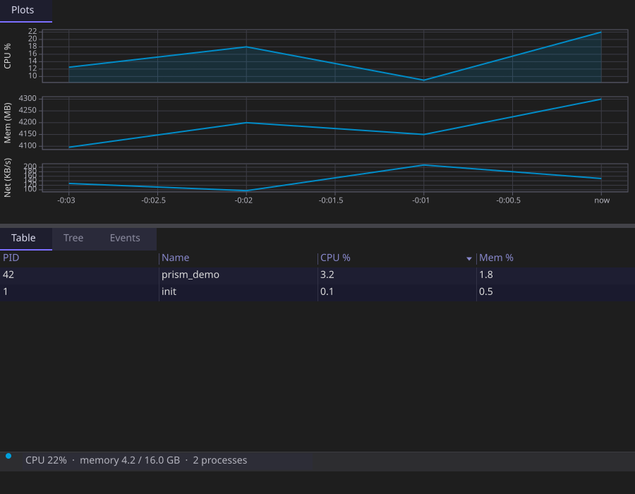

# Examples

## Full examples

[`examples/`](../../examples/README.md) holds eight complete apps, all of which also run in the
[browser](https://jeandet.github.io/PRISM/):

- [`tour`](../../examples/tour/): **start here** — five programs of 20 to 40 lines, one idea each, from a
  struct that becomes a window to a block, each pointing at the big example that uses it.
- [`widget_gallery`](../../examples/widget_gallery/): every widget, in ten tabs: a code editor in six
  languages (open a 100,000-line file and type), Markdown edited as rich text, docking, drag and
  drop, and a custom widget built in the open. Come here to pick a widget and copy its line.
- [`model_notes`](../../examples/model_notes/): a small editor with a file tree, search, menus and undo.
- [`model_system_monitor`](../../examples/model_system_monitor/): sampler threads feeding live plots, a
  sortable process table and tree (Linux `/proc`, or a simulated machine elsewhere).
- [`perf_lab`](../../examples/perf_lab/): a 100k-row table and a 1M-point plot under 1 kHz telemetry.
- [`model_lab_bench`](../../examples/model_lab_bench/): a bench instrument — scope, supply, generator —
  whose hardware thread can be stalled without the window missing a frame, and whose logic thread,
  stalled on purpose, freezes it. Run the two buttons side by side.
- [`model_synth_rack`](../../examples/model_synth_rack/): a synthesizer that plays in the browser, its
  audio thread fed through lock-free buffers, with a live spectrum.
- [`model_data_studio`](../../examples/model_data_studio/): SQL over 500,000 rows on a background
  thread; scroll, edit and cancel while a slow query runs.
- [`model_task_runner`](../../examples/model_task_runner/): streaming process output, 200,000 lines
  into consoles that keep up.

