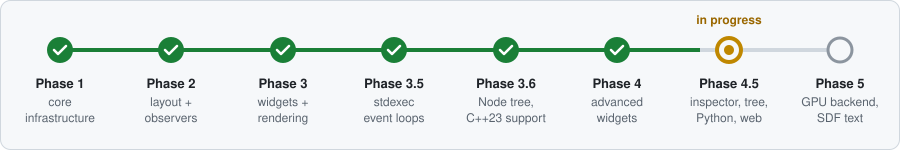

# Roadmap

<b>What each phase contains</b>

- **Phase 1**: DrawList, SceneSnapshot, SDL3 backend, event-driven loop.
- **Phase 2**: layout engine, hit testing, `Connection`/`SenderHub`, `Field<T>`, `List<T>`, P2996 reflection, `WidgetTree`, `model_app()`.
- **Phase 3**: widget dispatch, SDL_Renderer + SDL3_ttf, all basic widgets, overlays and popups, keyboard focus, `view()` override, `canvas()`, strong coordinate types.
- **Phase 3.5**: stdexec `run_loop` event loops, `core::then`/`core::on`, `AppContext`.
- **Phase 3.6**: the `Node` layer, C++23 support through `view()`, magic_enum fallback.
- **Phase 4**: scroll areas, virtual lists, animation, mouse capture and drag, table, tabs, plot, SVG export, custom window chrome, themes, transactions, `Derived<T>`/`Shared<T>`.
- **Phase 4.5** (in progress): `Widget<T>` for custom types, live inspector and annotations, `Tree<T>`, live widget-tree inspector, `Channel<T>`, the Python SDK, the WebAssembly build, frame pacing, snapshot and present statistics, `perf_lab`, plot decimation; real text metrics with Noto Sans and JetBrains Mono, text selection, clipboard, undo and input methods, content-sized layout, a popup layer, menu bars, context menus, modal dialogs and tooltips, accessibility metadata, images, anti-aliased shapes; table sorting, multi-row selection, column resize and horizontal scroll; word wrap; radio groups, spin boxes, editable combo boxes and progress bars (busy too); pixel tests through SDL; popups and dialogs that hold widgets, file dialogs, message boxes, drag and drop; image decoding and icon buttons; graphemes, Unicode line breaks and bidirectional text; a Windows CI lane; the Widget Gallery; disabled widgets. Done plans: [`doc/review-2026-11-01.md`](../review-2026-11-01.md), [`doc/review-2026-11-02.md`](../review-2026-11-02.md); next: [`doc/review-2026-11-12.md`](../review-2026-11-12.md) (the application shell).
- **Phase 5**: WebGPU renderer (started: shapes, text, images and windows on desktop; browser next), GPU text (Slug), tile compositing.

