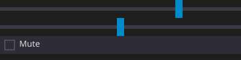
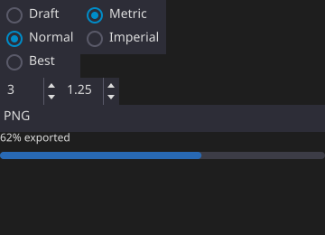
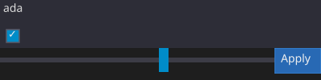

# From a struct to a window

## Quick tour

Every screenshot below is generated by the build itself. Each snippet is compiled, rendered
headlessly and exported as SVG (`scripts/update_screenshots.sh`).

### No reflection? Add one line

On C++23, or on Clang and WebAssembly, add a `view()` method. Same result:

```cpp
void view(app::ViewBuilder& vb) { vb.vstack(count, label); }
```

### The field type picks the widget

No registration. The type inside `Field<T>` decides:

```cpp
struct AudioMixer {
    core::Field<ui::Slider<>> volume{{.value = 0.75, .min = 0.0, .max = 1.0}};
    core::Field<ui::Slider<int>> quality{{.value = 3, .min = 1, .max = 5, .step = 1}};
    core::Field<ui::Checkbox> mute{{.checked = false, .label = "Mute"}};
};
```



<details>
<summary><b>Every built-in field type</b></summary>

```cpp
enum class Theme { Light, Dark, System };

struct Editor {
    core::Field<std::string>         title{""};                                    // read-only text
    core::Field<ui::Label<>>      status{{"OK"}};                               // read-only label
    core::Field<ui::Label<>>      heading{{.value = "Editor", .heading = true}}; // a title
    core::Field<ui::TextField<>>  search{{.placeholder = "Search..."}};         // editable text
    core::Field<ui::Password<>>   secret{{.placeholder = "API key"}};           // masked input
    core::Field<ui::ComboBox>     format{{.placeholder = "Format",
                                           .options = {"PNG", "SVG", "PDF"}}};      // free text with suggestions
    core::Field<ui::TextArea<>>   body{{.rows = 8}};                            // multi-line editor; .read_only, .font
    core::Field<ui::Slider<>>     volume{{.value = 0.8}};                       // continuous slider
    core::Field<ui::Slider<int>>  quality{{.value = 3, .min = 1,
                                               .max = 5, .step = 1}};               // discrete slider
    core::Field<ui::Button>       save{{"Save"}};                               // button
    core::Field<ui::Button>       cancel{{.text = "Cancel", .primary = false}};  // a quieter button; .icon draws an image
    core::Field<bool>                dark_mode{true};                              // checkbox
    core::Field<ui::Checkbox>     notify{{.checked = true, .label = "Enable"}}; // labelled checkbox
    core::Field<Theme>               theme{Theme::Dark};                           // dropdown, from the enum
    core::Field<ui::Radio<Theme>> look{{Theme::Dark}};                          // the same enum, as radio buttons
    core::Field<ui::RadioGroup>   units{{.options = {"Metric", "Imperial"}}};   // radio buttons, from strings
    core::Field<ui::SpinBox<int>> copies{{.value = 1, .min = 1, .max = 99}};    // number with steppers
    core::Field<ui::ProgressBar>  done{{.value = 0.4, .label = "Exporting"}};   // progress; .busy for unknown length
    core::Field<ui::Choice>       port{{.options = {"COM1", "COM3"}}};         // one of a list known at run time
    core::Field<core::Color>      ink{core::Color::rgba(0x33, 0x66, 0xCC)};    // color picker: hue bar + square
    core::Field<std::chrono::year_month_day> leave{2026y / November / 14};     // date picker: a month calendar
    core::Field<ui::TimeOfDay>    wake{{7, 30}};                                // HH:MM; arrows, wheel or digits
    core::Field<ui::Button>       bold{{.text = "Bold", .checked = false}};     // a toggle: stays pressed
    core::Field<ui::Label<>>      help{{.value = "Long help...", .wrap = true}}; // wraps to its width
    core::Field<ui::Link>         docs{{.text = "Docs", .url = "https://..."}};  // opens in the browser
    core::Field<ui::Picture>      logo{{.image = image}};                       // an image, fitted to .size
    core::Field<ui::Expander>     more{{.title = "Advanced"}};                  // vb.section(more, fn): folds
};
```

Containers with a look of their own: `vb.toolbar(fn)`, `vb.status_bar(fn)`, `vb.group("Title", fn)`,
and `vb.section(expander, fn)`, whose content exists only while it is open.



Widgets match on **concepts**, not concrete types. Your own string type works in `Label<>` if it
is `StringLike`. Any scoped enum gets a dropdown, through P2996 `enumerators_of` or magic_enum.

</details>

### Compose by nesting

Models are plain structs. Nest them. No inheritance, no macros:

```cpp
struct Settings {
    core::Field<std::string> username{"ada"};
    core::Field<bool> dark_mode{true};
};

struct Dashboard {
    Settings settings;                      // nested group, reflection recurses into it
    core::Field<ui::Slider<>> brightness{{.value = 0.6, .min = 0.0, .max = 1.0}};
    core::Field<ui::Button> apply{{"Apply"}};

    void view(app::ViewBuilder& vb) {   // optional: only for a custom layout
        vb.vstack([&] {
            vb.block(settings);
            vb.hstack(brightness, apply);
        });
    }
};
```



Put `vb.handle()` between two children of an `hstack`/`vstack` to make a draggable split pane,
`vb.spacer()` to push the rest to the end, and `vb.gap(8)` for a fixed space.
