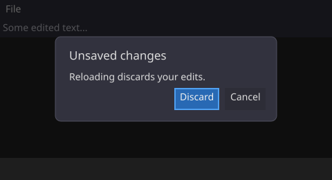
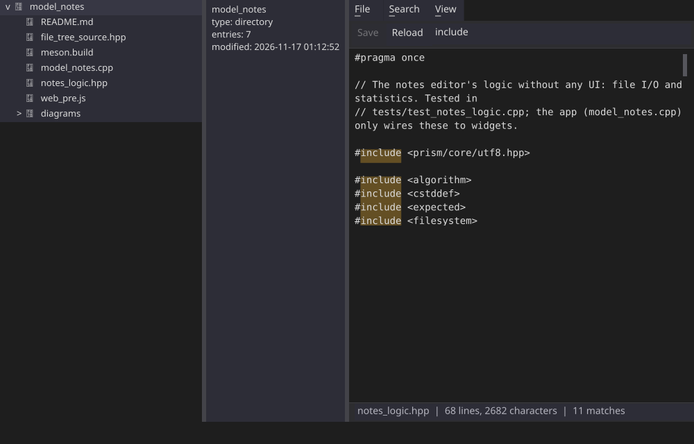

# Text, editing and menus

Text fields behave like a desktop app's: selection (shift+arrows, mouse drag, shift+click,
Ctrl/Cmd+A), copy, cut and paste, undo and redo, input methods for Chinese, Japanese and Korean,
and UTF-8 throughout. Text is measured with the real font: Noto Sans for the interface,
JetBrains Mono for code (a `TextArea` takes either, through `.font`). Widgets size to their
content: buttons and labels take their text width, text fields fill the row.

Text follows Unicode. The caret and Backspace step over whole characters (an `e` plus a combining
accent is one), lines wrap where the line-breaking rules allow, and Hebrew or Arabic read right
to left inside English text: the caret, clicks and selections follow the runs on screen. In a
`TextArea`, a paragraph that starts in Hebrew or Arabic is right-aligned, and its wrapped lines keep
its direction; a `TextField` holding such text sits on the right too. The arrow keys move the caret
across the screen, so inside Hebrew, Right steps back through the text. Noto Sans Hebrew and Arabic are bundled as fallback fonts. A `TextArea` with `.read_only = true`
can be selected and copied but not changed.

```cpp
struct Editor {
    core::Field<ui::Menu> file{{.title = "&File", .items = {
        {.text = "&Open…", .shortcut = {input::keys::o, input::mods::ctrl}},
        {.text = "&Save", .shortcut = {input::keys::s, input::mods::ctrl}},
        {.text = "Open &recent", .items = {{"notes.txt"}, {"todo.txt"}}},   // a submenu
        {.separator = true},
        {.text = "&Word wrap", .checked = true},
    }}};
    core::Field<ui::TextField<>> find{{.placeholder = "Find..."}};
    core::Field<ui::TextArea<>> body{{.rows = 20}};

    void view(app::ViewBuilder& vb) {
        vb.vstack([&] {
            vb.hstack(file, find);
            vb.widget(body);
        });
    }
};

Editor editor;
auto on_menu = ui::on_choice(editor.file, [](std::size_t i) {
    if (i == 1) { /* save */ }
});
```

Menus open on an in-window popup layer that takes input first: a click outside closes the menu
without reaching the widget underneath. Menus side by side form a menu bar: with one open, the
arrow keys or the mouse move to the next. Popups always stay inside the window: near an edge a
menu opens above its title, and a right-click menu opens up or left of the pointer.
A `&` in a label marks its keyboard shortcut: `"&File"` shows *File* with the F underlined,
Alt+F opens it, and an item's letter chooses it in an open menu (`ui::menu_text()` gives the
label without the `&`).

An item can also have a keyboard shortcut. It is shown on the item's right, and it chooses the
item from anywhere in the window, the menu closed. A focused text field keeps its own keys:
Ctrl+C there copies, even if a menu item says Ctrl+C. An item can have an `.icon`
(`render::load_image` reads PNG, JPEG or SVG files) or a check mark (`.checked`, flipped when
chosen), and `.enabled = false` greys it out. `ui::on_choice` reports what the user chose, and
not the app's own changes to the menu, such as greying out Save after saving.

A right-click menu belongs to the container it is declared in, and a modal dialog is a field
the app opens:

```cpp
core::Field<ui::ContextMenu> actions{{.items = {{"Copy"}, {"Paste"}}}};
core::Field<ui::Dialog> ask{{.title = "Unsaved changes",
                             .message = "Reloading discards your edits.",
                             .buttons = {"Discard", "Cancel"}}};
// in view(): vb.context_menu(actions); vb.dialog(ask);
// to ask:    show(ask);   // opens it with no answer yet
// the answer arrives through ask.on_change(): d.chosen is the button, or empty on Escape.
```

A dialog is made of ordinary widgets: its message wraps, scrolls and can be copied, and Enter
picks the first button. It can hold a form too:

```cpp
core::Field<ui::Dialog> rename{{.title = "Rename", .message = "", .buttons = {"Rename", "Cancel"}}};
// in view(): vb.dialog(rename, [&](auto& d) { d.widget(new_name).focus_on_open(); });
```

Any popup can hold widgets: a form, a list, a row of buttons. Focus moves into it when it opens,
Tab stays inside, and it comes back when it closes. A non-modal one (a popover) opens where it is
declared and closes on a click outside:

```cpp
core::Field<ui::Popup> options{{.open = false, .modal = false}};
// in view(), next to its button: vb.popup(options, [&](auto& p) { p.vstack(grid, snap); });
// to open:   show(options);   // stays non-modal
```



A tooltip shows when the pointer rests on a widget, and a click, key or scroll hides it; long
text wraps. Set it where the widget is placed, or annotate the member when the UI comes from
reflection:

```cpp
vb.widget(save).tooltip("Write the file to disk");                  // in view()
[[=core::tooltip<"Output level, in dB">]] core::Field<ui::Slider<>> volume;   // reflected
```

A widget can be greyed out. It then takes no clicks, keys or focus. The flag is any bool
`Field` or `Derived`, and the widget follows it as it changes. `enabled_if` covers everything
placed inside it without adding a container. A checkbox works as the flag too ("Advanced
options" enabling the group below it):

```cpp
core::Derived<bool> has_name{[this] { return !value(name).empty(); }};
vb.widget(save).enabled(has_name);                        // one widget
vb.enabled_if(unlocked, [&] { vb.vstack(volume, quality); });   // a group
```

Every widget also describes itself for assistive technology (role, name, value), ready for a
screen-reader bridge.


