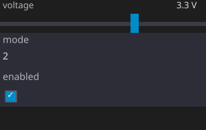

# Windows, themes and the inspector

## More windows

A second model gets a window of its own. It may read the first one's fields, so it stays in
step with them:

```cpp
struct Stats {
    core::Derived<std::string> summary;   // from the editor's text, in the main model
    void view(app::ViewBuilder& vb) { vb.widget(summary); }
};
// on the logic thread (a menu choice, setup):
auto id = ctx.open_window(stats, {.title = "Statistics", .width = 320, .height = 80});
```

When the user closes it, it goes and the app goes on; `ctx.window_open(id)` tells, and
`ctx.close_window(id)` closes it from code. Not in the browser yet: there is one canvas.

## Light, dark, or as the OS is set

`ui::dark_theme()` is the default and `ui::light_theme()` its light twin; both keep text at WCAG
AA contrast. A `Theme` is a plain struct of colors, so an app can start from either and change
a few. Switching repaints every widget at once:

```cpp
app::run(model, {.title = "My App"}, [](app::AppContext& ctx) {
    ctx.follow_system_theme();              // light or dark as the OS is set, and when it changes
    // ctx.set_theme(ui::light_theme());    // or a fixed one
});
```

One-color icons should be loaded as `render::symbolic(image)`: they are then drawn in the color of
the text beside them, so they read on both themes. A logo or a photo keeps its colors.

## Live inspector

Point PRISM at a plain struct behind a `Shared<T>`. You get a live, editable panel, with no mirror
struct to write. It is made for state that lives on another thread: device drivers, background
workers, plugin config.

```cpp
struct DeviceState {
    [[=core::range<0.f, 5.f, 0.1f>, =core::unit<"V">]] float voltage = 3.3f;   // a slider
    int mode = 2;
    bool enabled = true;
};

core::Shared<DeviceState> device_state{DeviceState{}};   // updated by some other thread
inspector::Inspector<DeviceState> inspector(device_state);
app::run(inspector, {.title = "Device Control"});      // or embed it with vb.block()
```



C++26 annotations tune individual fields without changing their type:

```cpp
struct Settings {
    [[=inspector::skip]]                  int internal_version;   // hidden
    [[=inspector::readonly]]              std::string device_id;  // shown, not editable
    [[=inspector::label<"Sample Rate">]]  int sample_rate;        // custom caption
    [[=inspector::section<"Audio">]]      float volume;           // header row above
    [[=core::range<0, 100>]]              int gain;               // a slider from 0 to 100
    [[=core::range<0.0, 1.0, 0.01>, =core::unit<"%">]] double mix;   // step 0.01, shown with a unit
};
```

`range` and `unit` work the same on a `Field` of a model with no `view()`: there
`[[=core::range<0.0, 30.0, 0.1>, =core::unit<"V">]] core::Field<double> volts;` is a slider
captioned "volts" that writes a plain `double`.
