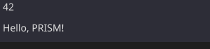

# PRISM

**Persistent Rendering & Interactive Scene Model.**
A from-scratch C++26 GUI framework. Write a struct, get a UI.
The renderer runs on its own thread, so slow app code never freezes the window.

:::{warning}
PRISM is an R&D project. Nothing here is production-ready yet.
:::

```cpp
#include <prism/prism.hpp>
using namespace prism;

struct Counter {
    core::Field<int> count{42};
    core::Field<std::string> label{"Hello, PRISM!"};
};

int main() {
    Counter counter;
    return app::run(counter, {.title = "My App"});   // C++26 reflection builds the UI
}
```



**Try it without installing anything:** the [live demos](https://jeandet.github.io/PRISM/) run the
real examples, compiled to WebAssembly.

Where to start:

- New here? Read [Why PRISM](guide/concepts.md), then [From a struct to a window](guide/struct-to-ui.md).
- Want to build it? [Building](guide/building.md).
- Looking for a widget? The [widget gallery](https://jeandet.github.io/PRISM/) shows them all, with
  the line of C++ that makes each one.
- Curious why it works this way? The [design notes](design/README.md).

```{toctree}
:caption: Start
:maxdepth: 2

guide/concepts
guide/building
guide/examples
```

```{toctree}
:caption: Guide
:maxdepth: 2

guide/struct-to-ui
guide/blocks
guide/reactive-core
guide/canvas-and-plot
guide/data-widgets
guide/text-and-menus
guide/documents
guide/settings
guide/drag-and-dock
guide/windows-and-themes
guide/io
guide/python
```

```{toctree}
:caption: Design
:maxdepth: 1
:glob:

design/README
design/*
```

```{toctree}
:caption: Project
:maxdepth: 1

guide/roadmap
```
