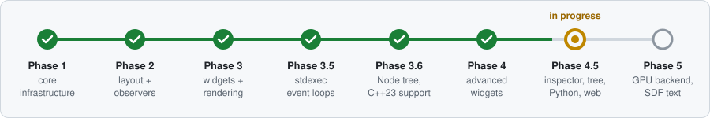

# Roadmap

PRISM is a research project, built in the open. Nothing here is production-ready yet. This page
says what exists today and what comes next.

## What exists

**The core.** Fields, derived values, lists, cross-thread values and channels, transactions.
A struct becomes a window through C++26 reflection, or through a short `view()` method on
compilers without it. The renderer runs on its own thread, and a frame is handed over in one
atomic swap.

**The widgets.** Buttons, toggles, checkboxes, radio buttons, sliders, spin boxes, text fields
and areas, combo boxes, drop-downs, date, time and color pickers, progress bars, labels, links
and pictures. Tables with sorting, editing, checkbox and icon cells, and columns the user hides,
moves and resizes. Trees with multi-select, checkboxes and rename. Lists with selection and
reordering. Tabs, splitters, groups, collapsible sections, scroll areas, a canvas and a plot.

**Text.** A text editor, a code editor in six languages with completion and a minimap, and
Markdown edited as rich text. Selection, clipboard, undo, input methods, right-to-left scripts.

**The application shell.** Menu bars with shortcuts and submenus, context menus, toolbars,
status bars, dialogs, popups, tooltips, file dialogs and message boxes. Several windows.
Settings saved between runs. Light and dark themes that follow the system. Drag and drop inside
the app. Docking: panels moved, tabbed, split, closed, reopened and floated.

**Beyond the window.** HTTP, TCP and serial ports, and audio output. A Python SDK with the same
model. A browser build: every example runs in a web page.

**Platforms.** Linux, Windows and macOS on the desktop, and the browser through WebAssembly.

## What comes next

- **Scale.** Each frame still does some work over the whole widget tree. Next: repainting only
  the parts of the window that changed, and a glyph cache for text.
- **The GPU.** A WebGPU renderer exists for the desktop, as an experiment. Next: the same in the
  browser, then GPU text rendering and tile compositing.
- **Decisions pending:**
  - drags between windows, which needs the system's drag and drop;
  - translations;
  - printing;
  - a bridge to the system's accessibility tools (screen readers).
- **Ideas parked:**
  - live previews of each `view()` as you save the file;
  - a thin client that shows an app running on another machine;
  - a port to small boards such as the ESP32-P4.

## How it got here

| Phase | What it brought |
|---|---|
| 1 | The draw list, the frame snapshot, the SDL backend, the event loop. |
| 2 | Layout, hit testing, connections, `Field<T>`, `List<T>`, reflection, the widget tree. |
| 3 | The basic widgets, popups, keyboard focus, `view()`, the canvas, typed coordinates. |
| 3.5 | `std::execution` event loops and the app context. |
| 3.6 | The node layer, C++23 support through `view()`. |
| 4 | Scroll areas, virtual lists, animation, tables, tabs, plots, SVG export, window chrome, themes, transactions, derived and shared values. |
| 4.5 (now) | Custom widgets, the inspectors, trees, channels, Python, the browser build, real text, menus and dialogs, drag and drop, docking, settings, the text stack. |
| 5 (next) | The GPU renderer, GPU text, tile compositing. |
