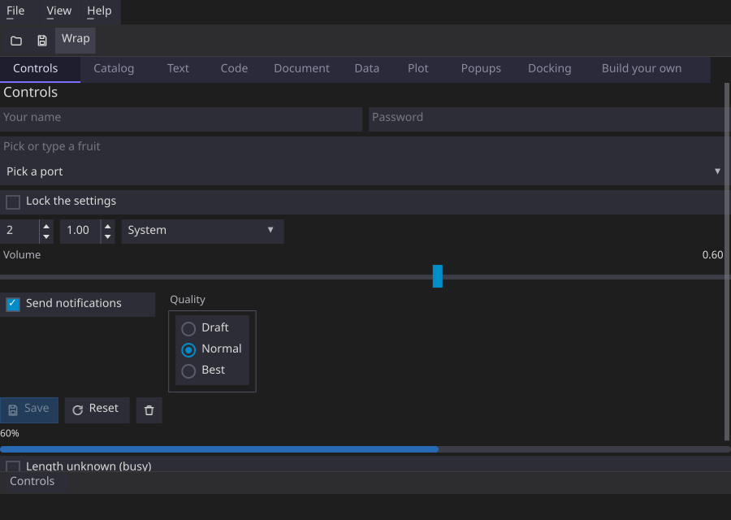
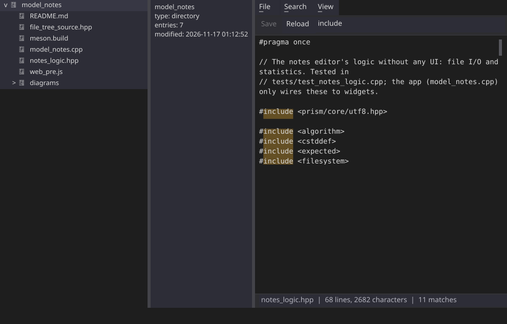
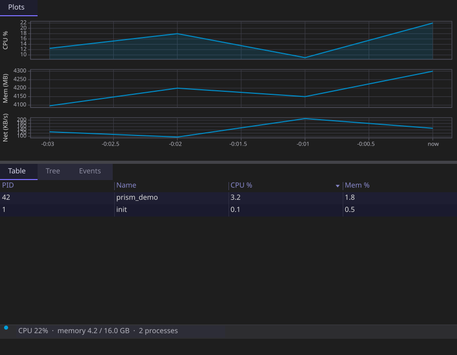
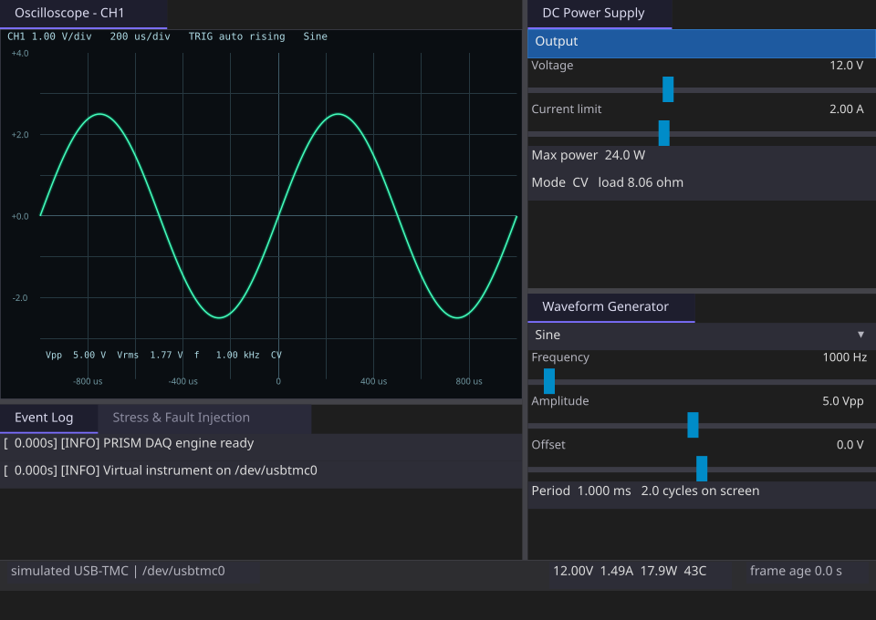
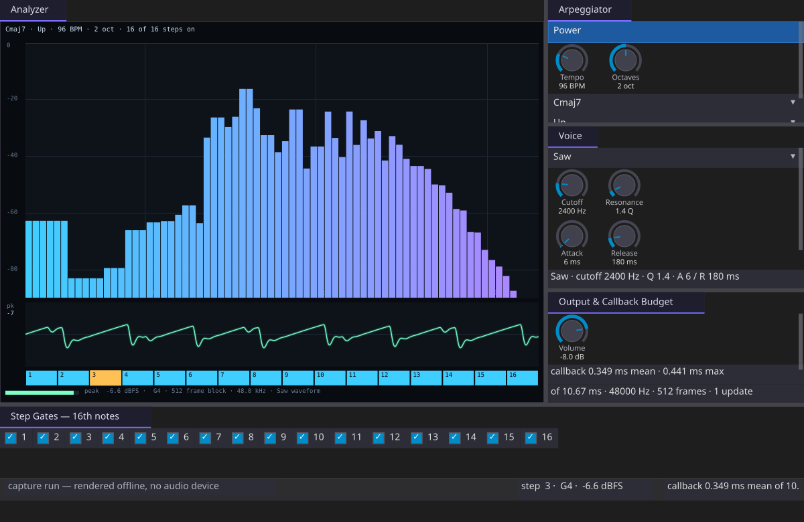
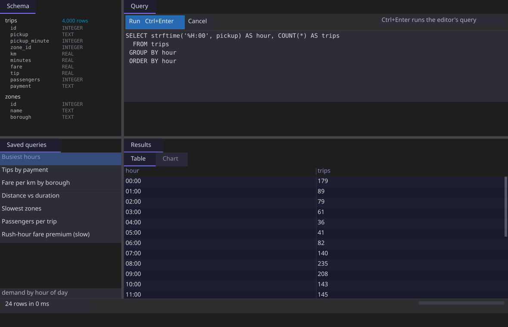
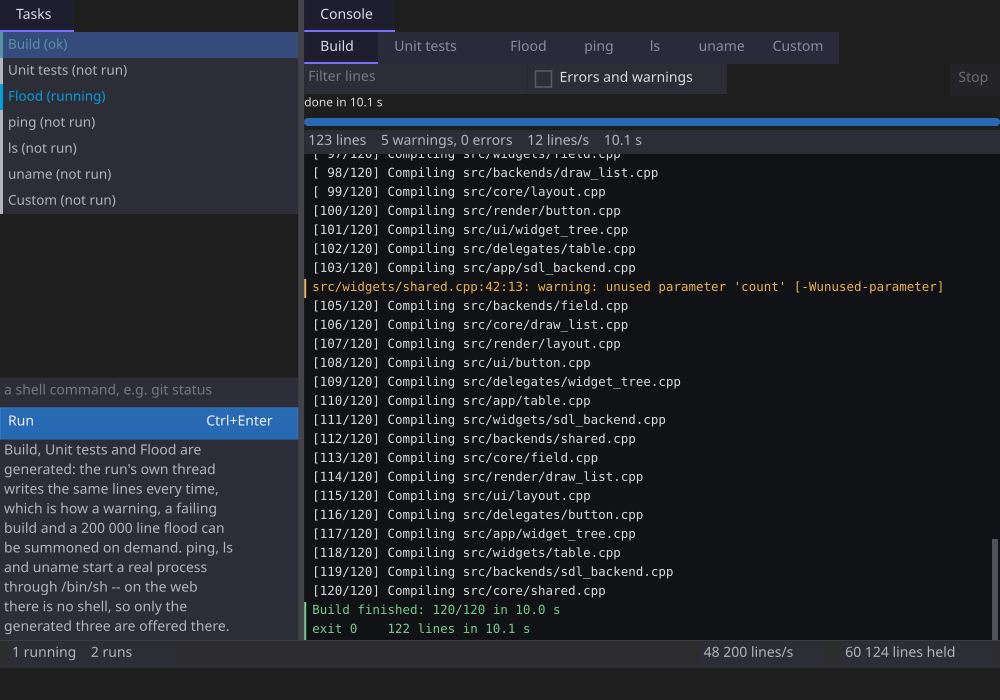
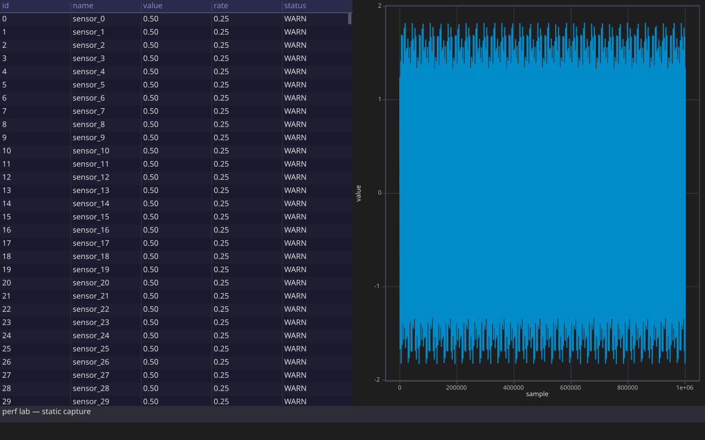

# Examples

PRISM comes with two kinds of examples.
The tour is five short programs, one idea each.
The apps are eight complete programs that use those ideas at full size.
Every app also runs [in your browser](https://jeandet.github.io/PRISM/), with nothing to install.

## The tour: five short programs

Start here. Each program is 20 to 40 lines, builds on its own, and ends by naming the app that does
the same thing at scale. They are in [`examples/tour/`](../../examples/tour/).

| Program | The idea | At scale |
|---|---|---|
| `01_struct_to_ui` | a struct of fields is a window | the lab bench |
| `02_derived` | a value computed from fields, kept up to date | the synth rack |
| `03_worker` | a worker thread hands values to the window | the system monitor |
| `04_custom_widget` | a type that brings its own widget | the widget gallery's knob |
| `05_block` | an app composed of blocks | the synth rack |

```bash
./builddir/examples/tour/01_struct_to_ui
```

The worker of `03_worker`, for a taste:

```cpp
struct Ticker {
    core::Field<ui::Label<>> reading{{"waiting for the worker..."}};
    core::Shared<int> ticks{};

    std::jthread worker{[this](std::stop_token stop) {
        for (int n = 0; !stop.stop_requested(); ++n) {
            ticks = n;   // Shared<T>: any thread may set it
            std::this_thread::sleep_for(std::chrono::milliseconds{100});
        }
    }};

    void attach(app::AppContext& ctx) {
        ctx.receive(ticks, [this](int n) { set_value(reading, "tick " + std::to_string(n)); });
    }

    void view(app::ViewBuilder& vb) { vb.widget(reading); }
};
```

The worker sets `ticks` from its own thread.
`ctx.receive` brings each new value to the window's thread, where the label may be changed.
[Threads](../concepts/threads.md) explains the rules.

## The apps

Each app's README opens with the part that is PRISM, and how many lines it takes.
The rest is ordinary C++: a DSP library, SQL, a process runner.

### Widget gallery

Every widget, in eleven tabs: a code editor in six languages, Markdown edited as rich text, a
100,000-row table, docking, drag and drop, a custom widget built in the open, and a small game drawn on a canvas.
Come here to pick a widget and copy its line of code.
[`examples/widget_gallery/`](../../examples/widget_gallery/)



### Notes

A small text editor: a file tree, search, menus and undo.
[`examples/model_notes/`](../../examples/model_notes/)



### System monitor

Two sampler threads feed live plots, a sortable process table and a process tree.
It reads Linux's `/proc`, or simulates a machine elsewhere (the browser, macOS, Windows).
[`examples/model_system_monitor/`](../../examples/model_system_monitor/)



### Lab bench

A bench instrument: an oscilloscope, a power supply and a function generator.
Its two stall buttons are the point.
One blocks the hardware thread, and the window does not miss a frame.
The other blocks the thread that owns the model, and the window freezes.
[`examples/model_lab_bench/`](../../examples/model_lab_bench/)



### Synth rack

A synthesizer that plays in the browser.
Its audio thread never waits for the window, and a spectrum shows what comes out.
[`examples/model_synth_rack/`](../../examples/model_synth_rack/)



### Data studio

SQL over 500,000 rows, on a background thread.
Scroll, edit and cancel while a slow query runs.
[`examples/model_data_studio/`](../../examples/model_data_studio/)



### Task runner

An IDE-style build console: 200,000 lines of process output into consoles that keep up.
[`examples/model_task_runner/`](../../examples/model_task_runner/)



### Perf lab

A 100,000-row table and a 1,000,000-point plot under 1 kHz telemetry.
It prints what each frame cost to build.
[`examples/perf_lab/`](../../examples/perf_lab/)


