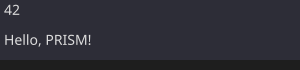
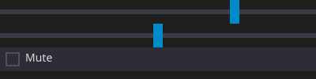
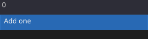
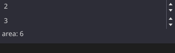
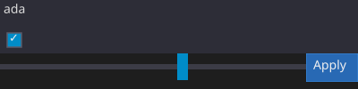

# Your first app

This page builds a small app in five steps.
Each step adds one idea: a window from a struct, a widget picked by type, a reaction to a click,
a computed value, and a layout.

## 1. A struct is a window

```cpp
#include <prism/prism.hpp>
using namespace prism;

struct Counter {
    core::Field<int> count{42};
    core::Field<std::string> label{"Hello, PRISM!"};
};

int main() {
    Counter counter;
    return app::run(counter, {.title = "My App", .width = 300, .height = 120});
}
```



`core::Field<T>` holds one value and tells whoever listens when it changes.
`app::run` opens a window, shows the model, and returns when the window closes.
The model must outlive the call: here it lives in `main`.

### Without reflection: add `view()`

With GCC 16, PRISM reads the struct's members by reflection.
With an older compiler, Clang, or in the browser, add a `view()` method that places them:

```cpp
struct Counter {
    core::Field<int> count{42};
    core::Field<std::string> label{"Hello, PRISM!"};

    void view(app::ViewBuilder& vb) { vb.vstack(count, label); }
};
```

The window is the same.
A struct with a `view()` always uses it, reflection or not, so `view()` is also how you choose your own layout.

## 2. The type picks the widget

A plain `int` or `std::string` is shown as read-only text.
To get a control, put a widget type in the field:

```cpp
struct AudioMixer {
    core::Field<ui::Slider<>> volume{{.value = 0.75, .min = 0.0, .max = 1.0}};
    core::Field<ui::Slider<int>> quality{{.value = 3, .min = 1, .max = 5, .step = 1}};
    core::Field<ui::Checkbox> mute{{.checked = false, .label = "Mute"}};
};
```



There is nothing to register: `Field<ui::Slider<>>` is a slider because of its type.
The double braces are the field's braces around the widget's own designated initializer.
Every widget type, with its options, is in [Widgets](../widgets/index.md).

## 3. React to a click

A button is a field too. Its value changes on each click, so you react to it like to any field:

```cpp
struct ClickCounter {
    core::Field<int> count{0};
    core::Field<ui::Button> add{{"Add one"}};

    ClickCounter() {
        add.observe([this](const ui::Button&) { ++count; });
    }
};
```



`observe(fn)` calls `fn` after each change of the field, for as long as the field lives.
`++count` sets the field: the window shows the new number, with nothing else to call.
Fields take `=`, `+=`, `++` and the other assignment operators; each one notifies.

To react to a field of *another* struct, keep the connection in a `core::Wiring` member, so it ends
with the struct that reacts. [Blocks](../concepts/blocks.md) shows how.

## 4. A value computed from others

`core::Derived<T>` is a value computed from fields.
It follows the fields its function reads, and recomputes when one of them changes:

```cpp
struct Rectangle {
    core::Field<ui::SpinBox<int>> width{{.value = 2, .min = 1, .max = 99}};
    core::Field<ui::SpinBox<int>> height{{.value = 3, .min = 1, .max = 99}};
    core::Derived<std::string> area{[this] {
        return "area: " + std::to_string(value(width) * value(height));
    }};
};
```



`value(width)` reads the number inside the spin box.
There is no list of inputs to keep up to date, and no callback to remember to call.
A `Derived` is shown as read-only text, like a plain value.

## 5. Lay it out

Structs nest. A nested struct is placed as one piece, called a block:

```cpp
struct Settings {
    core::Field<std::string> username{"ada"};
    core::Field<bool> dark_mode{true};
};

struct Dashboard {
    Settings settings;
    core::Field<ui::Slider<>> brightness{{.value = 0.6, .min = 0.0, .max = 1.0}};
    core::Field<ui::Button> apply{{"Apply"}};

    void view(app::ViewBuilder& vb) {
        vb.vstack([&] {
            vb.block(settings);
            vb.hstack(brightness, apply);
        });
    }
};
```



`vb.vstack` places its children top to bottom, `vb.hstack` left to right.
`vb.block(settings)` places the nested struct with its own layout.
[Views and layout](../concepts/views.md) has every layout call.

## Where to go next

- [Examples](examples.md): the tour's five programs build the same ideas, each in one file.
- [The model](../concepts/model.md): fields, computed values, lists, and how changes travel.
- [Threads](../concepts/threads.md): work that must not freeze the window.
- [Widgets](../widgets/index.md): every widget, with its options.
