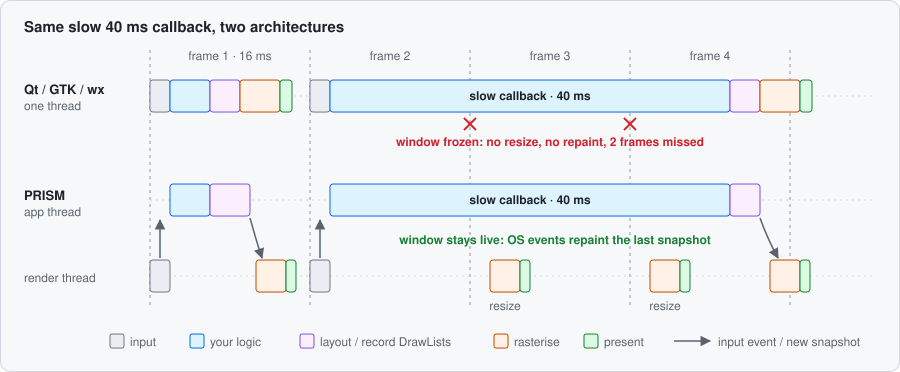
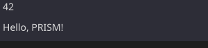
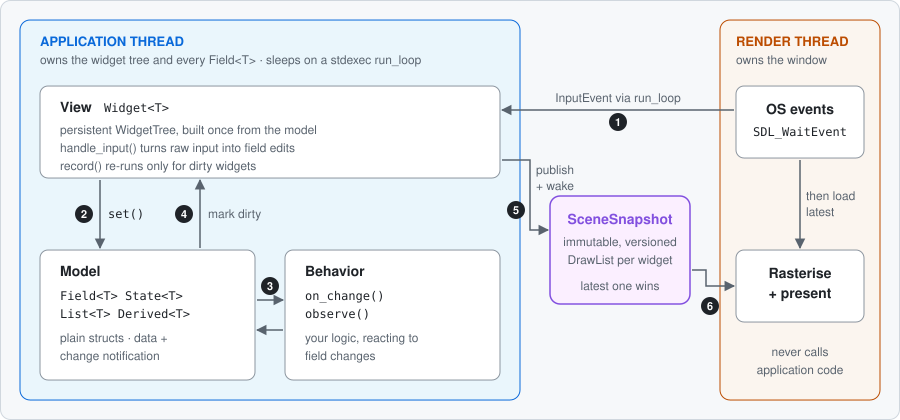
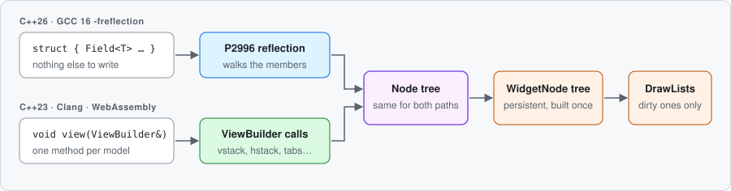

# Why PRISM

PRISM is a C++ GUI framework. You write a struct of values, and PRISM shows it as a window.
This page explains the one idea behind it, and what happens between a click and a pixel.

## A window that never freezes

Qt, GTK and wxWidgets run your code and the drawing on the same thread.
If one of your callbacks is slow, nothing else happens.
The window cannot repaint, cannot resize, and looks frozen.

PRISM draws on a thread of its own.
Your code can still block its own thread, but the window stays alive.



This is how PRISM is built, not an option you turn on.

## Write a struct, get a UI

Here is a whole program:

```cpp
#include <prism/prism.hpp>
using namespace prism;

struct Counter {
    core::Field<int> count{42};
    core::Field<std::string> label{"Hello, PRISM!"};
};

int main() {
    Counter counter;
    return app::run(counter, {.title = "My App"});
}
```



A `core::Field<T>` holds one value and tells the window when it changes.
The type inside the field picks the widget.
With a compiler that has C++26 reflection, there is nothing else to write.
[Your first app](first-app.md) goes from here to a window that reacts to clicks.

## Model, View, Behavior

PRISM splits an app in three parts:

| Part | What it is | Who writes it |
|---|---|---|
| **Model** | Structs of `Field<T>` values. They know nothing about drawing. | you |
| **View** | One widget per field type. It draws the value and turns clicks and keys into new values. | PRISM, or you for a custom widget |
| **Behavior** | Your reactions to changes: "when the price changes, update the total". | you |



There is no controller between them. The model is the single source of truth.

## One frame, step by step

What happens when the user drags a slider:

1. The render thread gets the mouse event from the OS and passes it to the logic thread.
2. The slider's widget turns the move into a new value and sets its field.
3. Your reactions to that field run. They may set other fields.
4. Each changed field marks the widgets that show it as dirty.
5. Only the dirty widgets draw themselves again.
6. The logic thread publishes a snapshot of the whole window and wakes the render thread.
7. The render thread draws the newest snapshot on screen.

The handover is one atomic pointer swap.
If the logic thread publishes faster than the screen refreshes, only the newest snapshot is drawn.
When nothing changes, both threads sleep: an idle app uses no CPU.

:::{note}
**The frame contract:** your code never blocks the drawing, and the drawing never calls your code.
:::

## Built once, kept

The widgets are built once and kept between frames.
PRISM does not rebuild the window every frame, and does not compare a new tree with the old one.
A change reaches exactly the widgets that show the changed value.

Two ways lead to the same widgets:

- With C++26 reflection, PRISM reads the struct's members.
- Without it, the struct has a short `view()` method that places them.



## Compared with Qt

PRISM keeps what works in Qt: a persistent tree of widgets, signals, a rich catalog of widgets.
It drops what does not:

| Qt | PRISM |
|---|---|
| `moc` and `Q_OBJECT` | plain C++, nothing to generate |
| a `QObject` base class | plain structs |
| `Q_PROPERTY` and setters | `Field<T>`: `price = 9.99` notifies |
| string-based signals | typed callbacks, checked by the compiler |
| one GUI thread | a logic thread and a render thread |
| `.ui` files or layout code | the struct, or a short `view()` |

## Where to go next

- [Install and build](install.md).
- [Your first app](first-app.md): a counter, then a form, then a computed value.
- [Examples](examples.md): five short programs, then eight full apps.
