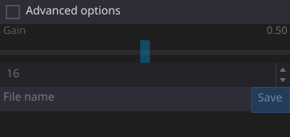

# What every widget does

This page covers what all widgets share: placing them, reading and writing their value,
hearing their changes, tooltips, greying out, and keyboard focus.
Each widget's own page only adds what is particular to it.

## Placing a widget

With C++26 reflection, a struct needs no code at all: every field becomes a widget, in order.
Without reflection, or for your own arrangement, write a `view()` method:

```cpp
struct Mixer {
    core::Field<ui::Slider<>> volume{{.value = 0.6}};
    core::Field<ui::Checkbox> mute{{.label = "Mute"}};

    void view(app::ViewBuilder& vb) {
        vb.widget(volume);   // one widget
        vb.widget(mute);
    }
};
```

| Call | Places |
|---|---|
| `vb.widget(field)` | one widget, and returns a handle for the options below |
| `vb.vstack(a, b, c)` | several widgets in a column |
| `vb.hstack(a, b, c)` | several widgets in a row |
| `vb.widget(derived)` | a `core::Derived<T>`, read-only |
| `vb.widget(shared)` | a `core::Shared<T>` filled by another thread, read-only |

Rows, columns and the other containers are in [Layout](layout.md).

## Reading and writing the value

A widget type such as `ui::Slider<>` holds more than its value: a range, a label, a step.
`value(x)` reads just the value, and `set_value(x, v)` changes just the value.

```cpp
core::Field<ui::Slider<>> volume{{.value = 0.6, .min = 0.0, .max = 1.0}};

double v = value(volume);   // 0.6
set_value(volume, 0.8);     // the range stays 0..1
```

`value()` reads `.value` when the widget type has one (slider, spin box, text field, label),
else `.checked` (checkbox, toggle button), else the whole value (`Field<bool>`, `Field<int>`).

Assigning the field replaces the whole widget value.
Members you do not name go back to their defaults:

```cpp
volume = {.value = 0.8};                          // the range is back to 0..1, the label gone
volume.update([](auto& s) { s.max = 2.0; });      // changes one member, keeps the rest
```

For a plain field, assignment is the natural way: `count = 3`, `count += 1`, `++count`,
`name += "!"`. Each change notifies once, and an equal value does not notify at all.

## Hearing changes

A field notifies every time its value changes, whether the user or your code changed it.
Three ways to listen, from the most common:

```cpp
struct Form {
    core::Field<ui::TextField<>> name{{.placeholder = "Name"}};
    core::Field<ui::Button> save{{"Save"}};
    core::Wiring wire;   // owns the connections below; they end with the struct

    Form() {
        wire.on(name, [](const ui::TextField<>& f) { /* f.value is the new text */ });
        wire.on(save, [this](const ui::Button&) { write(value(name)); });   // each click
    }
    void write(const std::string&) {}
};
```

- `wire.on(field, fn)` runs `fn` with the new value. The `Wiring` member ends the
  connection when the struct goes away.
- `field.observe(fn)` does the same, and the field keeps the connection itself.
- `auto c = field.on_change().connect(fn)` returns a handle: the connection lives as long as `c`.

A button's value is its click count, so each click is a change. That is how a click reaches you.

## Tooltips

A tooltip shows when the pointer rests on a widget. A click, a key or a scroll hides it.
Long text wraps.

```cpp
vb.widget(save).tooltip("Write the file to disk");
```

A struct shown by reflection has no `view()` to put it in. Annotate the member instead:

```cpp
[[=core::tooltip<"Output level, in dB">]] core::Field<ui::Slider<>> gain;
```

## Greying out

A greyed-out widget takes no clicks, no keys and no focus.
The flag is any bool `Field` or `Derived`, and the widget follows it as it changes.
A `ui::Checkbox` field works as a flag too.

```cpp
struct Advanced {
    core::Field<ui::Checkbox> unlocked{{.checked = false, .label = "Advanced options"}};
    core::Field<ui::Slider<>> gain{{.value = 0.5, .label = "Gain"}};
    core::Field<ui::SpinBox<int>> taps{{.value = 16, .min = 1, .max = 64}};
    core::Field<ui::TextField<>> name{{.placeholder = "File name"}};
    core::Field<ui::Button> save{{"Save"}};
    core::Derived<bool> has_name{[this] { return !value(name).empty(); }};

    void view(app::ViewBuilder& vb) {
        vb.widget(unlocked);
        vb.enabled_if(unlocked, [&] { vb.vstack(gain, taps); });
        vb.hstack([&] {
            vb.widget(name);
            vb.widget(save).enabled(has_name);
        });
    }
};
```



| Call | Greys out |
|---|---|
| `vb.widget(x).enabled(flag)` | one widget |
| `vb.enabled_if(flag, fn)` | everything `fn` places, nested containers included; it adds no container |

## Keyboard focus

Tab moves the focus to the next widget that takes it, Shift+Tab to the previous one.
A click focuses the widget it lands on.
Labels, pictures and progress bars never take the focus.

Space or Enter acts on the focused widget: it presses a button, ticks a checkbox, opens a
dropdown. A click acts on the release, over the widget that was pressed, as on every platform:
sliding off a button before letting go cancels it.

Inside a popup or a dialog, the first widget gets the focus when it opens.
`.focus_on_open()` gives it to another one:

```cpp
vb.dialog(rename, [&](app::ViewBuilder& d) { d.widget(new_name).focus_on_open(); });
```

## Accessibility

Every widget describes itself for assistive technology: a role (button, checkbox, slider...),
a name and a value. With reflection, the name is the member's name.
A widget with no text of its own, such as an icon-only button, should get a tooltip:
the tooltip becomes its name.

## Handle methods at a glance

`vb.widget(field)` returns a handle. Its methods chain:

| Method | Does | Page |
|---|---|---|
| `.tooltip(text)` | a tooltip | this page |
| `.enabled(flag)` | greys out while `flag` is false | this page |
| `.focus_on_open()` | the focused widget when its popup opens | this page |
| `.drag_source(fn)` | the widget can be dragged, carrying what `fn` returns | [Drag and drop](drag-and-drop.md) |
| `.drop_target(fn)` | the widget takes dropped values of the type `fn` names | [Drag and drop](drag-and-drop.md) |

```cpp
vb.widget(save).tooltip("Write the file").enabled(has_name);
```
