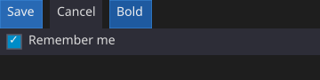

# Button

A button runs an action when the user clicks it.
With `.checked` set, it becomes a toggle that stays pressed.

```cpp
struct Buttons {
    core::Field<ui::Button> save{{"Save"}};
    core::Field<ui::Button> cancel{{.text = "Cancel", .primary = false}};
    core::Field<ui::Button> bold{{.text = "Bold", .checked = true}};
    core::Field<ui::Checkbox> remember{{.checked = true, .label = "Remember me"}};

    void view(app::ViewBuilder& vb) {
        vb.hstack([&] {
            vb.widget(save);
            vb.gap(8);
            vb.widget(cancel);
            vb.gap(8);
            vb.widget(bold);
            vb.spacer();
        });
        vb.widget(remember);
    }
};
```



## Reacting to a click

A button's value counts its clicks. Each click changes it, so each click notifies:

```cpp
struct Editor {
    core::Field<ui::Button> save{{"Save"}};
    core::Wiring wire;

    Editor() {
        wire.on(save, [this](const ui::Button&) { write(); });
    }
    void write() {}
};
```

A toggle notifies too. Read its state with `value(bold)`, which is `checked` (false when unset).

## `ui::Button`

| Member | Type | Default | Meaning |
|---|---|---|---|
| `text` | `std::string` | `""` | the label |
| `click_count` | `std::uint64_t` | `0` | counts the clicks; each click notifies |
| `icon` | `std::shared_ptr<const render::Image>` | none | a 16 pt image left of the text |
| `primary` | `bool` | `true` | `false` draws a quieter button, for a Cancel beside an OK |
| `shortcut` | `ui::Shortcut` | none | presses the button from anywhere in the window, shown after the text |
| `checked` | `std::optional<bool>` | none | set: a toggle; each click flips it, and it is drawn pressed while true |

`render::load_image("save.png")` reads an icon from a PNG, JPEG or SVG file.
It returns a `std::expected`: check it, or write `*render::load_image(...)` when the file
ships with the app.
A button with an icon and no text has no name of its own: give it a tooltip.

A shortcut is a key and its modifiers. `input::mods::ctrl` means Ctrl, or Cmd on macOS:

```cpp
core::Field<ui::Button> run{{.text = "Run", .shortcut = {input::keys::r, input::mods::ctrl}}};
```

## Using it

- A click presses it. Sliding off before letting go cancels the click.
- Space or Enter presses the focused button.
- Its shortcut presses it while the window has the focus, unless a dialog is open.

## See also

- [Checkbox](checkbox.md), for an on/off value with a label.
- [Toolbar](../layout/frames.md): toggles in a toolbar look like tool buttons.
- [Menu](../popups/menu.md): the same actions, with the same shortcuts.
