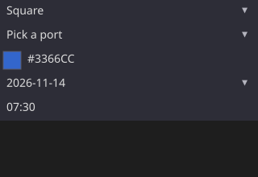
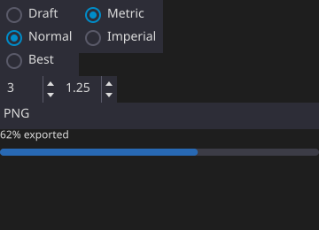

# Choices

Four widgets pick one option among several. Which one depends on where the options come from,
and on whether they should all be visible.

| Options | All visible | In a dropdown |
|---|---|---|
| an `enum` | `ui::Radio<E>` | the enum itself, or `ui::Dropdown<E>` |
| strings | `ui::RadioGroup` | `ui::Choice` |

```cpp
enum class Shape { Circle, Square, Triangle };

struct Pickers {
    core::Field<Shape> shape{Shape::Square};
    core::Field<ui::Choice> port{{.options = {"COM1", "COM3"}, .placeholder = "Pick a port"}};
    core::Field<core::Color> ink{core::Color::rgba(0x33, 0x66, 0xCC)};
    core::Field<std::chrono::year_month_day> day{std::chrono::year{2026} / std::chrono::November / 14};
    core::Field<ui::TimeOfDay> alarm{{7, 30}};

    void view(app::ViewBuilder& vb) { vb.vstack(shape, port, ink, day, alarm); }
};
```



## An enum: a dropdown

A field of any scoped enum is a dropdown of its values. Nothing to register.
With reflection, the names come from the enum; without it, from the magic_enum library.

```cpp
enum class Theme { Light, Dark, System };
core::Field<Theme> theme{Theme::Dark};
```

`ui::Dropdown<E>` is the same dropdown with labels of your own:

| Member | Type | Default | Meaning |
|---|---|---|---|
| `value` | `E` | `E{}` | the choice |
| `labels` | `std::vector<std::string>` | none | one per enum value, in order; empty: the enum's names |

## An enum: radio buttons

```cpp
enum class Quality { Draft, Normal, Best };
core::Field<ui::Radio<Quality>> quality{{Quality::Normal}};
```

| Member | Type | Default | Meaning |
|---|---|---|---|
| `value` | `E` | `E{}` | the choice |

## Strings: radio buttons

```cpp
core::Field<ui::RadioGroup> units{{.selected = 0, .options = {"Metric", "Imperial"}}};
```

| Member | Type | Default | Meaning |
|---|---|---|---|
| `selected` | `std::size_t` | `0` | the index of the choice in `options` |
| `options` | `std::vector<std::string>` | none | the buttons' labels |



## Strings known at run time: a choice

`ui::Choice` is a dropdown over strings the app finds while it runs: serial ports, recent files.
Unlike a [combo box](combo-box.md), it takes nothing but its options.

```cpp
core::Field<ui::Choice> port{{.options = {"COM1", "COM3"}, .placeholder = "Pick a port"}};

if (const std::string* p = port.get().chosen()) open(*p);
```

| Member | Type | Default | Meaning |
|---|---|---|---|
| `options` | `std::vector<std::string>` | none | the list |
| `selected` | `std::optional<std::size_t>` | none | the index of the choice; none: no choice yet |
| `placeholder` | `std::string` | `""` | shown while nothing is chosen |
| `chosen()` | `const std::string*` | | the chosen option, or null |

When the app shortens `options` past the selection, the choice reads as none.

## Using them

- A dropdown opens on a click, Space or Enter. In the open list, Up and Down move,
  Enter or a click takes, Escape closes.
- On a closed dropdown, Up and Down step to the previous or next option directly.
- A set of radio buttons is one stop for Tab; the arrow keys move the choice.
- Each new choice notifies.

## See also

- [Combo box](combo-box.md): free text with suggestions.
- [Checkbox](checkbox.md): for two states.
