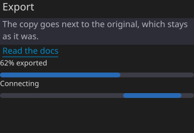

# Label

A label shows text the user reads but does not change: a status, a heading, a help line.

```cpp
struct Labels {
    core::Field<ui::Label<>> title{{.value = "Export", .heading = true}};
    core::Field<ui::Label<>> help{{.value = "The copy goes next to the original, "
                                            "which stays as it was.", .wrap = true}};
    core::Field<ui::Link> docs{{.text = "Read the docs", .url = "https://prism-gui.readthedocs.io"}};
    core::Field<ui::ProgressBar> done{{.value = 0.62, .label = "62% exported"}};
    core::Field<ui::ProgressBar> waiting{{.label = "Connecting", .busy = true}};

    void view(app::ViewBuilder& vb) { vb.vstack(title, help, docs, done, waiting); }
};
```



## `ui::Label<T>`

`T` is the string type, `std::string` by default.

| Member | Type | Default | Meaning |
|---|---|---|---|
| `value` | `T` | `""` | the text |
| `heading` | `bool` | `false` | a title: larger and brighter, with no box behind it |
| `wrap` | `bool` | `false` | breaks into lines to fit its width, and grows as tall as they are |

## Plain values

A field of `std::string` or of a number shows as read-only text too:

```cpp
core::Field<std::string> status{"Ready"};
core::Field<int> count{0};
```

So does a computed value or a value another thread publishes:

```cpp
struct Cart {
    core::Field<int> items{3};
    core::Derived<std::string> summary{[this] { return std::to_string(items.get()) + " items"; }};

    void view(app::ViewBuilder& vb) { vb.widget(summary); }   // follows `items`
};
```

## Using it

A label takes no focus and no input. It redraws when its field changes.

## See also

- [Link](link.md): text the user clicks.
- [Text area](text-area.md) with `.read_only = true`: text the user can select and copy.
