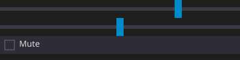

# Slider

A slider picks a number in a range by dragging.
It suits a value the user tunes by feel: a volume, a zoom, a threshold.

```cpp
struct AudioMixer {
    core::Field<ui::Slider<>> volume{{.value = 0.75, .min = 0.0, .max = 1.0}};
    core::Field<ui::Slider<int>> quality{{.value = 3, .min = 1, .max = 5, .step = 1}};
    core::Field<ui::Checkbox> mute{{.checked = false, .label = "Mute"}};

    void view(app::ViewBuilder& vb) {
        vb.vstack(volume, quality, mute);
    }
};
```



## `ui::Slider<T, O>`

`T` is the number type, `double` by default; any integer or floating type works.
`O` is `Orientation::Horizontal` (the default) or `Orientation::Vertical`.

| Member | Type | Default | Meaning |
|---|---|---|---|
| `value` | `T` | `0` | the number |
| `min` | `T` | `0` | the left (or bottom) end |
| `max` | `T` | `1` | the right (or top) end |
| `step` | `T` | `0` | the value moves in steps of this size; `0`: continuous |
| `label` | `std::string` | `""` | a caption above the track, with the value printed at its right end |
| `unit` | `std::string` | `""` | printed after the value, in the caption |

```cpp
core::Field<ui::Slider<>> volume{{.value = 30, .max = 100, .step = 1, .label = "Volume", .unit = "%"}};
```

The caption prints the value to the step's precision: a step of `0.1` shows one decimal.
A vertical slider draws no caption.

## From a plain number

In a struct shown by reflection, a plain number becomes a slider when you give it a range:

```cpp
struct Bench {
    [[=core::range<0.0, 30.0, 0.1>, =core::unit<"V">]] core::Field<double> volts{5.0};
};
```

The member's name is the caption. Without the annotation, a number is read-only text.

## Using it

- Drag the knob, or click the track to jump there.
- With a step, the value snaps to the nearest step.
- The value notifies at every move of a drag.
- The keyboard does not move a slider yet: use a [spin box](spin-box.md) where that matters.

## See also

- [Spin box](spin-box.md), for an exact number the user types.
- [Progress bar](progress-bar.md), for a number the user does not change.
