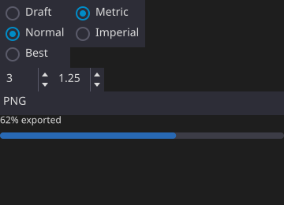

# Spin box

A spin box holds an exact number. The user types it, or steps it up and down.

```cpp
struct Print {
    core::Field<ui::SpinBox<int>> copies{{.value = 3, .min = 1, .max = 99, .step = 1}};
    core::Field<ui::SpinBox<double>> scale{{.value = 1.25, .min = 0.5, .max = 4.0, .step = 0.25}};

    void view(app::ViewBuilder& vb) { vb.hstack(copies, scale); }
};
```



## `ui::SpinBox<T>`

| Member | Type | Default | Meaning |
|---|---|---|---|
| `value` | `T` | `0` | the number |
| `min` | `T` | `0` | the smallest value |
| `max` | `T` | `100` | the largest value |
| `step` | `T` | `1` | what the steppers, the arrows and the wheel add or take away |

## Using it

- The steppers, Up and Down, and the mouse wheel step the value, kept between `min` and `max`.
- Typed digits are kept until Enter takes them. Escape, or leaving the field, drops them.
- Only a taken value notifies, not each digit.

## See also

- [Slider](slider.md), for a value tuned by dragging.
