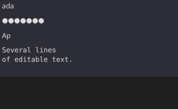

# Text field

A text field holds one line of text the user types: a name, a search, a path.
`ui::Password<>` is the same field with its text shown as dots.

```cpp
struct TextInputs {
    core::Field<ui::TextField<>> name{{.value = "ada", .placeholder = "Name"}};
    core::Field<ui::Password<>> secret{{.value = "hunter2", .placeholder = "Password"}};
    core::Field<ui::ComboBox> fruit{{.value = "Ap", .placeholder = "Fruit",
                                     .options = {"Apple", "Apricot", "Banana"}}};
    core::Field<ui::TextArea<>> notes{{.value = "Several lines\nof editable text.", .rows = 3}};

    void view(app::ViewBuilder& vb) { vb.vstack(name, secret, fruit, notes); }
};
```



## `ui::TextField<T>` and `ui::Password<T>`

`T` is the string type, `std::string` by default. Any type that behaves like a string works.

| Member | Type | Default | Meaning |
|---|---|---|---|
| `value` | `T` | `""` | the text |
| `placeholder` | `std::string` | `""` | shown greyed while the field is empty |
| `max_length` | `std::size_t` | `0` | the most characters it takes; `0`: no limit |

`value(name)` reads the text. `set_value(name, "grace")` changes it and keeps the placeholder.

## Using it

- Typing, Backspace and Delete edit. The caret steps over whole characters: an accent typed
  as a second code point goes with its letter.
- Shift with the arrows, Home or End selects; so do a drag and Shift+click. Ctrl+A selects all.
- Ctrl+C, Ctrl+X and Ctrl+V copy, cut and paste. Ctrl+Z undoes, Ctrl+Y or Ctrl+Shift+Z redoes.
  On macOS, Cmd takes Ctrl's place.
- Input methods for Chinese, Japanese and Korean work, with the text being composed shown
  in place.
- Hebrew and Arabic read right to left; a field holding such text sits on the right.
- A password field never puts its text on the clipboard.
- Every edit notifies.

A focused text field keeps its own keys: Ctrl+C there copies, even when a menu item has
Ctrl+C as its shortcut.

## See also

- [Text area](text-area.md), for several lines.
- [Combo box](combo-box.md), for a text with suggestions.
- [Text and code](../text.md), for long documents.
