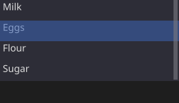

# List

A list shows one row per item of a `core::List<T>`, and follows it as items come and go.

```cpp
struct Groceries {
    core::List<std::string> items;
    core::Field<std::optional<std::size_t>> picked{std::size_t{1}};

    Groceries() {
        for (auto s : {"Milk", "Eggs", "Flour", "Sugar"}) items.push_back(s);
    }

    void view(app::ViewBuilder& vb) { vb.list(items).selection(picked).reorderable(); }
};
```



## `core::List<T>`

A `List<T>` is a vector that tells its views what changed.
Each row shows the item with the widget its type picks: a `std::string` is read-only text,
a `ui::Checkbox` a checkbox.

| Method | Does | Notifies |
|---|---|---|
| `push_back(item)` | adds an item at the end | `on_insert()` |
| `erase(index)` | removes an item | `on_remove()` |
| `set(index, item)` | replaces an item | `on_update()` |
| `move(from, to)` | moves an item, `to` counted after the move | `on_update()` for each slot, then `on_move()` |
| `replace_all(range)` | the list becomes `range`; only the items that differ are updated | each change |
| `size()`, `operator[]`, `begin()`, `end()` | read it | |

## The call and its handle

`vb.list(items, on_click)` places the list. `on_click(index, item)` runs on a click on a row,
and may be left out. The handle's methods:

| Method | Does |
|---|---|
| `.selection(field)` | a `Field<std::optional<std::size_t>>` holds the selected row; a click selects, the row is highlighted |
| `.reorderable()` | the user drags rows to reorder them; an insertion line shows where |
| `.follow_tail()` | rows appended while the last row shows scroll the list down, as a terminal does |

The selection follows the items: removing a row above it moves it up one, and removing the
selected item clears it.
`follow_tail` stops while the user scrolls up, and starts again at the bottom.

## Using it

- A click selects a row.
- With a selection, the list takes the focus: Up, Down, Home and End move the selection and
  scroll it into view.
- With `.reorderable()`, drag a row and let it go where the line shows.

## See also

- [Table](table.md): several columns, sorting, editing.
- [Tabs over a list](../layout/tabs.md): one tab per item.
- [Drag and drop](../drag-and-drop.md).
