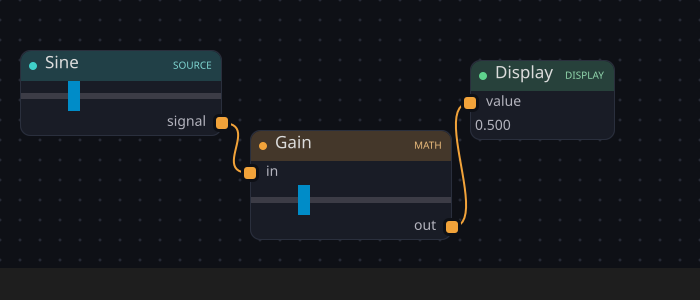

# Node board

A node board is a canvas of cards joined by wires: a signal graph, a shader graph, a patch bay.
Each card is one of your structs, its ports are typed fields, and the wires between them are the
graph's. The user moves cards, draws wires, and deletes what you allow.

The board draws the cards, the wires, the grid and the probes; what a card *is* stays your code.
A card holds real widgets — a slider, a spin box, a text field — so a node editor is a set of
small forms you can wire together.

```cpp
#include <prism/app/model_app.hpp>
#include <prism/nodes/graph.hpp>
#include <prism/nodes/node_kind.hpp>

#include <array>
#include <cmath>
#include <numbers>
#include <vector>

namespace nodes = prism::nodes;
```

Snippets here assume `using namespace prism;`, as the examples do.

## A node

A node is a struct with ports and a `view`:

```cpp
inline std::vector<double> scaled(std::vector<double> wave, double gain) {
    for (double& v : wave) v *= gain;
    return wave;
}

struct Gain {
    explicit Gain(double level = 1.0) : by{"gain", level} {}

    nodes::In<std::vector<double>> in{"in", {}};   // an unwired wave is silence
    nodes::In<double> by{"gain", 1.0};
    nodes::Out<std::vector<double>> out{"out", [this] { return scaled(in.get(), by.get()); }};
    core::Field<ui::Label<>> note{{.value = "one window", .flat = true}};

    std::vector<nodes::Port*> ports() { return {&in, &by, &out}; }
    void view(app::ViewBuilder& vb) {
        vb.port(in);
        vb.port(by);
        vb.widget(note);
        vb.port(out);
    }
};
```

`nodes::In<T>` holds a `core::Field<T>` the wire writes into; it starts at the fallback you give it
and goes back there when the wire is removed. `nodes::Out<T>` holds a `core::Derived<T>`: its value
is recomputed from whatever it reads, so `in.get()` above follows the upstream node without you
wiring a callback.

`ports()` lists the ports in order. A wire names a port by its index in that list, so put the
outputs last or keep the order stable — it is part of the node's interface.

`view` lays the card out. `vb.port(p)` is one port row: the dot on the inward or outward edge, the
port's name, and the value it carries. Everything else is an ordinary widget — `vb.widget(field)`
takes any field, and the type inside it picks the widget, exactly as outside a node. A label inside
a card usually sets `.flat = true`: the card already draws the surface behind it.

## A board

A source and a sink are the same shape, shorter:

```cpp
// Any waveform will do; this is `cycles` periods of a sine over one window.
inline std::vector<double> wave(double cycles) {
    std::vector<double> out(240);
    for (std::size_t i = 0; i < out.size(); ++i)
        out[i] = std::sin(2 * std::numbers::pi * cycles * static_cast<double>(i) / 240.0);
    return out;
}

struct Sine {   // a source: one widget and an output
    core::Field<ui::Slider<>> cycles{{.value = 3, .min = 0.5, .max = 12, .step = 0.5, .label = "Cycles"}};
    nodes::Out<std::vector<double>> out{"wave", [this] { return wave(cycles.get().value); }};

    std::vector<nodes::Port*> ports() { return {&out}; }
    void view(app::ViewBuilder& vb) {
        vb.widget(cycles);
        vb.port(out);
    }
};

struct Scope {   // a sink: an input, and whatever widgets read it
    nodes::In<std::vector<double>> in{"in", {}};

    std::vector<nodes::Port*> ports() { return {&in}; }
    void view(app::ViewBuilder& vb) { vb.port(in); }
};
```

The graph holds the nodes you give it and the wires it owns:

```cpp
struct Sandbox {
    Sine sine;
    Gain gain;
    Scope scope;

    nodes::Graph graph;
    nodes::NodeId s = graph.add(sine, {.title = "Sine", .family = "source",
                                       .at = core::Point{core::X{20}, core::Y{30}}});
    nodes::NodeId g = graph.add(gain, {.title = "Gain", .family = "math",
                                       .at = core::Point{core::X{260}, core::Y{30}}});
    nodes::NodeId o = graph.add(scope, {.title = "Scope", .family = "display",
                                        .at = core::Point{core::X{520}, core::Y{30}}});

    Sandbox() {
        graph.connect({s, 0}, {g, 0});   // the sine's output into the gain's wave input
        graph.connect({g, 2}, {o, 0});   // and the gain's output into the scope
    }

    void view(app::ViewBuilder& vb) { vb.node_board(graph); }
};
```

A wire is `(node, port index)` to `(node, port index)`: `Sine` has one port, its output, so 0;
`Gain`'s ports are `in`, `by`, `out` in that order, so its wave input is 0 and its output is 2;
`Scope` has one input, 0. `connect` returns
`std::expected<nodes::EdgeId, nodes::ConnectError>`: it refuses an output wired to an output
(`NotOutputToInput`), two ports of different types (`TypeMismatch`), a wire that would make a cycle
(`Cycle`), and a port that is not there (`UnknownPort`). `can_connect` asks the same question
without drawing anything — the board fades the ports a wire cannot land on with it.

`vb.node_board(graph)` is the whole board. It fills the space it is given, cards at their graph
positions, so a board alone in a window is the window; put it beside a palette in an `hstack` and
it takes what is left.

An app is the model and `app::run`:

```cpp
int main() {
    Sandbox sandbox;
    return app::run(sandbox, {.title = "Patch"});
}
```

## A palette

A palette lists node kinds; dragging one onto the board adds a node where it is dropped.

```cpp
std::array kinds{nodes::kind_of<Sine>("Sine", "source"), nodes::kind_of<Gain>("Gain", "math"),
                 nodes::kind_of<Scope>("Scope", "display")};

void view(app::ViewBuilder& vb) {
    vb.hstack([&] {
        vb.node_palette(graph, kinds);   // a column of rows, each in its family's colour
        vb.node_board(graph);
    });
}
```

`nodes::kind_of<N>(title, family)` is the sugar for the usual kind: it emplaces an `N`, removable,
with that title and family. Double-clicking a row, or pressing Enter on it, adds its node at the
board's visible top-left instead, a step further down and right on each add. A kind is a plain
struct, so a node that wants constructor arguments writes its own:

```cpp
nodes::NodeKind gain_of(double level) {
    return {.title = std::format("Gain ×{}", level), .family = "math",
            .add = [level](nodes::Graph& graph, core::Point at) {
                return graph.emplace<Gain>({.title = "Gain", .family = "math", .at = at, .removable = true},
                                           level);
            }};
}
```

`graph.emplace<N>(options, args...)` gives the graph a node it owns, built in place from `args`:
the node goes when it is removed from the board, after its wires, and with the graph. That is what
makes a palette node deletable. `graph.add` stays the way to show a node the app owns — a node you
keep as a member lives as long as your model does, and is not removable unless the options say
`.removable = true`.

## Gestures

| Gesture | Does |
|---|---|
| drag a card's header | moves the node |
| drag from a port's dot | starts a wire; drop it on a port of the same type to connect |
| drag from a wired input | picks that wire up; drop it on nothing and it is gone |
| click a wire, then Delete | removes the wire |
| click a card, then Delete | removes the node, when it is removable |
| drag the background | pans |
| middle drag | pans, even over a card |
| Ctrl+wheel | zooms about the pointer; a trackpad pinch arrives as this |
| `graph.request_fit()` | shows every card in the board's size, at its next layout |

`request_fit` is what a Fit button calls; a zoom readout is a `Derived` over `graph.view()`:

```cpp
core::Derived<std::string> zoom{[this] { return std::format("{:.0f} %", graph.view().zoom * 100.f); }};
```

The view is a field (`graph.view_field()`), so it can be saved and restored with `set_view`, like a
dock layout.

## Probes

Hovering a wire shows the value it carries in a bubble beside the pointer, ringed in the wire's
colour. The board reads the output port at the wire's start and formats it for its type — a
waveform says how many samples and its peak, a number shows three significant digits. It watches
that output, so a live signal's bubble keeps up; the bubble stays at its natural size whatever the
zoom.

A type with no formatter shows its type's name instead of a value.

## Port types

Ports connect only when their types match. The types the board knows, and the wire colour each one
gets:

| Type | Slot | Colour in the dark look |
|---|---|---|
| `std::vector<double>` (waveform) | 0 | `#4ea1ff` |
| `double` (number) | 1 | `#f2a33a` |
| `bool` (boolean) | 2 | `#5fd38d` |
| `int` (integer) | 3 | `#a98bff` |
| `std::string` (text) | 4 | `#eef1f7` |
| your types | 5, 0, 1, … in the order they are first used | `#9aa1b2` for the first |

A type of your own is a name and, if you want one, a formatter:

```cpp
struct Volts { double v; };

template <>
struct prism::nodes::PortType<Volts> {
    static constexpr std::string_view name = "volts";
    static std::string format(const Volts& v) { return std::format("{:.2f} V", v.v); }
};
```

That is all: the first time a `Volts` port is built, the type is registered under its name, and
`format` becomes its probe text. Nothing is registered at start-up, so a plugin loaded at run time
needs no static initialiser.

`nodes::set_formatter(nodes::type_key<Volts>(), std::function<std::string(const std::any&)>)`
replaces it later — that is how a binding installs a formatter for a type it describes by name, and a
formatter set that way wins over the type's own.

The wire colour follows the slot: `theme.node_wires[nodes::wire_slot(nodes::type_key<Volts>())]`.
The five types above hold slots 0 to 4; your own start at the last slot and wrap round, one slot
each in the order they are first used — the first type you add takes 5, the second 0, the third 1.
Give the last slot a colour of its own and the first type you add gets it:

```cpp
ui::Theme mine = ui::dark_theme();
mine.node_wires[ui::node_wire_slots - 1] = core::Color::rgba(120, 200, 255);
```

## Families and the theme

A node's `family` is a word — `source`, `filter`, `math`, `display` out of the box — and each
family has a colour in the theme. The card's header band is the family colour mixed 20 % over the
card's surface, its name upper-cased on the right in the family colour mixed 60 % over the text,
and the dot before the title is the colour itself. A family the palette lists is drawn in the same
colour, so the two ends match.

An app adds a family without touching the board:

```cpp
ui::Theme mine = ui::dark_theme();
mine.node_families.push_back({"dsp", core::Color::rgba(120, 200, 255)});
tree.set_theme(std::move(mine));
```

A family the theme does not name uses `theme.node_family_default`.

Every colour the board draws is a role, in both themes:

| Role | Draws |
|---|---|
| `node_board_bg` | the board behind the cards |
| `node_grid`, `node_grid_dots` | the grid: dots where the flag is set, lines otherwise |
| `node_surface`, `node_border` | a card's fill and its 1 px border |
| `node_border_selected`, `node_glow` | the selected card's border and its outer ring |
| `node_wires` | one colour per wire slot |
| `node_probe_bg`, `node_probe_text` | the probe bubble |
| `node_families`, `node_family_default` | family colours |

`ui::mix(a, b, t)` is the mixing the theme uses; `ui::node_family_color(theme, family)` is the
lookup the board uses, handy for a widget of yours that wants its node's colour.

Switching the theme repaints the board in place — the cards, the grid, the wires, and the probes —
without rebuilding a single widget, so a hover or a selection survives a light/dark switch.


