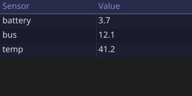

# Table

A table shows rows and columns. The user sorts it, moves and resizes its columns,
selects rows and edits cells.

## From a list of structs

With reflection, a `core::List` of structs is a table: one column per member.

```cpp
struct Reading {
    core::Field<std::string> sensor{""};
    core::Field<double> value{0.0};
};

struct TableShowcase {
    core::List<Reading> readings;

    TableShowcase() {
        readings.push_back(Reading{.sensor = {"battery"}, .value = {3.7}});
        readings.push_back(Reading{.sensor = {"bus"}, .value = {12.1}});
        readings.push_back(Reading{.sensor = {"temp"}, .value = {41.2}});
    }

    void view(app::ViewBuilder& vb) {
        vb.table(readings).headers({"Sensor", "Value"}).sort(1, /*descending=*/true);
    }
};
```



The cells take edits by themselves, each parsed into its member's type.
A `bool` member is a checkbox column.
A struct of vectors, one vector per column, works the same way.

## From your own source

Without reflection, or for data that is not in a list (a database, a file, values computed
from the row number), write a source. It is any type with four methods:

```cpp
struct Squares {
    std::size_t column_count() const { return 2; }
    std::size_t row_count() const { return 1000; }
    std::string_view header(std::size_t c) const { return c == 0 ? "n" : "n²"; }
    std::string cell_text(std::size_t r, std::size_t c) const {
        return std::to_string(c == 0 ? r : r * r);
    }
};

struct Maths {
    Squares squares;
    void view(app::ViewBuilder& vb) { vb.table(squares); }
};
```

The table asks only for the rows on screen. Add any of these methods for more:

| Method | Gives |
|---|---|
| `bool set_cell(row, col, std::string_view text)` | the cells take edits; return false to refuse the text (the editor stays open) |
| `bool editable(col)` | only these columns take edits |
| `std::optional<bool> cell_check(row, col)` | a checkbox in the cell; a click hands `set_cell` `"true"` or `"false"` |
| `std::shared_ptr<const render::Image> cell_image(row, col)` | an icon before the cell's text |

The [gallery's Data tab](https://jeandet.github.io/PRISM/widget_gallery.html) is such a source:
10,000 rows computed from the row number, a checkbox column and an editable note column.

## The handle

| Method | Does |
|---|---|
| `.headers({...})` | column titles that replace the source's |
| `.sort(column, descending = false)` | the starting sort; the user changes it by clicking a header |
| `.columns(field)` | a `Field<std::vector<std::size_t>>` of the columns shown, in order; empty: all |
| `.depends_on(a, b...)` | redraws and re-sorts when any of these fields change |

With `.columns(field)`, the app hides a column by leaving it out of the vector, and saves the
user's order by saving the field. A header drag writes the new order into it.
There is no built-in menu to hide columns: the gallery builds one with a
[context menu](../popups/context-menu.md).

A table over a `List` hears its changes itself. A table over your own source does not know
when your data changes: list the fields it depends on with `.depends_on(...)`.

## Using it

- Click a header to sort by that column; click again to reverse. Numbers sort by value.
- Drag a header to move its column; drag a header's edge to resize the column.
- Click selects a row, Ctrl+click adds one, Shift+click selects a range;
  Shift with Up or Down extends it; Ctrl+A selects all.
- Up, Down, Home, End, Page Up and Page Down move the current row.
- Double-click a cell, or press F2 on a row, to edit. Enter keeps the text, Escape drops it,
  Tab goes on to the next editable cell.
- A wide table scrolls sideways.

## See also

- [List](list.md): one column, any widget per row.
- [Tree](tree.md): nested data.
