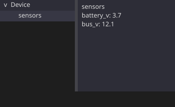

# Tree

A tree shows nested data: folders and files, a device and its parts.
Nodes open and close; only the open ones are built.

## From a struct

With reflection, a tree reads any struct, nested structs as nodes:

```cpp
struct Sensors {
    float battery_v = 3.7f;
    float bus_v = 12.1f;
};

struct Device {
    std::string name = "Controller";
    Sensors sensors;
    int firmware = 12;
};

struct TreeShowcase {
    Device device;
    ui::TreeController ctrl{ui::wrap_struct_tree(device)};

    TreeShowcase() {
        ctrl.on_row_clicked(0, ctrl.rows[0]); // expand root
        ctrl.on_row_clicked(1, ctrl.rows[1]); // expand "sensors"
    }

    void view(app::ViewBuilder& vb) { vb.tree(ctrl); }
};
```



## From your own source

Any type with six methods is a tree source. Each node has an id, a `ui::TreeNodeId`
(a 64-bit number) the source picks:

```cpp
struct Chores {
    struct Node {
        std::string name;
        std::vector<ui::TreeNodeId> children;
        std::optional<bool> done;   // rooms have no box
    };
    std::vector<Node> nodes{{"Kitchen", {2, 3}, {}}, {"Garden", {4}, {}},
                            {"Dishes", {}, true}, {"Floor", {}, false}, {"Water the plants", {}, false}};

    std::size_t root_count() const { return 2; }
    ui::TreeNodeId root_at(std::size_t i) const { return i; }
    std::size_t child_count(ui::TreeNodeId id) const { return nodes[id].children.size(); }
    ui::TreeNodeId child_at(ui::TreeNodeId id, std::size_t i) const { return nodes[id].children[i]; }
    std::string label(ui::TreeNodeId id) const { return nodes[id].name; }
    bool has_children(ui::TreeNodeId id) const { return !nodes[id].children.empty(); }
};

struct Todo {
    Chores chores;
    ui::TreeController tree{ui::wrap_tree_storage(chores)};
    void view(app::ViewBuilder& vb) { vb.tree(tree, /*detail=*/false); }
};
```

Add any of these methods for more:

| Method | Gives |
|---|---|
| `std::optional<std::string> icon(id)` | a glyph from the icon font before the label |
| `std::shared_ptr<const render::Image> image(id)` | an image before the label; it wins over the glyph |
| `std::vector<std::pair<std::string, std::string>> attributes(id)` | name and value lines in the detail pane |
| `std::optional<bool> checked(id)` and `void set_checked(id, bool)` | a checkbox on the node |
| `bool rename(id, std::string_view name)` | renaming in place; return false to refuse the name |

## `ui::TreeController`

The controller holds what the user did to the tree. Keep it next to its source.

| Member | Type | Meaning |
|---|---|---|
| `selected` | `Field<std::optional<TreeNodeId>>` | the current node; set it to select one node |
| `selection` | `Field<std::vector<TreeNodeId>>` | every selected node, in the rows' order |
| `on_move` | `std::function<void(node, target, ui::TreeDrop)>` | set: the user drags nodes; you move them in your data |
| `refresh()` | | reads the source again, after you changed it |

`ui::TreeDrop` is `Before`, `After` or `Inside`.

## The call

`vb.tree(controller, detail = true)` places the tree.
With `detail`, a pane beside it shows the selected node's label and attributes.
Pass `false` to show the selection your own way, for example with
[`vb.pages`](../layout/tabs.md) following `controller.selected`.

## Using it

- A click selects a node and opens or closes it. Ctrl+click adds to the selection,
  Shift+click selects a range.
- Up and Down move; Shift with them extends the selection. Right opens a node, Left closes it.
- Enter or Space opens or closes the current node; Space ticks its checkbox when it has one.
- F2 or a double-click renames, when the source can. Enter keeps the name, Escape drops it.
  A refused name keeps the editor open, outlined in red.
- With `on_move` set, drag a node: on the middle of a folder it goes inside, near an edge
  before or after. A node never goes into its own subtree.

## See also

- [Table](table.md), [List](list.md).
- [Drag and drop](../drag-and-drop.md).
