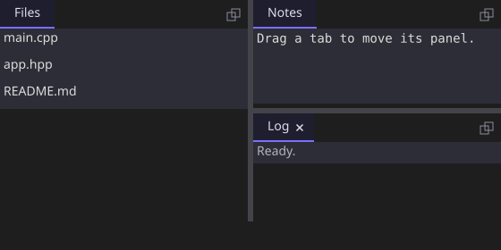

# Docking

A dock arranges named panels in splits and tab groups, as an IDE does.
The user drags panels between groups, splits them, floats them in windows of their own,
and closes them. The arrangement is a value your app owns, so it saves with the settings.

```cpp
#include <prism/ui/dock.hpp>

struct DockShowcase {
    core::List<std::string> files;
    core::Field<ui::TextArea<>> notes{{.value = "Drag a tab to move its panel.", .rows = 4}};
    core::Field<ui::Label<>> log{{"Ready."}};
    core::Field<ui::DockLayout> layout{{ui::dock_split(/*vertical=*/false, {
        ui::dock_group({"files"}),
        ui::dock_split(/*vertical=*/true, {ui::dock_group({"notes"}), ui::dock_group({"log"})}),
    })}};

    DockShowcase() {
        for (auto f : {"main.cpp", "app.hpp", "README.md"}) files.push_back(f);
    }

    void view(app::ViewBuilder& vb) {
        vb.dock(layout, {
            {"files", "Files", [&](app::ViewBuilder& p) { p.list(files); }},
            {"notes", "Notes", [&](app::ViewBuilder& p) { p.widget(notes); }},
            {"log", "Log", [&](app::ViewBuilder& p) { p.widget(log); }, /*closable=*/true},
        });
    }
};
```



## Panels

`vb.dock(layout, panels)` takes the layout field and the list of panels.
Each panel is `{name, title, build, closable}`:

| Member | Type | Meaning |
|---|---|---|
| `name` | `std::string` | the panel's id, used by the layout |
| `title` | `std::string` | its tab's text |
| `build` | `std::function<void(app::ViewBuilder&)>` | places its widgets |
| `closable` | `bool` | a close button on its tab; `false` by default |

A moved panel keeps its widgets: its scroll position, caret, selection and focus stay,
as with Qt's dock widgets.

## The layout

`ui::DockLayout` is plain data:

| Member | Type | Meaning |
|---|---|---|
| `root` | `ui::DockNode` | the tree of splits and groups |
| `floating` | `std::vector<std::string>` | panels in windows of their own (cards in the browser) |
| `closed` | `std::vector<std::string>` | panels the user closed |
| `places` | `std::vector<ui::PanelPlace>` | where floating cards sit, in the browser |

A `ui::DockNode` is a group of panels shown as tabs, or a split of parts:

| Member | Type | Meaning |
|---|---|---|
| `panels` | `std::vector<std::string>` | a group: its panels, in tab order |
| `active` | `std::size_t` | a group: the panel shown |
| `vertical` | `bool` | a split: parts above one another; otherwise side by side |
| `sizes` | `std::vector<float>` | a split: the parts' sizes; empty: equal |
| `parts` | `std::vector<ui::DockNode>` | a split's parts |

Build one with `ui::dock_group({names...})` and `ui::dock_split(vertical, {parts...}, sizes = {})`.

The user's moves, split sizes and tab choices are written back into the field.
Save the field with the settings and the dock reopens as the user left it.
A layout saved by another version of the app still works: panels it does not name join its
first group, and names with no panel are dropped.

## Changing the layout from code

Each function takes a layout and returns the changed one:

```cpp
layout = ui::show_panel(layout.get(), "log");   // a "View > Log" menu item
```

| Function | Returns the layout with |
|---|---|
| `show_panel(l, name)` | closed panel `name` shown again, in the first group |
| `close_panel(l, name)` | panel `name` closed, kept in `closed` |
| `float_panel(l, name)` | panel `name` floating in a window of its own |
| `dock_panel(l, name)` | floating panel `name` back in the first group |
| `move_panel(l, name, anchor, zone)` | `name` moved into `anchor`'s group (`ui::DockZone::Middle`) or beside it (`Left`, `Right`, `Top`, `Bottom`) |
| `insert_panel(l, name, anchor, index)` | `name` put into `anchor`'s group before tab `index` |
| `dock_panel_at_edge(l, name, side)` | `name` along a whole side of the dock |

Groups left empty go away, and a split left with one part becomes that part.

## Using it

- Drag a panel's tab onto another group. A guide shows five buttons: the middle one adds the
  panel to that group's tabs, the others put it beside the group. The area it would take is
  shaded.
- Drag it onto the dock's edge buttons to put it along a whole side.
- Drag a tab along its bar to reorder the tabs.
- Let a tab go outside the window, double-click it, or press the button at the right end of
  its bar: the panel floats in a window of its own. Close that window and it docks again.
- A closable panel's tab has a close button; a middle click closes it too.

## In the browser

A web page has only one window. There, a floating panel is a card over the dock instead.
Drag its title to move it. Let it go on a guide's button to dock it there, or press its
button to dock it back. On the desktop, floating panels are always real windows.

## See also

- [Tabs and pages](layout/tabs.md): tabs the app arranges.
- [Rows, columns and splits](layout/stacks.md).
- The [system monitor](https://jeandet.github.io/PRISM/model_system_monitor.html) and the
  [gallery's Docking tab](https://jeandet.github.io/PRISM/widget_gallery.html) are built on a dock.
