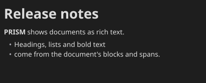

# Markdown and rich text

A `text::Document` holds rich text as well as code: headings, lists, quotes, code blocks,
tables, and bold, italic, code and link spans.
PRISM reads it from Markdown and writes it back.

```cpp
struct RichText {
    text::Document notes{"Release notes\n"
                         "PRISM shows documents as rich text.\n"
                         "Headings, lists and bold text\n"
                         "come from the document's blocks and spans."};

    RichText() {
        notes.set_kind(0, text::BlockKind::heading, 1);
        notes.style({{1, 0}, {1, 5}}, text::Style::strong);
        notes.set_kind(2, text::BlockKind::bullet, 0, "•");
        notes.set_kind(3, text::BlockKind::bullet, 0, "•");
    }

    void view(app::ViewBuilder& vb) { vb.text_view(notes); }
};
```



Rich text is drawn in real Noto Sans Bold and Italic faces, not slanted or thickened copies.

## From and to Markdown

```cpp
#include <prism/text/markdown.hpp>
#include <prism/text/to_markdown.hpp>

text::Document readme = text::markdown(source);   // GitHub-flavoured Markdown
std::string back = text::to_markdown(readme);     // and back, tables included
```

`text::markdown` uses cmark-gfm, GitHub's own parser: tables, strikethrough, autolinks and
task lists work. Each heading, paragraph, quote, list item, code line, rule and table row
becomes a block; emphasis, strong, code, links and strikethrough become spans.

Markdown support is opt-in, like HTTP: it is built when Meson finds or fetches cmark-gfm
(`-Dmarkdown=auto`, the default). Link your program with the `prism_markdown_dep` dependency.
A hard line break inside a paragraph becomes a space, and an image shows its alt text.

## Editing rich text

`vb.text_editor(doc, {.rich = true})` edits rich text:

| Keys | Do |
|---|---|
| Ctrl+B, Ctrl+I, Ctrl+E | bold, italic or code on the selection, or the word at the caret; again to take it off |
| `# ` at a paragraph's start | a heading (`## ` for a level-2 heading, and so on) |
| `- ` | a bullet item |
| `1. ` | a numbered item |
| `> ` | a quote |
| Enter in a list item | the next item; Enter on an empty item leaves the list |
| Backspace at a block's start | the block becomes a paragraph again |

The [gallery's Document tab](https://jeandet.github.io/PRISM/widget_gallery.html) shows
Markdown on the left and the rendering on the right, each editable and each following the
other: the source is a code editor, the rendering a rich editor, and `to_markdown` writes one
into the other.

## See also

- [The document](text/document.md): blocks, kinds and styles.
- [Views and editors](text/views-and-editors.md).
