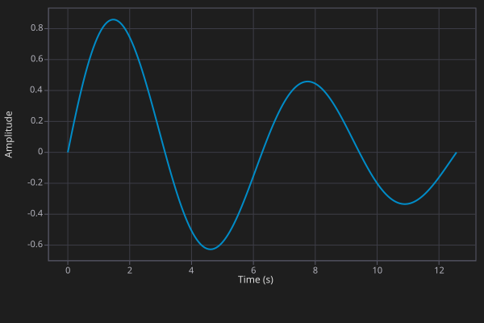

# Plot

A plot draws line series against two axes, and lets the user zoom and pan.
It is a canvas: place it with `vb.canvas(plot)`.

```cpp
#include <prism/widgets/plot.hpp>

struct PlotShowcase {
    plot::PlotModel plot;

    void setup_data() {
        constexpr int N = 200;
        std::vector<double> xs(N), ys(N);
        for (int i = 0; i < N; ++i) {
            double t = static_cast<double>(i) / (N - 1) * 4.0 * std::numbers::pi;
            xs[static_cast<size_t>(i)] = t;
            ys[static_cast<size_t>(i)] = std::sin(t) * std::exp(-t * 0.1);
        }

        auto colors = plot::default_series_colors(ui::default_theme());
        plot.add_series(plot::XYData{std::move(xs), std::move(ys)},
                        plot::SeriesStyle{colors[0], 2.f});
        plot.x_label.set("Time (s)");
        plot.y_label.set("Amplitude");
        plot.notify();
    }

    void view(app::ViewBuilder& vb) {
        vb.canvas(plot)
            .depends_on(plot.x_range)
            .depends_on(plot.y_range)
            .depends_on(plot.view)
            .depends_on(plot.cursor)
            .depends_on(plot.revision);
    }
};
```



## `plot::PlotModel`

| Member | Type | Meaning |
|---|---|---|
| `x_range`, `y_range` | `Field<plot::AxisRange>` | each axis's range |
| `x_label`, `y_label` | `Field<std::string>` | the axes' titles |
| `view` | `Field<plot::ViewTransform>` | the user's zoom and pan |
| `cursor` | `Field<plot::CursorState>` | where the crosshair is |
| `revision` | `Field<std::uint32_t>` | bumped by `notify()`: the data changed |
| `x_tick_format` | `std::function<std::string(double)>` | how x ticks print; empty: plain numbers |

| Method | Does |
|---|---|
| `add_series(source, style)` | adds a series |
| `add_series(xs, ys, style)` | adds a series from two vectors |
| `remove_series(index)`, `clear_series()` | removes series |
| `series_count()`, `series_len(index)` | counts |
| `notify()` | tells the plot its data changed: call it after changing a series |
| `reset_view()` | back to the full range |

`plot::AxisRange` is `{min, max, auto_fit}`. With `auto_fit` (the default), the axis fits the
data. Set `auto_fit = false` with your own `min` and `max` to fix it.

`plot::SeriesStyle`:

| Member | Type | Default | Meaning |
|---|---|---|---|
| `color` | `core::Color` | blue | the line's color |
| `thickness` | `float` | `2` | the line's width |
| `fill` | `bool` | `false` | fills between the line and `baseline` |
| `baseline` | `double` | `0` | where the fill stops |

`plot::default_series_colors(theme)` gives colors that read on the theme.

## Large series

A series need not be two vectors. Any type with `size()`, `x(i)` and `y(i)` is a source,
so a plot can read a ring buffer or a memory-mapped file in place:

```cpp
struct Ramp {
    std::size_t size() const { return 1'000'000; }
    double x(std::size_t i) const { return static_cast<double>(i); }
    double y(std::size_t i) const { return static_cast<double>(i % 1000); }
};

plot.add_series(Ramp{}, plot::SeriesStyle{});
```

Before drawing, the plot reduces a series to what the screen can show, so a million points
draw as fast as a few thousand.
The [perf lab](https://jeandet.github.io/PRISM/perf_lab.html) plots a million points under
live data.

## Using it

- Drag to pan.
- The wheel zooms around the pointer; over an axis, it zooms that axis only.
- A right-click in the plot, or the M key, goes back to the full range.
- Moving the pointer moves the crosshair.

## Draw the depends_on list once

The five `depends_on` calls are the fields a plot reads. They can go in one call:

```cpp
vb.canvas(plot).depends_on(plot.x_range, plot.y_range, plot.view, plot.cursor, plot.revision);
```

## See also

- [Canvas](canvas.md): your own drawing.
