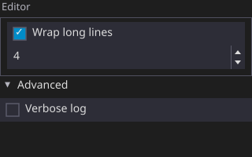
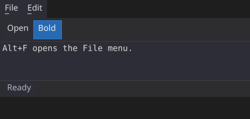

# Groups, sections and bars

Four containers have a look of their own.
A group outlines widgets that belong together. A section folds away.
A toolbar and a status bar run across the window.

```cpp
struct Containers {
    core::Field<ui::Checkbox> wrap{{.checked = true, .label = "Wrap long lines"}};
    core::Field<ui::SpinBox<int>> tab_width{{.value = 4, .min = 1, .max = 8}};
    core::Field<ui::Expander> advanced{{.title = "Advanced", .open = true}};
    core::Field<ui::Checkbox> verbose{{.label = "Verbose log"}};

    void view(app::ViewBuilder& vb) {
        vb.group("Editor", [&] {
            vb.widget(wrap);
            vb.widget(tab_width);
        });
        vb.section(advanced, [&](app::ViewBuilder& inner) { inner.widget(verbose); });
    }
};
```



## Group

`vb.group(title, fn)` draws an outline with `title` on it, around what `fn` places,
in a column.

## Section

`vb.section(expander, build)` shows a header with an arrow and a title.
A click on it, or Space or Enter while it has the focus, opens or folds the section.
What `build` places exists only while the section is open: folded widgets take no focus
and no clicks.

`ui::Expander` is the header's field:

| Member | Type | Default | Meaning |
|---|---|---|---|
| `title` | `std::string` | `""` | the header's text |
| `open` | `bool` | `false` | whether the content shows |

Set `open` from code to open or fold it. Keep the field in the settings to remember it.

## Toolbar and status bar

```cpp
struct MenuShowcase {
    core::Field<ui::Menu> file{{.title = "&File", .items = {
        {.text = "&Open…", .shortcut = {input::keys::o, input::mods::ctrl}},
        {.text = "&Save", .shortcut = {input::keys::s, input::mods::ctrl}},
        {.separator = true},
        {.text = "&Word wrap", .checked = true},
    }}};
    core::Field<ui::Menu> edit{{.title = "&Edit", .items = {{"Undo"}, {"Redo"}}}};
    core::Field<ui::Button> open{{.text = "Open", .primary = false}};
    core::Field<ui::Button> bold{{.text = "Bold", .checked = false}};
    core::Field<ui::TextArea<>> body{{.value = "Alt+F opens the File menu.", .rows = 3}};
    core::Field<ui::Label<>> status{{"Ready"}};

    void view(app::ViewBuilder& vb) {
        vb.hstack([&] { vb.widget(file); vb.widget(edit); vb.spacer(); });
        vb.toolbar([&] { vb.widget(open); vb.widget(bold); vb.spacer(); });
        vb.widget(body);
        vb.status_bar([&] { vb.widget(status); vb.spacer(); });
    }
};
```



| Call | Draws |
|---|---|
| `vb.toolbar(fn)` | a row of tools on the window's chrome color; toggle buttons in it stay pressed |
| `vb.status_bar(fn)` | a row of short status texts, usually last in the window |

Both are rows: end them with a `spacer()` to keep their content left.
A [block](../../concepts/blocks.md) placed in a bar lays out along the bar's row.

## See also

- [Rows, columns and splits](stacks.md).
- [Menu](../popups/menu.md): the menu bar above the toolbar.
