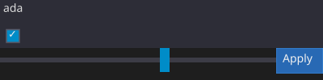
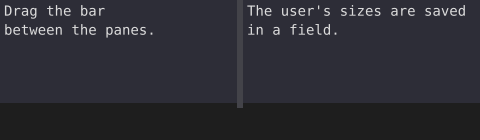

# Rows, columns and splits

`vb.vstack` puts widgets in a column, `vb.hstack` in a row.
A `view()` with no container is a column already.

```cpp
struct Settings {
    core::Field<std::string> username{"ada"};
    core::Field<bool> dark_mode{true};

    void view(app::ViewBuilder& vb) {
        vb.vstack(username, dark_mode);
    }
};

struct Dashboard {
    Settings settings;
    core::Field<ui::Slider<>> brightness{{.value = 0.6, .min = 0.0, .max = 1.0}};
    core::Field<ui::Button> apply{{"Apply"}};

    void view(app::ViewBuilder& vb) {
        vb.vstack([&] {
            vb.block(settings);
            vb.hstack(brightness, apply);
        });
    }
};
```



## The calls

| Call | Does |
|---|---|
| `vb.vstack(a, b, c)` | the fields in a column |
| `vb.hstack(a, b, c)` | the fields in a row |
| `vb.vstack([&] { ... })` | a column of whatever the function places |
| `vb.hstack([&] { ... })` | a row of whatever the function places |
| `vb.spacer()` | an empty space that takes what is left, pushing the rest to the end |
| `vb.gap(points)` | a fixed empty space, `points` long, along the row or column |
| `vb.handle()` | a bar the user drags to resize the parts on either side |
| `vb.remember_split(sizes)` | the split's sizes kept in a field, to save and restore them |
| `vb.block(child)` | a nested struct with its own `view()` |

The list forms take fields, `Derived`s, `Shared`s and blocks, mixed.

## How widgets take space

Each widget has a natural size. Buttons, labels and checkboxes take their text's width.
Text fields, text areas, combo boxes, sliders and progress bars stretch to fill a row.
A text area is as tall as its `rows`.
A `spacer()` stretches too, so a row of buttons followed by a spacer keeps the buttons left:

```cpp
vb.hstack([&] {
    vb.widget(save);
    vb.gap(8);
    vb.widget(cancel);
    vb.spacer();   // the buttons stay left; without it they share the row
});
```

## Splits

A `handle()` between two parts of a row or a column turns it into a split.
The user drags the bar; the parts on either side grow and shrink.
`remember_split` keeps the sizes in a field, so the app can save them with its settings:

```cpp
struct SplitShowcase {
    core::Field<ui::TextArea<>> outline{{.value = "Drag the bar\nbetween the panes.", .rows = 5}};
    core::Field<ui::TextArea<>> body{{.value = "The user's sizes are saved in a field.", .rows = 5}};
    core::Field<ui::SplitSizes> sizes{};

    void view(app::ViewBuilder& vb) {
        vb.hstack([&] {
            vb.remember_split(sizes);
            vb.widget(outline);
            vb.handle();
            vb.widget(body);
        });
    }
};
```



`ui::SplitSizes` holds one `std::vector<float> value`: the parts' sizes along the split.
Leave it empty the first time. Once the user drags, it holds their sizes, and a split
built from it starts where they left it.
Call `remember_split` inside the row or column it belongs to.

## See also

- [Groups, sections and bars](frames.md): containers with a look of their own.
- [Docking](../docking.md): splits the user rearranges, with tabs and floating panels.
