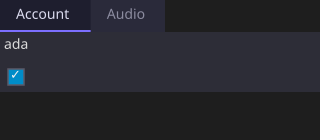
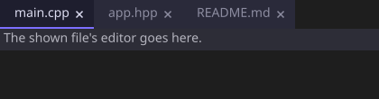

# Tabs and pages

Tabs show one page at a time, with a bar of titles to pick it.
Only the shown page is built: the others cost nothing.

```cpp
struct TabsShowcase {
    core::Field<ui::TextField<>> username{{.value = "ada"}};
    core::Field<bool> dark_mode{true};
    core::Field<ui::Slider<>> volume{{.value = 0.6}};
    core::Field<ui::TabBar<>> tabs;

    void view(app::ViewBuilder& vb) {
        vb.tabs(tabs, [&] {
            vb.tab("Account", [&](app::ViewBuilder& tvb) {
                tvb.vstack(username, dark_mode);
            });
            vb.tab("Audio", [&](app::ViewBuilder& tvb) {
                tvb.widget(volume);
            });
        });
    }
};
```



## `ui::TabBar<>`

| Member | Type | Default | Meaning |
|---|---|---|---|
| `selected` | `std::size_t` | `0` | the shown page |

Set it to switch pages from code: `tabs = {.selected = 1};`.
Keep it in the settings to reopen on the same page.

## The calls

| Call | Does |
|---|---|
| `vb.tabs(bar, fn)` | a tab bar and the shown page; `fn` declares the pages with `vb.tab` |
| `vb.tab(title, build)` | one page: `build(page_vb)` places its widgets |
| `vb.pages(bar, fn)` | the same with no bar: the app picks the page through `bar` |

`pages` suits a detail view that follows a selection, or the steps of a wizard.

## Tabs over a list

When the tabs stand for the items of a list, such as an editor's open files, give `tabs`
the list. There is one tab per item, and the tabs follow the list as it changes.

```cpp
struct OpenFiles {
    core::List<std::string> files;
    core::Field<ui::TabBar<>> shown;
    core::Field<ui::Label<>> page{{"The shown file's editor goes here."}};

    OpenFiles() {
        for (auto f : {"main.cpp", "app.hpp", "README.md"}) files.push_back(f);
    }

    void view(app::ViewBuilder& vb) {
        vb.tabs(shown, files, [](const std::string& f) { return f; },
                [&](app::ViewBuilder& p, const std::string&) { p.widget(page); })
            .closable()
            .reorderable();
    }
};
```



`vb.tabs(bar, list, title, page)` takes `title(item)` for each tab's text and
`page(vb, item)` to build the shown item's page. It returns a handle:

| Method | Does |
|---|---|
| `.closable()` | a close button on each tab; a click on it, or a middle click on the tab, erases the item |
| `.closable(can_close)` | the same, only on the tabs where `can_close(index)` is true |
| `.reorderable()` | a tab dragged along the bar moves its item there (`List::move`), and is shown |

Pushing an item adds a tab, erasing one removes it. The selection stays on the same item.

## Tabs from a struct

With reflection, a `ui::TabBar<S>` makes one tab per member of the struct `S`,
titled with the member's name:

```cpp
struct Pages {
    Account account;
    Audio audio;
};
core::Field<ui::TabBar<Pages>> settings;   // in view(): vb.tabs(settings);
```

## Using it

- A click on a title shows its page.
- Left and Right move to the previous or next tab while the bar has the focus.
- Changing pages notifies the bar's field.

## See also

- [Docking](../docking.md): tab groups the user splits, floats and closes.
