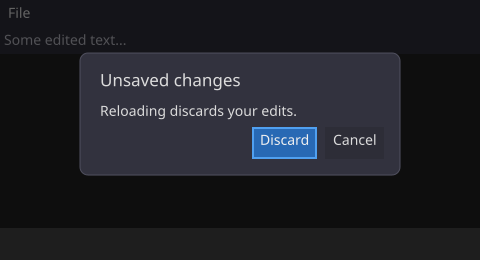

# Dialog

A dialog asks a question and waits for an answer. It is modal: the window behind it is
dimmed and takes no input until it closes.

```cpp
struct DialogShowcase {
    core::Field<ui::Menu> file{{.title = "File", .items = {{"Save"}, {"Reload"}}}};
    core::Field<ui::Label<>> text{{"Some edited text..."}};
    core::Field<ui::Dialog> ask{{.title = "Unsaved changes",
                                     .message = "Reloading discards your edits.",
                                     .buttons = {"Discard", "Cancel"},
                                     .open = true}};

    void view(app::ViewBuilder& vb) {
        vb.vstack([&] {
            vb.widget(file);
            vb.widget(text);
            vb.dialog(ask);
        });
    }
};
```



## Asking and hearing the answer

`show(dialog)` opens it, with no answer yet. The answer comes back through the field:
it closes with `chosen` set to the button's index, or with no choice on Escape.

```cpp
struct Editor {
    core::Field<ui::Button> reload{{"Reload"}};
    core::Field<ui::Dialog> ask{{.title = "Unsaved changes",
                                 .message = "Reloading discards your edits.",
                                 .buttons = {"Discard", "Cancel"}}};
    core::Wiring wire;

    Editor() {
        wire.on(reload, [this](const auto&) { show(ask); });
        wire.on(ask, [this](const ui::Dialog& d) {
            if (!d.open && d.chosen == 0) discard();
        });
    }
    void discard() {}

    void view(app::ViewBuilder& vb) {
        vb.widget(reload);
        vb.dialog(ask);
    }
};
```

## `ui::Dialog`

| Member | Type | Default | Meaning |
|---|---|---|---|
| `title` | `std::string` | `""` | the title |
| `message` | `std::string` | `""` | the text under it; it wraps, scrolls and can be copied |
| `buttons` | `std::vector<std::string>` | none | the buttons, first one first |
| `open` | `bool` | `false` | whether it shows; `show(d)` sets it |
| `chosen` | `std::optional<std::size_t>` | none | the button that closed it; none on Escape |
| `activations` | `std::uint64_t` | `0` | counts the closings |

## A dialog with a form

`vb.dialog(dialog, build)` places widgets between the message and the buttons:

```cpp
core::Field<ui::Dialog> rename{{.title = "Rename", .buttons = {"Rename", "Cancel"}}};
core::Field<ui::TextField<>> new_name{{.value = "report.txt"}};
core::Field<ui::Checkbox> backup{{.checked = true, .label = "Keep a backup"}};

// in view():
vb.dialog(rename, [&](app::ViewBuilder& d) {
    d.widget(new_name).focus_on_open();
    d.widget(backup);
});
```

The widgets are built when the dialog opens and dropped when it closes.
Read their fields when the answer comes.

## Using it

- Enter presses the first button, which has the focus when the dialog opens,
  unless a widget asks for it with `.focus_on_open()`.
- Tab moves between the dialog's widgets and stays inside it.
- Escape closes it with no choice.
- When it closes, the focus goes back to where it was.

A dialog takes no space in the layout. Declare it anywhere in `view()`.

## See also

- [Popover](popup.md): a non-modal popup.
- [File dialogs and message boxes](file-dialogs.md): the platform's own.
