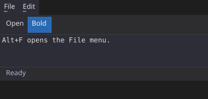

# Menu

A menu field is a title that opens a list of items. Menus placed side by side form a menu bar.

```cpp
struct MenuShowcase {
    core::Field<ui::Menu> file{{.title = "&File", .items = {
        {.text = "&Open…", .shortcut = {input::keys::o, input::mods::ctrl}},
        {.text = "&Save", .shortcut = {input::keys::s, input::mods::ctrl}},
        {.separator = true},
        {.text = "&Word wrap", .checked = true},
    }}};
    core::Field<ui::Menu> edit{{.title = "&Edit", .items = {{"Undo"}, {"Redo"}}}};
    core::Field<ui::Button> open{{.text = "Open", .primary = false}};
    core::Field<ui::Button> bold{{.text = "Bold", .checked = false}};
    core::Field<ui::TextArea<>> body{{.value = "Alt+F opens the File menu.", .rows = 3}};
    core::Field<ui::Label<>> status{{"Ready"}};

    void view(app::ViewBuilder& vb) {
        vb.hstack([&] { vb.widget(file); vb.widget(edit); vb.spacer(); });
        vb.toolbar([&] { vb.widget(open); vb.widget(bold); vb.spacer(); });
        vb.widget(body);
        vb.status_bar([&] { vb.widget(status); vb.spacer(); });
    }
};
```



## Reacting to a choice

`ui::on_choice(menu, fn)` calls `fn` each time the user chooses an item: by a click, the keys
or a shortcut. It does not fire when your code changes the menu, such as greying out an item.

```cpp
struct Notes {
    core::Field<ui::Menu> file{{.title = "&File", .items = {{"&Open…"}, {"&Save"}}}};
    core::Connection on_file = ui::on_choice(file, [this](std::size_t i) {
        if (i == 0) open();
        else save();
    });
    void open() {}
    void save() {}
};
```

`fn` takes the item's index among the top-level items.
To hear items inside submenus too, take the path instead: `[](const std::vector<std::size_t>& path)`,
where `{1, 0}` is the first item of the second item's submenu.
Keep the returned `core::Connection`: the listening ends with it.

## `ui::Menu`

| Member | Type | Default | Meaning |
|---|---|---|---|
| `title` | `std::string` | `""` | the title in the bar; `&` marks its Alt key |
| `items` | `std::vector<ui::MenuItem>` | none | the items |
| `chosen` | `std::optional<std::size_t>` | none | the last top-level item chosen |
| `chosen_path` | `std::vector<std::size_t>` | none | the path to the last item chosen, through submenus |
| `activations` | `std::uint64_t` | `0` | counts the choices, so choosing the same item again still notifies |

## `ui::MenuItem`

An item is plain data. To change it, grey it out or tick it, set the menu field again.

| Member | Type | Default | Meaning |
|---|---|---|---|
| `text` | `std::string` | `""` | the label; `&` marks the letter that chooses it in the open menu |
| `shortcut` | `ui::Shortcut` | none | chooses it from anywhere in the window, the menu closed; shown on the right |
| `icon` | `std::shared_ptr<const render::Image>` | none | drawn left of the text |
| `enabled` | `bool` | `true` | `false`: greyed, cannot be chosen |
| `checked` | `std::optional<bool>` | none | set: a check item; choosing it flips the mark |
| `separator` | `bool` | `false` | a line between groups; the other members are ignored |
| `items` | `std::vector<ui::MenuItem>` | none | a submenu, opening beside the item |

`ui::menu_text("&File")` gives the label without the `&`: `"File"`.

```cpp
file.update([](ui::Menu& m) { m.items[1].enabled = false; });   // grey out Save
```

## Using it

- A click on the title opens the menu. With one menu open, moving to the next title opens it.
- Alt and the title's marked letter opens it: Alt+F for `"&File"`.
- In an open menu: Up and Down move, Right opens a submenu, Left closes it or moves to the
  previous menu; Enter or Space chooses; a marked letter chooses its item; Escape closes.
- A shortcut chooses its item while the window has the focus. A focused text field keeps
  its own keys: Ctrl+C there copies, even when a menu item has Ctrl+C.
- Choosing a check item flips its mark, and the field notifies.

## See also

- [Context menu](context-menu.md): the same items, on right-click.
- [Button](../controls/button.md): shortcuts on buttons.
- [Groups, sections and bars](../layout/frames.md): the toolbar.
