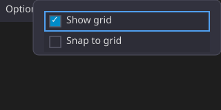

# Popover

A popover is a popup holding widgets, opened by the app: options by a button, a small form,
a list. A click outside closes it.

```cpp
struct Popover {
    core::Field<ui::Button> options{{.text = "Options", .primary = false}};
    core::Field<ui::Popup> panel{{.open = true, .modal = false}};
    core::Field<ui::Checkbox> grid{{.checked = true, .label = "Show grid"}};
    core::Field<ui::Checkbox> snap{{.label = "Snap to grid"}};

    void view(app::ViewBuilder& vb) {
        vb.hstack([&] {
            vb.widget(options);
            vb.popup(panel, [&](app::ViewBuilder& p) { p.vstack(grid, snap); });
            vb.spacer();
        });
        vb.spacer();
    }
};
```



The screenshot shows it open. An app starts it closed and opens it on the button's click:

```cpp
wire.on(options, [this](const auto&) { show(panel); });
```

## `ui::Popup`

| Member | Type | Default | Meaning |
|---|---|---|---|
| `open` | `bool` | `false` | whether it shows; `show(p)` opens it |
| `modal` | `bool` | `true` | `true`: centred over a dimmed window; `false`: a popover where it is declared |

## The call

`vb.popup(popup, build)` declares it. A non-modal popup opens where it is declared,
so put it next to the widget that opens it.
`build` runs each time it opens: the widgets are built then, and dropped when it closes.

## Using it

- The focus moves into it when it opens; Tab stays inside.
- Escape closes it, and so does a click outside a non-modal one.
- When it closes, the focus goes back where it was.

## See also

- [Dialog](dialog.md): a question with buttons.
