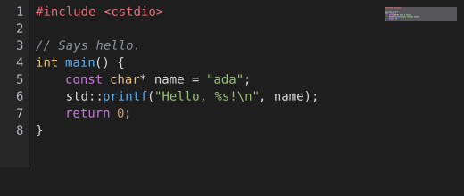

# Text and code

PRISM has two kinds of text widgets.

- **Form text** holds its text in a field: a [text field](controls/text-field.md) for one line,
  a [text area](controls/text-area.md) for a few. Right for a name, a message, a setting.
- **Documents** hold their text in a `text::Document`: a file, a log, a note, a page of code.
  Their views lay out only what is on screen, so a 100,000-line file types and scrolls
  as fast as a ten-line one.

This section covers documents.

```cpp
struct CodeShowcase {
    text::Document source{R"(#include <cstdio>

// Says hello.
int main() {
    const char* name = "ada";
    std::printf("Hello, %s!\n", name);
    return 0;
})"};

    void view(app::ViewBuilder& vb) { vb.code_editor(source, "cpp"); }
};
```



| Page | Covers |
|---|---|
| [The document](text/document.md) | `text::Document`: blocks, positions, edits, undo, watching changes |
| [Views and editors](text/views-and-editors.md) | `text_view`, `text_editor`, `code_view`, `code_editor`; their options and keys |
| [Code and syntax colors](text/code.md) | the built-in languages, and plugging in your own highlighter |
| [Find and replace](text/find.md) | `find_all`, `replace_all`, highlighting what was found |
| [Completion](text/completion.md) | a list of suggestions under the caret |
| [Markdown and rich text](documents.md) | headings, lists and bold text; reading and writing Markdown |

Try them in the [gallery's Code tab](https://jeandet.github.io/PRISM/widget_gallery.html):
it opens a 100,000-line file on request.

```{toctree}
:maxdepth: 1
:hidden:

text/document
text/views-and-editors
text/code
text/find
text/completion
```
