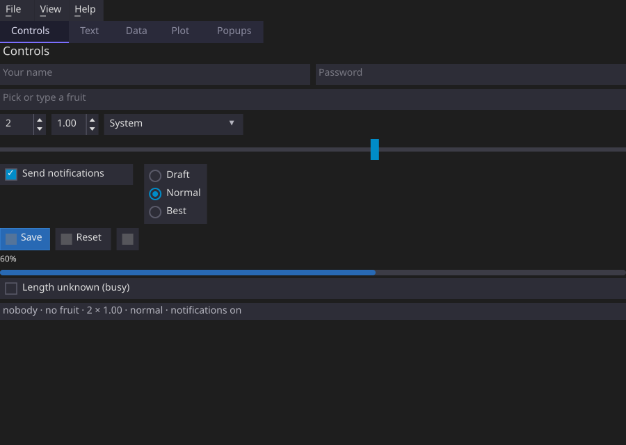
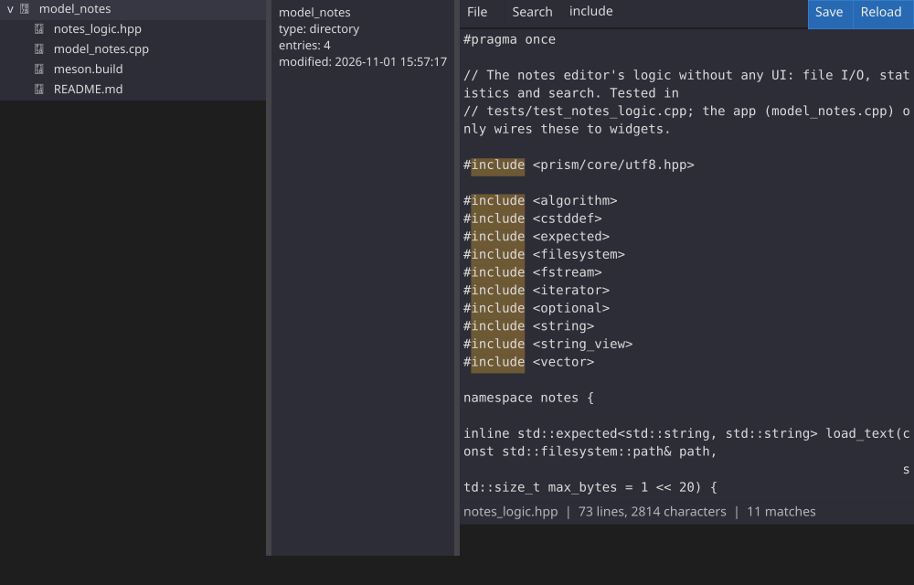
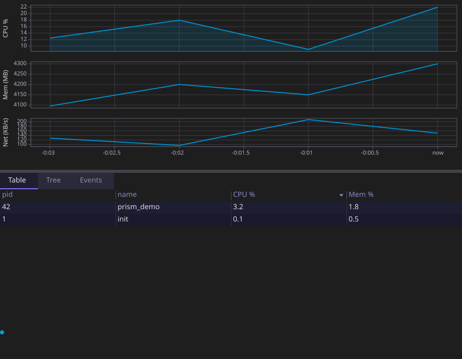
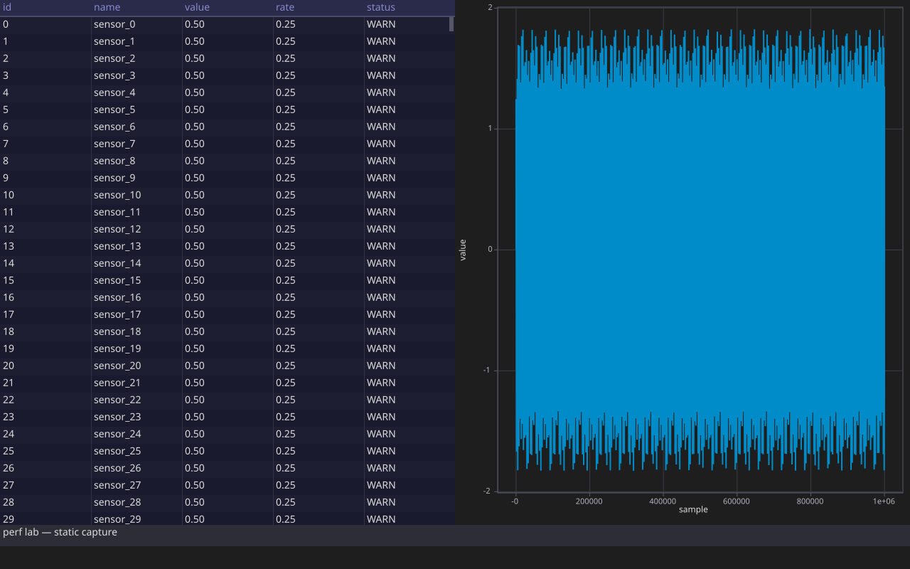

# Examples

Four complete apps, each with its own README. All of them also run in the browser, compiled to
WebAssembly: see the [live demos](https://jeandet.github.io/PRISM/).

<table>
<tr>
<th>Example</th>
<th>Screenshot</th>
<th>Demonstrates</th>
</tr>
<tr>
<td><a href="widget_gallery/">widget_gallery</a></td>
<td></td>
<td>Every widget, in five tabs: controls with tooltips, text in several scripts (right to left
too), a table, tree and list, a plot and a canvas, menus, dialogs (one holding a form), a popover,
file dialogs, drag and drop. Start here.</td>
</tr>
<tr>
<td><a href="model_notes/">model_notes</a></td>
<td></td>
<td>A text editor: file tree, <code>TextArea</code> with selection, clipboard, undo and input
methods, search highlights, menus with Alt shortcuts, a rename dialog, file dialogs, drop to open</td>
</tr>
<tr>
<td><a href="model_system_monitor/">model_system_monitor</a></td>
<td></td>
<td>Background threads feeding the UI through <code>Shared&lt;T&gt;</code> and <code>Channel&lt;T&gt;</code>:
live plots, a sortable process table and tree, an event log. Linux <code>/proc</code>, or a simulated
machine elsewhere</td>
</tr>
<tr>
<td><a href="perf_lab/">perf_lab</a></td>
<td></td>
<td>100k-row table, 1M-point plot and 1 kHz telemetry, a live FPS/build-stats bar, and a
<code>--headless N</code> report</td>
</tr>
</table>

`showcase/` is a separate, internal set of minimal snippets used only to auto-generate the
small feature screenshots embedded in the top-level README — not meant to be read as usage
examples on their own.

Python counterparts live in [`../python/examples/`](../python/examples/README.md) — same ideas via `prism.Model` (`01_counter`, `02_mixer`, `03_validation_and_transaction`, `04_background_shared_channel`, `05_lists_and_derived`). Run with `PYTHONPATH=builddir/python python python/examples/01_counter.py`.

## Running

Every example is built with the library:

```bash
meson setup builddir
ninja -C builddir
./builddir/examples/widget_gallery/widget_gallery
```

Each also writes a one-frame SVG capture when given an output path, which is how the screenshots
above are made (`scripts/update_screenshots.sh` refreshes them all):

```bash
./builddir/examples/widget_gallery/widget_gallery capture.svg 2   # the gallery's third tab
```

Meson's `custom_target` doesn't track header dependencies, so if you change a header without
touching the `.cpp` that includes it, delete the stale `.svg` under `builddir/` before rebuilding
or ninja won't notice it needs regenerating.

For the browser build, see [In the browser](../README.md#in-the-browser) in the top-level README;
`scripts/build_web_site.sh` assembles the demo page.
