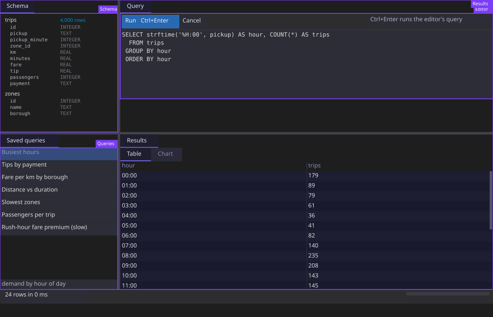
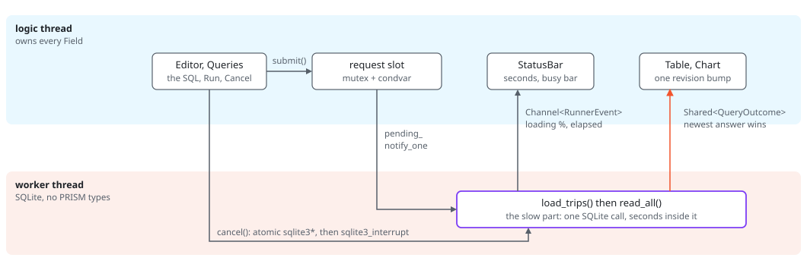

# Data Studio

A small SQL tool. It builds a year of 500,000 generated taxi trips into an in-memory SQLite
database, and puts a schema panel, seven saved queries, an editor, a result table and a chart around
it. The slow query takes seconds, and the window keeps scrolling, editing and drawing while it runs.

<p align="center"></p>

It shows three things:

- **Blocks.** Each panel is a small struct with its own fields and view. The app only puts them
  together.
- **A slow job on a second thread.** Progress comes back through a `Channel`, the answer through a
  `Shared`, and cancel interrupts SQLite from the logic thread without waiting for it.
- **A table over a plain struct.** `ResultSet` is columns and cells; the table reads it through
  `ColumnStorage` and repaints when a revision field moves.

The same window with each block outlined and named: every panel is one small struct, placed with
`vb.block()`.

<p align="center"></p>

## Running the example

- **In the browser:** open the [live demo](https://jeandet.github.io/PRISM/model_data_studio.html).
  It builds the same year, so wait for the status line to say the trips are ready.
- **On the desktop:** `ninja -C builddir examples/model_data_studio/model_data_studio`, then run
  `builddir/examples/model_data_studio/model_data_studio`. SQLite is fetched by the build if the
  system has none.
- **The screenshot:** pass a path — `model_data_studio out.svg` — and it runs one query with no
  thread, no window and no worker, then writes that file.

## How it fits together

<p align="center"></p>

Two threads, and only one of them touches the model:

1. Pressing **Run** changes the editor's `run` field. The app bumps a generation number and puts the
   SQL in the runner's request slot: a `std::optional<Request>` behind a mutex, where the newest
   request replaces whatever was waiting.
2. The **worker thread** takes the request out of the slot and steps the statement against its
   in-memory database. It is the only thread that ever talks to SQLite.
3. While it steps, SQLite calls a progress handler every 2,000 VM instructions. At most every 50 ms
   that handler sends a `RunnerEvent` on a `Channel`. `ctx.receive()` hands each one to the logic
   thread and the status bar counts the seconds.
4. When the statement ends, the worker stores a whole `QueryOutcome` in a `Shared`. The newest one
   wins, and the app also drops any answer whose generation number is not the current one.
5. **Cancel** does not wait for the worker. The logic thread calls `sqlite3_interrupt` on the handle
   the worker published through an atomic, and the progress handler also stops on a flag.
6. A new result replaces the `ResultSet` and bumps a revision field. The table repaints from it, the
   chart re-plans its columns, and the status line says how long the query took.

## Walkthrough

Read the files in this order. The PRISM part is `model_data_studio.cpp`, `settings.hpp` and
`blocks/`, 535 lines. `query_runner.hpp` (199 lines) is the thread glue, and the only file here that
knows both a thread and a PRISM type. `sql/` is plain C++ with no PRISM in it.

### A block: the results panel

`blocks/results.hpp` is the panel with the most in it, and it is still only a struct. A result comes
in as a value, and one field is what the widgets watch:

```cpp
void show(ResultSet result) {
    source.set = std::move(result);
    source.revision.set(source.revision.get() + 1);
    update_chart();
}

void view(app::WidgetTree::ViewBuilder& vb) {
    vb.tabs(tabs, [&] {
        vb.tab("Table", [&](app::WidgetTree::ViewBuilder& page) {
            page.table(source.set).depends_on(source.revision);
        });
        vb.tab("Chart", [&](app::WidgetTree::ViewBuilder& page) {
            page.canvas(chart)
                .depends_on(chart.x_range, chart.y_range, chart.view, chart.cursor, chart.revision);
        });
    });
}
```

`source.set` is not a `Field`: the table reads it as a `ColumnStorage`, and asks it for
`column_count()` every time it lays out, so a result with different columns brings its own headers.
The revision field is the only notification. Nothing is rebuilt, and the chart is a canvas with a
model of its own.

### The worker thread

`QueryRunner` builds the database in its constructor, on a thread it owns, and reports every slice of
the insert through the same channel it later reports progress on:

```cpp
explicit QueryRunner(std::vector<Trip> trips) : trips_(std::move(trips)) {
    thread_ = std::jthread([this](std::stop_token stop) { run(stop); });
}
```

The worker only ever sends and sets. The app drains nothing by hand: `ctx.receive()` binds each
pipe's waker, observes it, and drains it on the logic thread whenever the worker wakes it, which is
the whole hand-over.

### Three kinds of news, two pipes

The app connects them in `start_runner()`, all on the logic thread. Each pipe carries something
different, and the difference is why it is not one pipe:

```cpp
void start_runner(app::AppContext& ctx) {
    runner = std::make_unique<QueryRunner>(make_trips(kFullDatasetRows));
    ctx.receive(runner->events(), [this](const RunnerEvent& event) { on_runner_event(event); });
    ctx.receive(runner->results(), [this](const QueryOutcome& outcome) { on_outcome(outcome); });
}
```

Progress is a `core::Channel<RunnerEvent>`: every event matters and they arrive in order, so the
status line can show a loading percentage that only goes up. The answer is a
`core::Shared<QueryOutcome>`: a half-finished result is worth nothing, so only the newest one is
kept and the ones in between are dropped. Cancel is neither — it is an atomic `sqlite3*` and a
relaxed flag, because `sqlite3_interrupt` is the only thing that can stop a statement already
stepping.

### The progress handler is where a query dies

`on_progress` runs inside `sqlite3_step`, so everything it decides takes effect in the middle of the
statement:

```cpp
bool on_progress() {
    if (!in_query_) return true;
    if (stop_.stop_requested() || cancel_requested_.load(std::memory_order_relaxed)) return false;
    if (superseded()) return false;
    auto stamp = now();
    if (stamp - last_publish_ < kProgressPublish) return true;
    last_publish_ = stamp;
    auto elapsed = std::chrono::duration<double>(stamp - query_started_).count();
    events_.send(RunnerEvent{.kind = RunnerEvent::Kind::Running, .elapsed = elapsed});
    return true;
}
```

Returning false aborts the statement, which the engine reports as interrupted rather than as an
error. `superseded()` tries the request mutex without blocking: if a newer query is already waiting,
this one gives way so the newer one can start. `settle()` then decides what an interruption means —
cancelled by the user, replaced by a newer request and dropped silently, or something else and
reported as cancelled.

### What the app does with an answer

Four things can come back: rows, an error, a cancellation, or an answer to a query that has been
replaced since. The app is the only place that decides, and it decides in one function:

```cpp
void on_outcome(const QueryOutcome& outcome) {
    if (outcome.generation != generation_) return;   // an answer to a query already replaced
    if (!outcome.error.empty()) return show_error(outcome);
    if (outcome.cancelled) return status.set(StatusKind::Cancelled, cancelled_status(outcome.elapsed_s));
    show_result(outcome);
}
```

An error leaves the last good result on screen and only moves the status line and the editor's mark.
The mark comes from `error_mark()` in `sql/errors.hpp`, which finds the token SQLite named — `near
"FROMM"`, `no such column: kmm` — and returns its byte range, which the text area draws as a
highlight. Typing in the editor clears it, and opening a saved query clears it too.

### The chart picks its own columns

Nothing in the query says which column is the x axis, so `chart_plan()` decides from the result:
take the first column that is mostly numbers as the value to plot, and if a text column comes before
it, that column becomes the tick labels.

```cpp
for (std::size_t col = 0; col < first_numeric; ++col) {
    if (distinct_texts(set, col) >= 2)
        return ChartPlan{.plottable = true, .numeric_x = false, .x_column = col, .y_column = first_numeric};
}
for (std::size_t col = first_numeric + 1; col < set.column_count(); ++col) {
    if (mostly_numeric(set, col))
        return ChartPlan{.plottable = true, .numeric_x = true, .x_column = first_numeric, .y_column = col};
}
```

"Busiest hours" plots as a filled line over twenty-four hour labels; "Distance vs duration" plots as
a plain line, because both columns are numbers. A tick that lands between two rows gets no label:
rounding it to the nearest row's name would print "Manhattan, Manhattan, Brooklyn, Brooklyn".

### main()

```cpp
int main(int argc, char* argv[]) {
    DataStudioApp app;
    if (argc >= 2) {
        app.seed_demo_data();
        return showcase(argc, argv, app, 1180, 760);
    }

    app::run(app, {.title = "PRISM Data Studio", .width = 1180, .height = 760,
                   .settings = &app.settings, .organization = "prism", .name = "data-studio"},
             [&app](app::AppContext& ctx) {
                       // The busy progress bar asks for a frame every 33 ms through node.redraw_at;
                       // a running clock is what turns those requests into frames.
                       ctx.clock().add([](auto) { return true; });
                       app.start_runner(ctx);
                   });
    return 0;
}
```

`app::run` opens the window, loads `settings` and saves it on every change. The lambda is the one
place the threads are started, after the model exists and before the first frame.

## Try this

1. Click **Rush-hour fare premium (slow)** in the saved queries, then press **Run** (or Ctrl+Enter).
   The status bar starts counting seconds, with a busy bar beside the text.
2. Keep using the window while it runs: scroll the table from the previous result, switch to the
   **Chart** tab, change a number in the SQL. Nothing stalls.
3. Press **Cancel**. The statement dies at its next few thousand instructions, and the status line
   says how long it lasted.
4. Break the SQL — change `FROM trips` to `FROMM trips` — and press Run. SQLite's message appears in
   the status bar and the editor underlines the word it choked on.

## Files

| File | What it is |
|---|---|
| `model_data_studio.cpp` | The app: composes the panels, starts the worker, decides what an answer means, `main()`. |
| `settings.hpp` | What is saved between runs: the dock layout and window size. |
| `blocks/schema.hpp` | The two tables and their columns, drawn as a canvas. |
| `blocks/queries.hpp` | The seven saved queries, the selection, and the note under the list. |
| `blocks/editor.hpp` | The SQL text area, Run and Cancel, and the error mark that typing clears. |
| `blocks/results.hpp` | The table and chart tabs, and what a new result does to them. |
| `blocks/status_bar.hpp` | The one line of words and its progress bar. |
| `query_runner.hpp` | The worker thread: the request slot, the progress channel, the shared answer, cancel. |
| `sql/` | No PRISM: the generated trips, cell formatting, the chart's column rule, the error locator, the SQLite engine. |
| `diagrams/query_threads.svg` | The picture above. |

`tests/test_data_studio.cpp` pins the dataset's ranges, the cell formatting, `chart_plan()` and
`error_mark()` down, and then drives the runner itself — the answer, the error, cancel, the
truncation — with no window. The Python counterpart is `python/examples/18_data_studio.py`.
