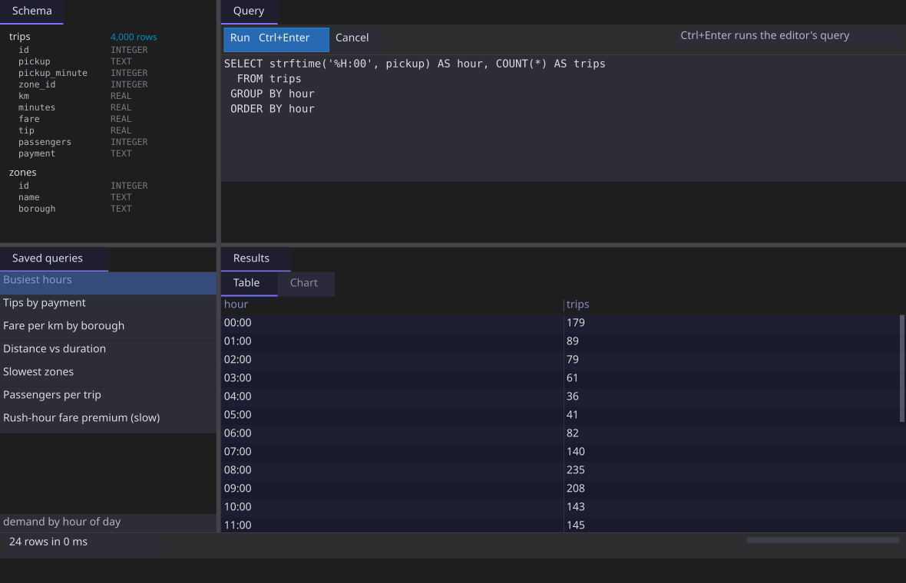

# model_data_studio Example

A small SQL tool over a generated year of 500,000 taxi trips: a schema panel, seven saved
queries, an editor, a result table and a chart. The point is the slow query: while SQLite chews
on millions of rows in its own thread, the window still scrolls, edits, changes tabs, and can
take the query back.

## Try this

1. Click **Rush-hour fare premium (slow)** in the saved queries, then press **Run** (or
   Ctrl+Enter). The status bar starts counting seconds, with a busy bar beside the text.
2. Keep using the window while it runs: scroll the table from the previous result, switch to the
   **Chart** tab, change a number in the SQL. Nothing stalls.
3. Press **Cancel**. The query stops within a hundred milliseconds, and the status line says how
   long it lasted.
4. Now break the SQL — change `FROM trips` to `FROMM trips` — and press Run. SQLite's message
   appears in the status bar and the editor underlines the word it choked on.

## How it is built

- **The dataset is pure code.** `studio_model.hpp` generates the trips from a seeded RNG: pickup
  times weighted by hour of day, zones weighted toward Manhattan, distances and fares from the
  pickup. Same seed, same year, on every machine. `tests/test_data_studio.cpp` pins the ranges
  down.
- **Loading is a worker job with visible progress.** `QueryRunner` builds the in-memory database
  on its own thread and reports every slice through a `Channel<RunnerEvent>`; the model's
  `drain()` collects them and the status bar shows a percentage. The UI is usable from the first
  frame, when the table is still empty.
- **One slot for requests, latest wins.** `request()` puts the SQL in a mutex-guarded slot and
  wakes the worker. That mutex is honest: a request happens when a person presses a button, not
  a thousand times a second, and the worker holds it for a few microseconds.
- **Cancel is `sqlite3_interrupt`.** The worker publishes its `sqlite3*` handle through an atomic
  so the logic thread can interrupt it in the middle of a step. A progress handler checks that
  and the stop token every couple of thousand VM instructions, so the query dies where it is.
- **Results come back in a `Shared<QueryOutcome>`.** The newest answer is the only one worth
  having; a result computed for a query that has since been replaced is dropped by generation
  number, on the logic thread.
- **The table is a `ColumnStorage`.** `ResultSet` is just column names and typed cells, with
  `cell_text()` doing the formatting (thousands separators, two decimals when they fit). The
  model owns it; a revision `Field` is what the table's `depends_on` watches, so a new result
  repaints without rebuilding a tree.
- **The chart picks its own columns.** `chart_plan()` takes the first column that is mostly
  numbers as the value to plot. A text column before it becomes the tick labels, and a tick that
  lands between two rows instead of on one is left unlabelled — otherwise the plot's own tick
  positions round to the same name twice. With no text column, a second numeric column becomes
  the x axis; with neither, there is nothing to plot and the chart stays empty. "Busiest hours"
  plots as a filled line over twenty-four hour labels; "Distance vs duration" plots as a plain
  line.
- **Errors point at their cause.** `error_mark()` finds the token SQLite names ("near FROMM",
  "no such column: kmm") and returns its byte range; the editor's `TextArea` draws it as a
  highlight. Typing clears it.
- **A table re-reads its shape.** A result's columns change with every query, and the table asks
  its source for `column_count()` every time it needs one — layout, the column list, a sort — so
  a new `ResultSet` swapped into the model is all it takes; the same field that repaints the rows
  also brings the new headers.

The Python counterpart is `python/examples/18_data_studio.py`.
