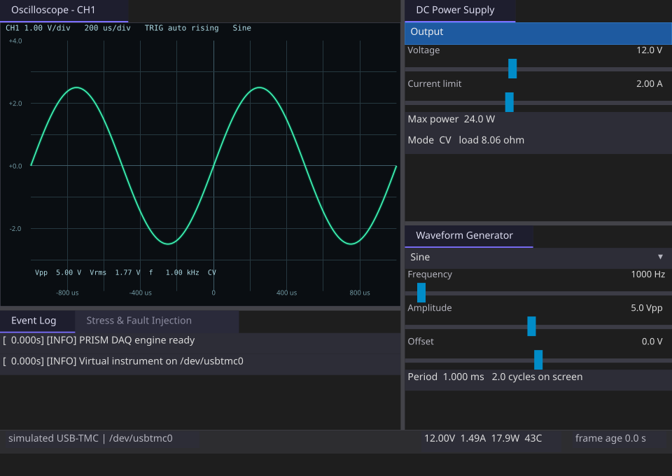

# model_lab_bench Example

A bench instrument: an oscilloscope, a DC power supply and a function generator, driven by a
simulated USB instrument on its own thread. Its two stall buttons are the point of the example: one
blocks the hardware thread, the other the thread that owns the model.

The PRISM part is `model_lab_bench.cpp` plus `blocks/` — 617 lines: the five docked panels, the one
settings value that reaches the hardware thread, and the status bar. Everything below `daq/` is
plain C++ with no PRISM in it: waveforms, the supply's load line, the scope's autoscale and
measurements. `hardware_thread.hpp` (51 lines) is the thread glue between the two.

<p align="center"></p>

## Blocks

Each panel is a struct with its fields, its `view()` and its reactions. The app composes them with
`vb.block(...)` and never mentions a control of its own. This is the whole scope panel:

```cpp
struct Scope {
    explicit Scope(core::Field<DaqTelemetry>& shot) : frame{shot} {}

    core::Field<DaqTelemetry>& frame;   // the app's: it owns the frame, this panel reads it
    std::vector<core::Point> trace{};   // scratch space for one draw

    void view(app::WidgetTree::ViewBuilder& vb) { vb.canvas(*this).depends_on(frame); }

    void canvas(render::DrawList& dl, core::Rect bounds, const ui::WidgetNode& node) {
        scope_canvas::draw(dl, bounds, node, frame.get(), trace);
    }
};
```

The drawing is next to it in `blocks/scope_canvas.hpp`: free functions over a `DrawList` that take a
frame and produce the graticule, the trace, the readouts and the protection banner. The block is
placement; the canvas is pixels.

## Try this

1. Open **Stress & Fault Injection** and press **Stall the hardware thread**.
2. Drag the voltage slider during the two seconds. It moves, its value and the "Max power" line
   follow, and the status bar's frame age climbs to 2 s.
3. Press **Stall the logic thread**. Now the window stops answering: a click waits until the stall
   ends. That is every GUI toolkit whose widgets and model share one thread.

In PRISM a slow device, a slow file or a slow network call blocks only the thread that waits for it.
The window keeps drawing and stays interactive, and shows the last frame it got.

## How it is built

- **Controls are fields.** Each slider is a `Field<ui::Slider<double>>` with a `label` and a `unit`,
  so it prints its own value. The waveform is a `Field<WaveformType>`, an enum: its dropdown comes
  free. `blocks/power_supply.hpp` and `blocks/wave_generator.hpp` own theirs and expose the one
  method the app needs: `apply_to(DaqSettings&)`.
- **Readouts are `Derived`.** "Max power", the period and the supply's CC/CV mode are computed from
  the controls and the last frame, and recompute when those change. They live in the block that
  owns the controls they read, not in the app.
- **One value crosses to the hardware thread.** A `Derived<DaqSettings>` gathers every setpoint on
  the logic thread; its observer hands it to a `Shared<DaqSettings>` the worker reads. The worker
  never touches a `Field`.
- **Frames come back coalesced, events in order.** Frames travel in a `Shared<DaqTelemetry>`: only
  the newest one matters. State changes the instrument sees (protection tripped, constant-current
  mode) travel in a `Channel<DaqEvent>`: none is dropped. One `ctx.receive()` each hands them to
  the model on the logic thread.
- **A stall is a request, not a value.** The button sets an `atomic<bool>`; the worker takes it with
  one `exchange(false)`, so a second press during a stall cannot queue a third.
- **The scope is a canvas.** `blocks/scope_canvas.hpp` draws the frame with a 1-2-5 autoscale and
  prints the scale it drew. `depends_on(frame)` repaints it when a frame arrives, and only then.
- **The instrument is pure.** `daq/model.hpp` is its data (settings, telemetry, events);
  `daq/instrument.hpp` is its behaviour (waveforms, the supply's load line, autoscale,
  measurements). No threads, no IO, no PRISM — `tests/test_lab_bench.cpp` tests both directly.
- **`hardware_thread.hpp` is the glue.** How often to poll, how long a stall lasts, what the worker
  reports back. It is the only file that knows both a thread and a `Channel`, and it is 51 lines.

The Python counterpart is `python/examples/16_lab_instrument.py`.
