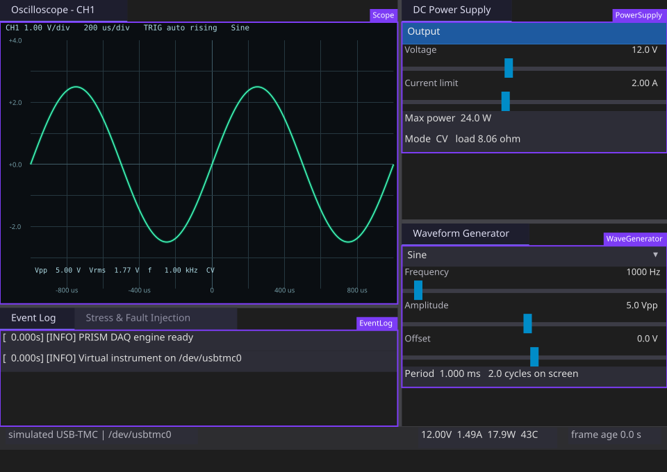
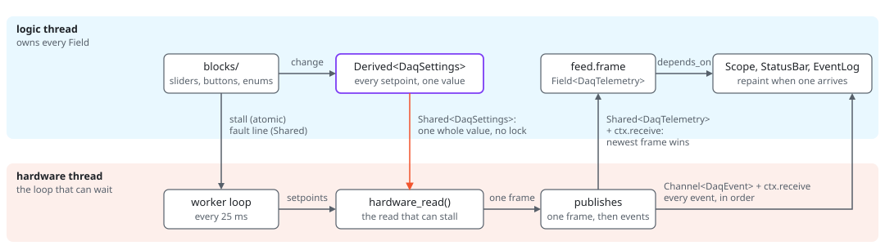

# Lab Bench

A bench instrument: an oscilloscope, a DC power supply and a function generator, driven by a
simulated USB instrument on its own thread. Its two stall buttons are the point: one blocks the
hardware thread, the other blocks the thread that owns the model.

<p align="center"></p>

It shows three things:

- **Blocks.** Each panel is a small struct with its own fields, its view and its reactions. The app
  only puts them together.
- **A worker thread next to the UI.** One settings value goes to the hardware thread. Frames and
  events come back, each through the primitive that matches what it carries.
- **Custom drawing.** The scope is one canvas: graticule, rulers, trace, readouts, fault banner.

The same window with each block outlined and named: every panel is one small struct, placed with
`vb.block()`.

<p align="center"></p>

## Running the example

- **In the browser:** open the [live demo](https://jeandet.github.io/PRISM/model_lab_bench.html).
  The instrument it talks to is simulated, so nothing has to be plugged in.
- **On the desktop:** `ninja -C builddir examples/model_lab_bench/model_lab_bench`, then run
  `builddir/examples/model_lab_bench/model_lab_bench`.
- **To save one frame:** pass a path —
  `builddir/examples/model_lab_bench/model_lab_bench bench.svg`. That run seeds a single frame and
  stops: no window and no threads.
- **Over a real link (desktop):** the same instrument can sit behind a TCP port and speak SCPI,
  the text protocol bench instruments use. In one terminal run
  `model_lab_bench --serve-instrument 5025`, in another `model_lab_bench --instrument
  127.0.0.1:5025`. The window is the same; its frames now come over the wire, and the event log
  says when the link connects or drops. Any SCPI client can talk to the server too: send
  `*IDN?`, `VOLT 5`, `MEAS?` or `WAV?`, one per line.

## How it fits together

<p align="center"></p>

Two threads, and only one of them touches the model:

1. The **logic thread** owns every field. Moving a slider changes a field in a panel. One
   `Derived<DaqSettings>` gathers every setpoint into one value.
2. That value goes to the **hardware thread** through a `Shared<DaqSettings>`: publishing is a
   store, and the worker always reads a whole value. The stall request crosses as an
   `atomic<bool>`, the fault line as a second `Shared`.
3. The worker polls every 25 ms. It publishes each frame into a `Shared<DaqTelemetry>`, because
   only the newest frame matters, and sends the state changes it saw into a `Channel<DaqEvent>`,
   because none of those may be dropped.
4. `ctx.receive` hands both to the logic thread: the frame into `feed.frame`, the events into the
   log. The scope and the status bar depend on `feed.frame`, so they repaint when a frame arrives.

## Walkthrough

Read the files in this order. The PRISM part is `model_lab_bench.cpp`, `settings.hpp` and
`blocks/`, 626 lines: the five docked panels, the one settings value that reaches the hardware
thread, and the status bar. `hardware_thread.hpp` (51 lines) is the thread glue. `daq/` (186
lines) is plain C++ with no PRISM in it: waveforms, the supply's load line, the scope's autoscale
and measurements.

### A panel is a block

`blocks/scope.hpp` is 27 lines, and it is the whole pattern. It borrows the frame the app owns,
keeps the scratch space one draw needs, and repaints when the frame changes:

```cpp
struct Scope {
    explicit Scope(core::Field<DaqTelemetry>& shot) : frame{shot} {}

    core::Field<DaqTelemetry>& frame;
    std::vector<core::Point> trace{};

    void view(app::WidgetTree::ViewBuilder& vb) { vb.canvas(*this).depends_on(frame); }

    void canvas(render::DrawList& dl, core::Rect bounds, const ui::WidgetNode& node) {
        scope_canvas::draw(dl, bounds, node, frame.get(), trace);
    }
};
```

`depends_on(frame)` is also the repaint rule: the canvas redraws when a frame arrives, and only
then. Nothing in the panel starts a thread or waits for a device.

### What a panel contributes

A panel owns the controls for its own slice of the instrument, plus the captions that follow from
them. `blocks/power_supply.hpp` exposes one method the app calls, and one value it cannot print
itself:

```cpp
core::Derived<std::string> power_caption{
    [this] {
        return fmt::format("Max power {:>5.1f} W", value(target_voltage) * value(current_limit));
    }};
```

The caption recomputes when either slider moves, on the logic thread, with no frame involved. This
panel also connects a reaction: enabling or disabling the output writes one line to the event log.
The connections live in a `std::vector<core::Connection> reactions_` declared last, so they go
before the fields they observe.

### One value for the hardware thread

The app holds the link between the two threads in one struct. None of it is a widget:

```cpp
struct Link {
    core::Derived<lab::DaqSettings> setpoints;
    core::Shared<lab::DaqSettings> setpoints_for_worker{};
    std::atomic<bool> stall_request{false};
    core::Shared<bool> fault_request{false};
    core::Shared<lab::DaqTelemetry> telemetry_ingest{};
    core::Channel<lab::DaqEvent> event_ingest{};
};
Link bus{.setpoints = {[this] {
    lab::DaqSettings settings;
    supply.apply_to(settings);
    wave_gen.apply_to(settings);
    return settings;
}, supply.target_voltage, supply.current_limit, supply.output_toggle, wave_gen.wave_type,
   wave_gen.frequency, wave_gen.amplitude, wave_gen.offset}};
```

`setpoints` lists every control it depends on, so it recomputes when any of them moves, and only
then. `DaqSettings` is trivially copyable, which is what makes the two `Shared` crossings a store
each. `event_ingest` is a `Channel` because a state change the instrument saw must reach the log
even if three arrive before the next drain.

### Wiring it up when the app starts

`main()` passes a setup lambda to `app::run`. It runs once, on the logic thread, before the first
frame; this is where the threads are connected:

```cpp
app.bus.setpoints.observe([&app](const lab::DaqSettings& s) { app.bus.setpoints_for_worker.set(s); });
app.bus.setpoints_for_worker.set(app.bus.setpoints.get());

ctx.receive(app.bus.telemetry_ingest, [&app](const lab::DaqTelemetry& t) { app.ingest_telemetry(t); });
ctx.receive(app.bus.event_ingest, [&app](const lab::DaqEvent& e) { app.ingest_event(e); });
```

`ctx.receive` is the one call for anything another thread sets or sends: it wakes the logic thread
and hands each value over there. `ingest_telemetry` writes the frame into `feed.frame`, which is
what repaints the scope.

The worker is a `std::jthread` started in the same lambda. Its loop is the other half of the
picture:

```cpp
lab::DaqSettings requested = app.bus.setpoints_for_worker.get();
requested.simulate_fault = app.bus.fault_request.get();
const double time_sec =
    std::chrono::duration<double>(lab::steady::now() - started).count();
lab::DaqTelemetry reading = lab::hardware_read(requested, time_sec, stop, app.bus.stall_request);
app.bus.telemetry_ingest.set(reading);
lab::report_transitions(app.bus.event_ingest, previous, reading);
previous = reading;
std::this_thread::sleep_for(lab::kPollPeriod);
```

The worker reads the newest setpoints, reads the instrument, publishes the frame, and compares it
with the previous one to decide which events to send. It never touches a `Field`.

### A stall is a request, not a value

The stress panel sets the atomic; the worker takes it with one `exchange(false)`:

```cpp
if (stall_request.exchange(false)) stall_for(stop, kStall);
```

So a second press during a stall cannot queue a third one, and the wait happens on the thread that
can afford it. `stall_for` waits in 20 ms slices and checks the `stop_token` in between, so closing
the window does not wait out the two seconds. The other button does not request anything: it calls
a plain sleep function on the logic thread, which is what a tool whose widgets and model share one
thread looks like.

### The scope is a canvas

`blocks/scope_canvas.hpp` draws the frame with free functions over a `DrawList`: the graticule and
its rulers, the trace with a glow under it, the readouts, then the protection banner on top:

```cpp
dl.filled_rect(bounds, kScreen);
core::Rect plot = plot_area(bounds);
draw_graticule(dl, bounds, plot, t);
draw_trace(dl, plot, t, scratch);
draw_readouts(dl, bounds, plot, t);
draw_fault_banner(dl, bounds, t);
dl.rounded_rect(bounds, node.theme->border, 0.f, 1.f);
```

The scale it prints is the scale it drew: `v_per_div` comes from the frame, chosen by a 1-2-5
autoscale over its peak, so the header cannot drift from the trace. Lines are placed at half-pixel
offsets, which keeps a 1 px graticule crisp when the backend scales the frame.

### main()

The hardware thread runs one loop whatever it reads: each period it takes the newest setpoints,
asks a read function for a frame, and publishes it. The read function is the local simulator, or,
with `--instrument host:port`, a SCPI client on a TCP link (`scpi_link.hpp`):

```cpp
void run_hardware_thread(LabBenchApp& app, const std::stop_token& stop, ReadInstrument read) {
    ...
        if (auto reading = read(requested, time_sec, stop)) {
            app.bus.telemetry_ingest.set(*reading);
            lab::report_transitions(app.bus.event_ingest, previous, *reading);
            previous = *reading;
        }
        std::this_thread::sleep_for(lab::kPollPeriod);
    ...
}
```

The remote read connects on first use and again after the link drops, and writes both to the
event log through the same `Channel` the fault messages use. The model cannot tell the two
sources apart: a frame is a `DaqTelemetry` either way.

`app::run` opens the window, loads `settings` and saves it on every change, so the panels come back
where they were left. With a path argument the app instead seeds one frame and renders a single
SVG: that is the screenshot above.

## Try this

1. Open **Stress & Fault Injection** and press **Stall the hardware thread (2 s)**.
2. Drag the **Voltage** slider during the two seconds. It moves, the **Max power** line follows it,
   and the status bar's frame age climbs to 2 s. The window keeps answering.
3. Press **Stall the logic thread (2 s)**. Now a click waits until the stall ends: this is the
   thread the frame is drawn on.
4. Switch the generator to **Square** and watch the trace change shape. Press **Trip over-current
   protection**: the scope shows its banner, and the log gets the line the worker sent.

## Files

| File | What it is |
|---|---|
| `model_lab_bench.cpp` | The app: composes the panels, holds the link to the hardware thread, `main()`. |
| `settings.hpp` | What is saved between runs: the dock layout and window size. |
| `blocks/scope.hpp`, `scope_canvas.hpp` | The scope panel, and its drawing. |
| `blocks/power_supply.hpp` | Output, voltage, current limit, and the two captions under them. |
| `blocks/wave_generator.hpp` | Waveform, frequency, amplitude, offset, and the period caption. |
| `blocks/event_log.hpp` | The log: stamped lines, newest last, capped at 150. |
| `blocks/diagnostics.hpp` | The two stalls, the fault buttons, and the hint. |
| `blocks/status_bar.hpp` | Device name, the frame's scalars, and how old the frame is. |
| `hardware_thread.hpp` | Poll period, the stall, and what the worker reports back. |
| `daq/model.hpp` | The instrument's data: settings, one frame, one event. |
| `daq/instrument.hpp` | The instrument's behaviour: waveforms, load line, autoscale, measurements. |
| `daq/scpi.hpp` | The instrument as SCPI text, both ways: commands, `MEAS?`, `WAV?`, and its replies. |
| `scpi_link.hpp` | The instrument served on a TCP port, and the client the hardware thread reads it with (`io::TcpStream`, `io::LineStream`). |
| `diagrams/threads.svg` | The picture above. |

`tests/test_lab_bench.cpp` tests `daq/` directly: no window, no thread, no backend.
`tests/test_lab_bench_link.cpp` serves the instrument on localhost and checks that a frame read
over TCP is the frame the simulator computes. The Python
counterpart is [`python/examples/16_lab_instrument.py`](../../python/examples/16_lab_instrument.py).
