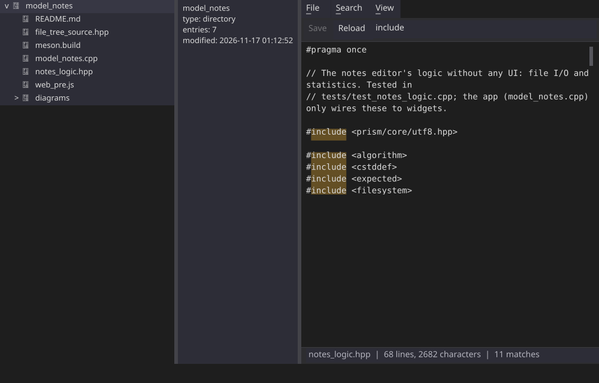
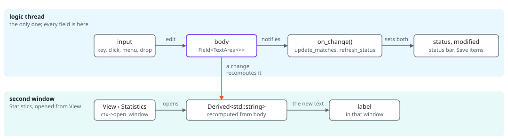

# Notes

A small text editor: a directory tree on the left, then a toolbar and a whole file in a text area,
with a status line counting lines, characters and search matches. It is the app that edits things,
so it is where selection, clipboard, undo, input methods and text measurement are exercised — the
things a dashboard never touches.

<p align="center"></p>

It shows three things:

- **A document as one field.** The text and its search highlights are one `Field<ui::TextArea<>>`
  value, and setting it is what makes the editor redraw.
- **Reactivity as plain connections.** Every consequence of an edit is an `on_change()` callback
  set up once, in the app's constructor.
- **A second window on the same data.** The Statistics window recomputes a `Derived<std::string>`
  from the editor and repaints as you type.

## Running the example

- **In the browser:** open the [live demo](https://jeandet.github.io/PRISM/model_notes.html). A page
  has no disk, so the build bundles PRISM's own sources and the tree opens on them.
- **On the desktop:** `ninja -C builddir examples/model_notes/model_notes`, then
  `builddir/examples/model_notes/model_notes`. It reopens the file you had open last time and roots
  the tree at the current directory.
- **A capture:** `builddir/examples/model_notes/model_notes out.svg [directory] [file]` renders one
  frame and writes it as SVG; that is how the picture above is made.

## How it fits together

<p align="center"></p>

One thread, and one pass from a change to a repaint:

1. A key, a click in the tree, a menu item or a dropped file changes a field: `body`, the editor's
   value, or `files.selected`.
2. `body`'s `on_change()` runs `update_matches()`, which writes every match of the search text into
   that same value (the highlights the text area draws), then `refresh_status()`.
3. `refresh_status()` sets `status` (the bottom line) and `modified`; `modified`'s own connection
   enables or greys the Save entries in two menus. The status bar and the menus repaint.
4. `NotesStats` holds a `Derived<std::string>` built from `body`; the Statistics window recomputes
   it and repaints its label.

## Walkthrough

Read the files in this order. `model_notes.cpp` (281 lines) wires the widgets; `notes_logic.hpp`
(73 lines) is the logic and `file_tree_source.hpp` (92 lines) is the tree. About 445 lines in all.

### The document is one field

```cpp
core::Field<ui::TextArea<>> body{{.placeholder = "Select a text file on the left", .rows = 26}};
```

The search highlights are part of that value, not a second model:

```cpp
void update_matches() {
    const auto& query = value(search);
    std::vector<ui::TextRange> hits;
    for (auto pos : notes::find_all(value(body), query)) hits.push_back({pos, pos + query.size()});
    if (hits != body.get().highlights) {
        auto b = body.get();
        b.highlights = std::move(hits);
        body.set(b);
    }
    refresh_status();
}
```

Notice the guard: `body.set()` notifies `on_change()` again, so the search runs a second time on the
new value, finds the same highlights, and stops there.

### Logic with no window in it

`notes_logic.hpp` loads, saves, searches and counts, and knows nothing about widgets:

```cpp
inline Stats stats(std::string_view text) {
    if (text.empty()) return {};
    auto newlines = static_cast<std::size_t>(std::ranges::count(text, '\n'));
    bool open_last_line = text.back() != '\n';
    return {newlines + (open_last_line ? 1 : 0), prism::core::utf8::count(text)};
}
```

Lines and characters, not bytes: characters are counted one by one through `core::utf8::count`, and a
last line without its newline still counts. `load_text` is the other half — it refuses files over a
megabyte and files with a NUL byte, and says which in the status line.

### Every consequence is a connection

The constructor is the whole wiring. `wire` (a `core::Wiring`) keeps the connections for as long as
`NotesApp` lives; the lambdas capture `this`, which is why `NotesApp` is never moved:

```cpp
wire.on(files.selected, [this](const auto& id) {
    std::error_code ec;
    if (id && fs::is_regular_file(source.path_of(*id), ec)) open(source.path_of(*id));
});
wire.on(body, [this](const auto&) { update_matches(); });
wire.on(save, [this](const auto&) { write(); });
wire.on(modified, [this](bool on) {
    enable_item(file_menu, "Save", on);
    enable_item(editor_menu, "Save", on);
});
```

The last one is the interesting shape: a `Field<bool>` that only exists to enable menu items, set
by `refresh_status()` and read by nobody else.

### A second window on the same field

```cpp
struct NotesStats {
    core::Derived<std::string> summary;
    explicit NotesStats(core::Field<ui::TextArea<>>& body)
        : summary([&body] {
              auto s = notes::stats(value(body));
              return std::to_string(s.lines) + " lines, " + std::to_string(s.characters) + " characters";
          }, body) {}
    void view(app::WidgetTree::ViewBuilder& vb) { vb.widget(summary); }
};
```

`Derived` names `body` as its dependency, so it recomputes when the text changes and nowhere else.
It becomes a window of its own through `ctx->open_window(stats, {.title = "Statistics", ...})`, from
the View menu — the same field, a second place to read it.

### The file tree is a `TreeSource`

`FileTreeSource` is written by hand over `std::filesystem`; the tree asks for children when a row is
opened, and ids are path hashes kept in a map so a path can be recovered from an id:

```cpp
prism::ui::TreeNodeId path_id(const std::filesystem::path& p) const {
    auto id = static_cast<prism::ui::TreeNodeId>(std::filesystem::hash_value(p));
    by_id_.emplace(id, p);
    return id;
}
```

That is the whole cost of a tree over data of your own: children on demand, stable ids, an icon and
some detail text.

### main()

```cpp
    ...
    app::SettingsFile settings{app.prefs, backends::settings_dir("prism", "notes") / "settings.toml"};
    if (std::error_code ec; fs::is_regular_file(app.prefs.last_file.get(), ec)) app.open(app.prefs.last_file.get());
    auto backend = app::Backend::software(app::RenderConfig{});
    auto& window = backend.create_window(app.prefs.window.applied_to(
        {.title = "PRISM Notes", .width = 1000, .height = 640, .decoration = app::DecorationMode::Custom}));
    app::model_app(backend, window, app, [&app](app::AppContext& ctx) {
        app.ctx = &ctx;
        ctx.remember_window_size(app.prefs.window);
        ctx.on_file_drop([&app](const input::FileDrop& drop) { app.open(drop.paths.front()); });
    });
    app.ctx = nullptr;   // the context ended with model_app
```

The `...` above is the capture: with an argument, the app renders one frame and returns through
`showcase` before any of this. `SettingsFile` writes `settings.toml` whenever the preferences change,
so the last file, the tree width and the window size come back next run. `app::model_app` runs the
loop until the window closes and then returns, which is why `ctx` is reset to `nullptr` after it.

## Try this

1. Open a file, type into it: the status line says `(modified)` and Save becomes clickable.
2. Put a word in the search field: every match is highlighted and the status line counts them. Clear
   the field and the highlights go.
3. Edit, then press F5: the *Unsaved changes* dialog asks before dropping your edits.
4. Open *View › Statistics window* (Ctrl+I, desktop only) and type in the editor: lines and
   characters count as you go.

## Files

| File | What it is |
| --- | --- |
| `model_notes.cpp` | The app: widgets, connections, file commands, `main()`. |
| `notes_logic.hpp` | Loading, saving, statistics, search: no widgets. |
| `file_tree_source.hpp` | The tree over `std::filesystem`; children listed when opened. |
| `web_pre.js` | Browser only: starts the app inside the bundled sources. |
| `meson.build` | The target, the SVG capture, the files bundled for the web page. |
| `diagrams/flow.svg` | The picture above. |

`tests/test_notes_logic.cpp` tests every function of `notes_logic.hpp` — a save and load round trip,
the refused files, the counting — and `tests/test_file_tree_source.cpp` tests the tree source, both
with no window.
