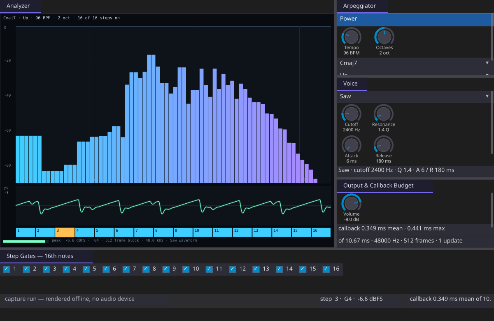
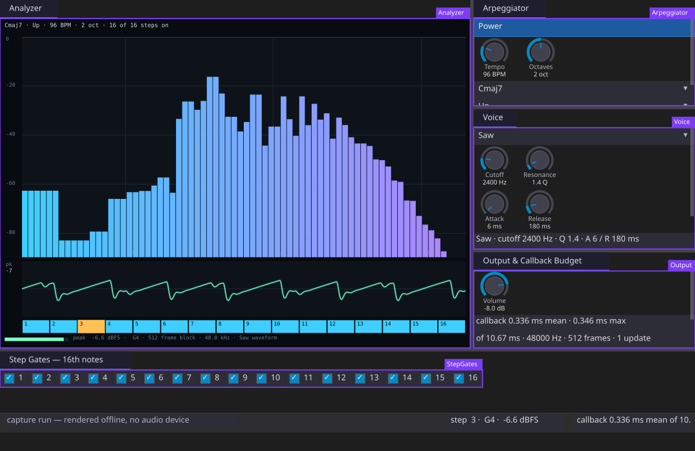
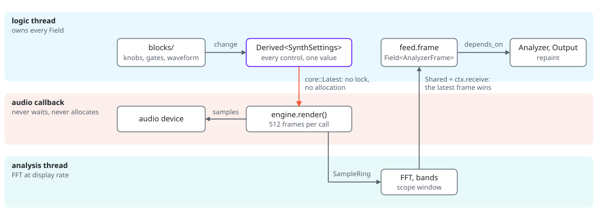

# Synth Rack

A small synthesizer: an arpeggiator, a resonant filter, a feedback delay, and a spectrum
analyzer that draws what comes out. Its audio runs on a real-time thread that never waits for the
window. Press **Power** and it plays.

<p align="center"></p>

It shows three things:

- **Blocks.** Each panel is a small struct with its own fields and view. The app only puts them
  together.
- **A real-time thread next to the UI.** One settings value goes to the audio thread without a
  lock; display frames come back without blocking it.
- **Custom drawing.** The analyzer is one canvas: spectrum bands, a scope, a playhead, a meter.

The same window with each block outlined and named: every panel is one small struct, placed with
`vb.block()`.

<p align="center"></p>

## Running the example

- **In the browser:** open the [live demo](https://jeandet.github.io/PRISM/model_synth_rack.html).
  Browsers start audio only after a click, so press **Power**.
- **On the desktop:** `ninja -C builddir examples/model_synth_rack/model_synth_rack`, then run
  `builddir/examples/model_synth_rack/model_synth_rack`. With no sound card it still runs: the same
  render function runs on a timer, so the analyzer stays live.

## How it fits together

<p align="center"></p>

Three threads, and only one of them touches the model:

1. The **logic thread** owns every field. Turning a knob changes a field in a block. One
   `Derived<SynthSettings>` gathers every control into one value.
2. That value goes to the **audio callback** through a `core::Latest`: no lock, no allocation. The
   callback renders 512 frames from the newest settings and never waits for anything.
3. The callback also copies its samples into a ring. The **analysis thread** reads the newest
   2048, runs the FFT, and sends one display frame back through a `Shared`. `ctx.receive` hands it
   to the logic thread, and the analyzer repaints.

## Walkthrough

Read the files in this order. The PRISM part is `model_synth_rack.cpp`, `rack_settings.hpp` and
`blocks/`, about 790 lines. `audio_thread.hpp` (175 lines) is the thread glue. `dsp/` is plain C++
with no PRISM in it.

### A block: the effects panel

`blocks/effects.hpp` is the shortest panel, and it is the whole pattern. Three fields, a `view()`
that lays them out, and a `settings()` that says what this panel contributes to the sound:

```cpp
struct Effects {
    core::Field<gallery::Knob> time{
        {.value = 260.0, .min = 20.0, .max = 600.0, .step = 5.0, .label = "Delay", .unit = "ms"}};
    core::Field<gallery::Knob> feedback{
        {.value = 0.32, .min = 0.0, .max = 0.85, .step = 0.01, .label = "Feedback"}};
    core::Field<gallery::Knob> mix{{.value = 0.22, .min = 0.0, .max = 1.0, .step = 0.01, .label = "Mix"}};

    EffectsSettings settings() const {
        return {.delay_ms = value(time),
                .delay_feedback = value(feedback),
                .delay_mix = value(mix)};
    }

    void view(app::WidgetTree::ViewBuilder& vb) {
        vb.hstack([&] {
            vb.widget(time);
            vb.gap(6.f);
            vb.widget(feedback);
            vb.gap(6.f);
            vb.widget(mix);
            vb.spacer();
        });
    }
};
```

A knob is a `Field<gallery::Knob>`: the widget the gallery builds from scratch in
[`knob.hpp`](../widget_gallery/knob.hpp). It prints its own label and value, and snaps to its
step. Nothing here knows about threads.

### The app composes the blocks

`SynthApp` in `model_synth_rack.cpp` declares the blocks as members:

```cpp
struct SynthApp {
    RackSettings settings;                       // saved: the dock layout and window size
    struct Feed { /* the display frame, and the Shared it arrives on */ } feed{};

    synth::blocks::StepGates gates{};
    synth::blocks::Arpeggiator arp{};
    synth::blocks::Voice voice{};
    synth::blocks::Effects effects{};
    synth::blocks::Output output{feed.frame};
    ...
```

Its `view()` puts each block in a dock panel with `p.block(effects)` and so on. The panels can be
dragged and tabbed; their arrangement is part of `settings`, so it comes back next time.

### One value to the audio thread

The six blocks' slices are pasted together in one `Derived`. It notes every control
`gather_settings()` reads, so it recomputes when any of them moves; there is no list to keep in
step with the blocks:

```cpp
Link link{{[this] { return gather_settings(); }}};
```

`SynthSettings` is trivially copyable. The audio callback reads it from a `core::Latest<T>`, a
triple buffer: publishing is one copy and one atomic exchange, and the reader always gets a whole
value. `Shared<T>` would allocate on every change, which an audio callback must never do.

### Wiring it up when the app starts

A block (and the app is one) may have an `attach()`. It runs once, on the logic thread, before
the first frame. This is where the synth connects the threads:

```cpp
void attach(app::AppContext& ctx) {
    if (offline) return;   // the screenshot run renders once, with no threads
    attached = true;
    link.settings.observe([this](const synth::SynthSettings& live) { audio.publish(live); });
    audio.publish(link.settings.get());
    ctx.receive(feed.frames, [this](const synth::AnalyzerFrame& shot) { feed.frame.set(shot); });
    start_analysis(ctx);
}
```

`ctx.receive` is the one call for anything another thread sets: it wakes the logic thread when a
frame arrives and hands it over there. The analyzer and output panels read `feed.frame` and
repaint when it changes.

### The analyzer is a canvas

`blocks/analyzer.hpp` is 27 lines. It borrows the frame and the settings from the app, and draws
when either changes:

```cpp
void view(app::WidgetTree::ViewBuilder& vb) { vb.canvas(*this).depends_on(frame, settings); }
```

The drawing itself is `blocks/analyzer_canvas.hpp`: log-frequency bands, a dB ruler, a scope
triggered on a rising zero crossing, the playhead and the peak meter, all `DrawList` calls.

### main()

```cpp
int main(int argc, char* argv[]) {
    // On the heap: the delay line and the FFT buffers are ~200 KB, and a wasm stack is 64 KB.
    auto app = std::make_unique<SynthApp>();
    if (argc >= 2) {   // `model_synth_rack out.svg` saves the screenshot above
        app->seed_demo_data();
        return showcase(argc, argv, *app, 1200, 780);
    }
    return app::run(*app, {.title = "PRISM Synth Rack", .width = 1200, .height = 780,
                           .settings = &app->settings, .organization = "prism", .name = "synth-rack"});
}
```

`app::run` opens the window, loads `settings` and saves it on every change.

## Try this

1. Press **Power**, then **Stall the logic thread (2 s)**. The window freezes for two seconds.
   The sound does not stop for a sample: the audio thread never waits for the window.
2. Drag **Cutoff** and **Resonance** while it plays. Each block of audio is rendered from one
   whole settings value, so a knob moving mid-block cannot cause a crackle.
3. Switch the pattern to **UpDown** or **Random**, change **Tempo**, and untick a few step gates.
   The analyzer's step strip follows the beat.
4. Read **callback … ms mean · … ms max**: the whole voice chain on one core, against a 10.67 ms
   budget per block.

## Files

| File | What it is |
|---|---|
| `model_synth_rack.cpp` | The app: composes the blocks, connects the threads in `attach()`, `main()`. |
| `rack_settings.hpp` | What is saved between runs: the dock layout and window size. |
| `blocks/arpeggiator.hpp` | Power, tempo, octaves, chord, pattern. |
| `blocks/step_gates.hpp` | The sixteen step checkboxes, and the mask they make. |
| `blocks/voice.hpp` | Waveform, cutoff, resonance, attack, release. |
| `blocks/effects.hpp` | Delay time, feedback, mix. |
| `blocks/output.hpp` | Volume, the callback budget readout, the stall button. |
| `blocks/analyzer.hpp`, `analyzer_canvas.hpp` | The analyzer panel, and its drawing. |
| `audio_thread.hpp` | The engine on an `audio::Output`, the sample ring and the analysis loop. |
| `dsp/` | The synth itself, no PRISM: oscillator, filter, envelope, delay, arpeggiator, engine, FFT. |
| `diagrams/threads.svg` | The picture above. |

`tests/test_synth_rack.cpp` tests `dsp/` directly: no window, no thread. There is no Python
version: the Python bindings have no audio device.
