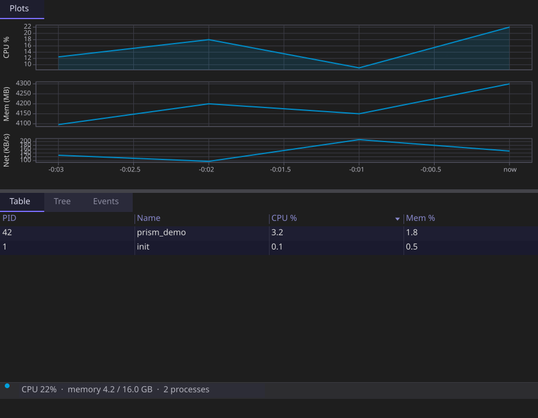
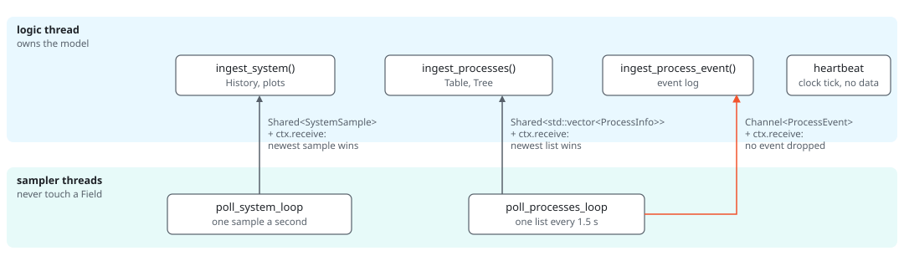

# System Monitor

A live monitor of the machine it runs on: two sampler threads read `/proc` and publish into
cross-thread cells, and the window drains them into three plots, a sortable process table, a
process tree and an event log. Where there is no `/proc` — the web page, macOS, Windows — the same
threads read a simulated machine instead.

<p align="center"></p>

It shows three things:

- **Cross-thread cells.** `Shared<T>` keeps the newest value and drops the ones in between; a
  `Channel<T>` delivers every event in order. The example uses each for what it carries.
- **One list, two views.** The same process list feeds a flat table and a parent/child tree, each
  through its own small adapter.
- **A canvas driven by the clock.** The heartbeat in the status bar repaints on an animation-clock
  tick, not on data, which is the same `canvas()` + `depends_on()` path.

## Running the example

- **In the browser:** open the [live demo](https://jeandet.github.io/PRISM/model_system_monitor.html).
  There is no `/proc` there, so it watches the simulated machine.
- **On the desktop:** `ninja -C builddir examples/model_system_monitor/model_system_monitor`, then
  run `builddir/examples/model_system_monitor/model_system_monitor`.
- **To save one frame:** pass a path —
  `builddir/examples/model_system_monitor/model_system_monitor monitor.svg`. That run seeds a
  small fixed sample instead of waiting for the sampler threads, so the table is never empty.

## How it fits together

<p align="center"></p>

Three threads, and only one of them touches the model:

1. The **system sampler** reads `/proc/stat`, `/proc/meminfo` and `/proc/net/dev` once a second,
   turns the counters into a `SystemSample`, and publishes it into a `Shared<SystemSample>`.
2. The **process sampler** lists `/proc/<pid>` every 1.5 s, publishes the list into a
   `Shared<std::vector<ProcessInfo>>`, and sends each process that appeared or vanished into a
   `Channel<ProcessEvent>`.
3. `ctx.receive` hands all three to the **logic thread**: the sample refills the plot histories,
   the list refills the table and the tree, each event appends one line to the log.
4. The plots, the table, the tree and the log are ordinary widgets over that state. They redraw
   when it changes, and the window keeps drawing while a sampler reads.

## Walkthrough

Read the files in this order. The PRISM part is `model_system_monitor.cpp`, 229 lines: the three
cells, the three ingest callbacks, the plots, the dock and the heartbeat. `proc_metrics.hpp` (330
lines) is the sampler: `/proc` parsing as pure functions, then the two loops; it touches PRISM only
in the loops' signatures, one `Shared` and one `Channel`. `process_table.hpp`,
`process_tree_source.hpp` and `sim_metrics.hpp` (161 lines together) are plain C++.

### Two cells and a channel

The background-fed state is not a `Field<T>`. A `Field` belongs to the logic thread, and these
are written by the samplers, so they are the two cross-thread primitives the core offers:

```cpp
core::Shared<SystemSample> sys_sample{};
core::Shared<std::vector<ProcessInfo>> proc_list{};
core::Channel<ProcessEvent> process_events{};
```

The two samples are a latest-value problem: if two samples are published before the window drains,
the older one is worth nothing. The events are the opposite — a process that started and stopped
between two drains must still show up twice in the log — which is why that one is a `Channel`.

### What arrives, arrives on the logic thread

`main()` names one callback per cell, and `ctx.receive` does the rest: it wakes the logic thread,
drains the cell there, and calls the callback with the value.

```cpp
ctx.receive(app.sys_sample, [&app](const SystemSample& s) { app.ingest_system(s); });
ctx.receive(app.proc_list,
            [&app](const std::vector<ProcessInfo>& p) { app.ingest_processes(p); });
ctx.receive(app.process_events,
            [&app](const ProcessEvent& e) { app.ingest_process_event(e); });
```

Nothing polls the cells, and nothing on the logic thread reads `/proc`. A sampler that stalls
delays its own next sample and nothing else.

### One loop, two readers

Each loop takes its reader as a `std::function`, so the same loop runs against `/proc` on Linux and
against the simulated machine everywhere else:

```cpp
inline void poll_system_loop(std::stop_token stop, prism::core::Shared<SystemSample>& out,
                             std::function<SystemSample(double dt)> read) {
```

`main()` picks with `has_proc()`: `proc_system_reader()` and `read_process_list` for the real
machine, `simulated_system_sample` and `simulated_processes` (`sim_metrics.hpp`) otherwise. The
simulated ones are pure functions of the time in seconds, so the web page shows the same curves
every run, and a compiler job that starts and stops every three seconds keeps the event log moving.

What the loops read is parsed by pure functions: `parse_stat_totals`, `parse_meminfo`,
`parse_net_totals`, `parse_process_entry`, and `diff_process_events`, which compares two snapshots
by pid and returns the starts and the stops. That is where the logic lives, and
`tests/test_proc_metrics.cpp` tests it with no `/proc` and no thread involved.

### One list, two views

`ingest_processes` gives one list to two widgets. The table is a hand-written `ColumnStorage` of
four columns, which needs no reflection and so builds with any C++23 compiler; the tree is a
`TreeSource` that indexes the same flat list by parent pid.

```cpp
void ingest_processes(const std::vector<ProcessInfo>& processes) {
    process_table.update(processes);
    process_count = processes.size();
    refresh_summary();
    process_revision.set(process_revision.get() + 1);
    tree_source.update(processes);
    tree_ctrl.refresh();
}
```

The table is not a widget that owns a field, so it needs a reason to redraw: `process_revision` is
that reason, and the table is built with `.depends_on(process_revision)` next to
`.sort(2, /*descending=*/true)`. The tree has its own refresh call, because a `TreeController`
re-reads its source.

### The plots scroll themselves

The three curves are `History` values: a deque of 600 floats, one sample a second, so ten minutes,
dropping the oldest as it fills. Each new sample rebuilds one series whose x values are seconds
ago, newest at zero:

```cpp
std::vector<double> xs(h.values.size());
std::vector<double> ys(h.values.begin(), h.values.end());
double newest_index = static_cast<double>(xs.size()) - 1.0;
for (size_t i = 0; i < xs.size(); ++i)
    xs[i] = (static_cast<double>(i) - newest_index) * History::sample_interval_seconds;
...
plot.notify();
```

There is no per-sample timestamp anywhere: the axis is reconstructed from the fixed sample
interval and the index, which is why `History::sample_interval_seconds` has to match the loop's
sleep. `format_seconds_ago` turns those x values into the `-0:02` labels under the plots, keeping a
fraction of a second whenever a tick is not near a whole one.

### The heartbeat

The status bar holds a canvas that draws one dot, and it depends on a field nothing but the clock
writes:

```cpp
ctx.clock().add([&app](ui::AnimationClock::time_point now) {
    double t = std::chrono::duration<double>(now.time_since_epoch()).count();
    ...
    double phase = std::fmod(t * 4.0, 2.0 * std::numbers::pi); // ~4 rad/s
    app.heartbeat_phase.set(static_cast<float>(phase));
    return true; // the heartbeat runs forever by design
});
```

The `std::fmod` before the cast to `float` is the whole point of the line: `now` is time since boot
as a `double`, and casting that straight to `float` would give it a step larger than one frame's
worth of phase, so `set()` would see no change and the dot would freeze. It is also the smallest
example of the redraw rule — a canvas can depend on a clock tick as well as on data.

### main()

```cpp
int main(int argc, char* argv[]) {
    SystemMonitor app;

    if (argc >= 2) {
        app.seed_demo_data();
        return showcase(argc, argv, app, 900, 700);
    }

    std::jthread sys_thread;
    std::jthread proc_thread;

    app::run(app, {.title = "PRISM System Monitor", .width = 900, .height = 700,
                   .settings = &app.settings, .organization = "prism", .name = "system-monitor"},
             [&](app::AppContext& ctx) {
        ...
    });

    return 0;
}
```

`settings` is the dock layout and the window size: the panels below the plots are tabs in one
group, so **Table**, **Tree** and **Events** are the same place at different moments, and dragging
a panel out survives a restart. The two `std::jthread`s live in `main()`'s scope, so closing the
window stops them.

## Try this

1. Watch **CPU %** for a few seconds and compare it with `top`. The curve is the machine's own
   counters, sampled once a second.
2. Click a header in **Table** to sort on that column; the default is **CPU %**, busiest first.
3. Open the **Tree** tab: the same processes, arranged by parent pid, with `make` and its compiler
   jobs under it on the simulated machine.
4. Drag one of the panels to another dock position, close the window, and start it again. It comes
   back where you left it, window size included.

## Files

| File | What it is |
|---|---|
| `model_system_monitor.cpp` | The app: the cells, the ingest callbacks, the plots, the dock, the heartbeat, `main()`. |
| `proc_metrics.hpp` | The `/proc` parsers as pure functions, and the two sampling loops. |
| `process_table.hpp` | The process list as four table columns. |
| `process_tree_source.hpp` | The same list as a parent/child tree. |
| `sim_metrics.hpp` | A made-up machine for platforms without `/proc`, and `has_proc()`. |
| `diagrams/threads.svg` | The picture above. |

`tests/test_proc_metrics.cpp` and `tests/test_process_tree_source.cpp` test the parsers, the
snapshot diffing and the tree index: no `/proc`, no threads, no window.
