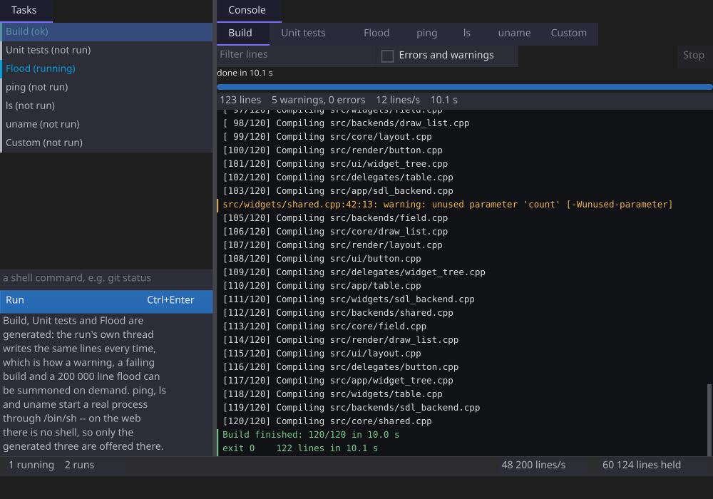

# Task Runner

An IDE-style build console: task list on the left, one tabbed console per task on the right, and
progress, throughput and exit codes parsed out of the output as it arrives. It runs the same on
the desktop and in the browser, because the interesting part is not the compiler: a run owns a
`std::jthread`, hands its lines to the model in batches through a `core::Channel<T>`, and the
model keeps them in a list that only ever paints the rows on screen — so a 200 000 line flood
costs the same per frame as a twelve line one.

The PRISM part is `model_task_runner.cpp` plus `blocks/` — 683 lines: three docked panels, a
status bar, and the channel the runs report through. Everything under `process/` is plain C++
with no PRISM in it: a byte stream cut into lines, a progress parser, a log that counts what it
says, the run and its thread, the simulated compiler, the child process.



## Try this

1. Press **Run** (or Ctrl+Enter) with **Build** selected: the console follows the compile as it
   goes, the progress bar climbs from the `[ 12/120]` lines themselves, warnings turn amber, and
   the run ends with an exit code — its own, not the task's guess at one.
2. Select **Flood** and Run: 200 000 lines arrive in a second or so. Scroll up while it runs and
   the console stops following; scroll back to the bottom and it picks the run up again.
3. Type `prism` in the filter box, or tick **Errors and warnings**: the console re-filters without
   losing its place. Then start **ping** and **ls** at the same time and watch both tabs fill.
4. Press **Stop** while a task runs: the process gets `SIGTERM`, then `SIGKILL`, and its exit code
   shows up as a number above 128, which is what a shell reports for a signal.

## The blocks

`blocks/console_pane.hpp` is one task's console: the filter, the stop button, the progress bar,
the lines — and, behind them, `process/console_run.hpp`, which owns the log, the stopwatch and
the thread. The two meet at a batch of strings, which is the only thing a run's thread can send:

```cpp
// One delivery from a run's thread; false when it belongs to a run that was replaced.
bool ingest(const OutputBatch& batch) {
    auto kept = run.ingest(batch, filter_now());
    if (!kept) return false;
    keep(std::move(*kept));
    sync_bar();
    sync_stats();
    return true;
}
```

`blocks/tasks_panel.hpp` is the list and the Run button, `blocks/console_panel.hpp` is the tabs,
`blocks/status_bar.hpp` is the three numbers along the bottom. Each is a plain struct with its
Fields, its `view()`, and the reactions it needs; the app puts them in the dock and wires the three
things that need to talk to each other.

## How it is built

- `process/` is the console's logic with nothing else in it: `text.hpp` cuts a byte stream into
  lines across chunk boundaries and drops ANSI colours, `progress.hpp` reads `[ 42%]` and
  `[3/120]` as progress, `lines.hpp` tells an error from a warning and filters on it, and
  `simulation.hpp` makes the generated tasks pure functions of their line index — so the same
  seed always produces the same build, and the tests can assert exactly which line failed.
- `process/console_log.hpp` holds what a run said and the counters a filter line shows;
  `run_status.hpp` holds how long it has been going and turns that into the bar's label and the
  exit line; `console_run.hpp` owns the two and the thread that fills them, and hands back the
  lines the filter keeps. All three are plain C++, and all three are what the pane paints.
- `process/child_process.hpp` is the only file that knows about processes: `posix_spawnp` with
  stdout and stderr on one non-blocking pipe, `poll` to read it, `SIGTERM` then `SIGKILL` to stop
  it. On the web `platform.hpp` compiles to `kNativeProcesses = false` and nothing else.
- `process/run_job.hpp` is what that thread runs: either the generated script, paced by its own
  timings, or the process, cut into lines as bytes arrive. Both send `OutputBatch`es of up to 4096
  lines, or whatever they have after 16 ms. The model drains the channel on the logic thread and
  appends to a `core::List<ConsoleLine>`.

**A custom widget is a specialization, not a subclass.** That is the whole of it — no base
class, no virtual function, nothing to construct and keep (`blocks/console_rows.hpp` has the real
thing, with the constants spelled out):

```cpp
template <>
struct prism::ui::Widget<runner::ConsoleLine> {
    static constexpr FocusPolicy focus_policy = FocusPolicy::none;
    static constexpr Height widget_h{console_rows::kConsoleRowHeight};

    static void record(DrawList& dl, const Field<runner::ConsoleLine>& field, WidgetNode& node) {
        const auto& line = field.get();
        const auto colour = console_rows::line_colour(node_theme(node), line.kind);
        dl.filled_rect(delegate_detail::make_rect(X{0}, Y{0}, delegate_detail::widget_w(node), widget_h),
                       console_rows::kBackground);
        if (line.kind != runner::LineKind::Info)
            dl.filled_rect(delegate_detail::make_rect(X{0}, Y{0}, Width{console_rows::kStripe}, widget_h), colour);
        dl.text(line.text,
                delegate_detail::make_point(X{console_rows::kPad},
                                            Y{(widget_h.raw() - console_rows::kConsoleGlyph) * 0.5f}),
                console_rows::kConsoleGlyph, colour, 0.f, TextAnchor::TopLeft, FontRole::Mono);
    }

    static void handle_input(Field<runner::ConsoleLine>&, const InputEvent&, WidgetNode&) {}
};
```

`blocks/console_rows.hpp` is that file, written out: one specialization for a console line, one
for a task row. `p.list(rows)` then draws them, and `.selection()` puts the highlight on top of
whatever `record` drew — the framework never needs to know what a row is.

- `p.list(rows).follow_tail()` is what makes it a console: rows appended while the list shows
  its last row scroll it to the new last row, scrolling up stops that, scrolling back to the
  bottom resumes it — the list owns that, the model never touches a scroll offset.
- Filtering hands the list a whole new set of lines (`List::replace_all`), which updates only the
  rows that differ, so the list keeps the widgets it had.
- The dock layout and the window size persist through `app::SettingsFile`, like every other
  example here.

Still wanted: a bulk append on `List<T>` — 200 000 lines is 200 000 inserts, each one signalling
the widget; an `append_range` would make the flood's cost proportional to publishes, not lines.

The Python counterpart is `python/examples/17_task_runner.py`.
